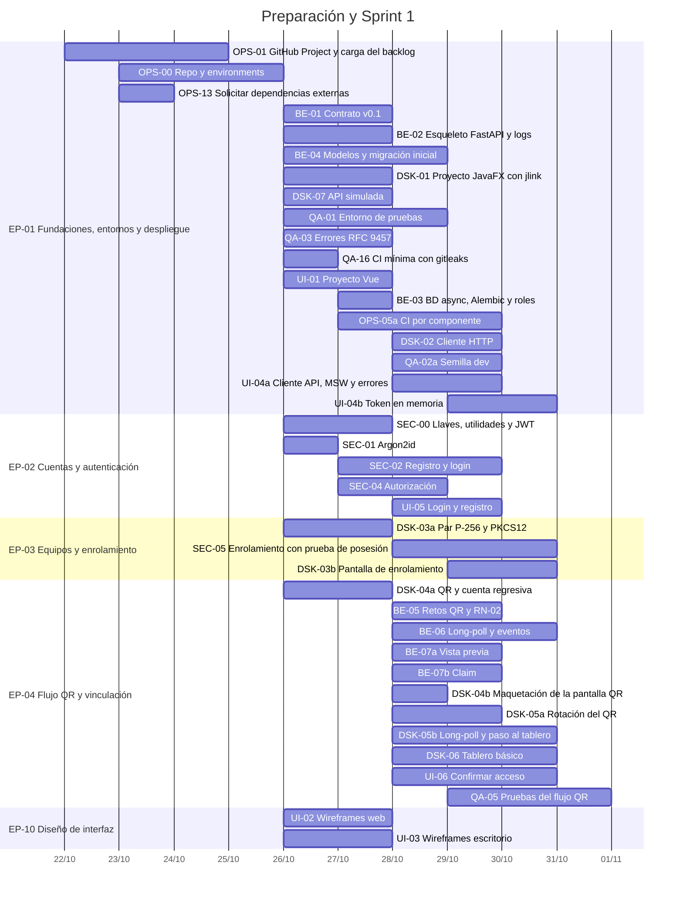
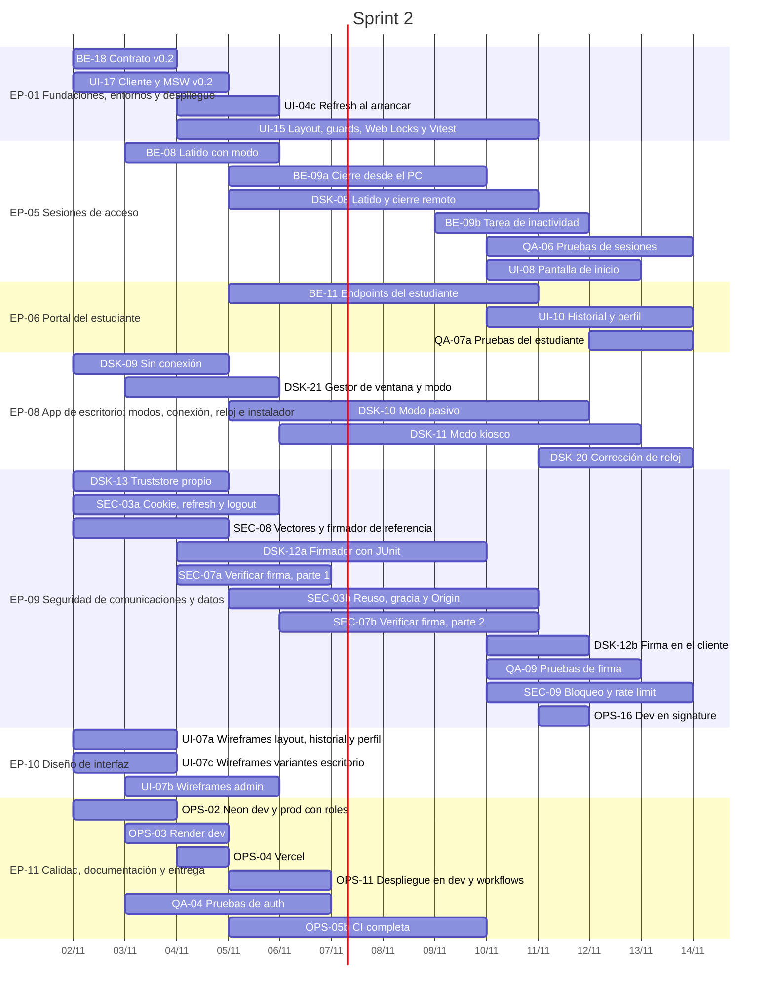
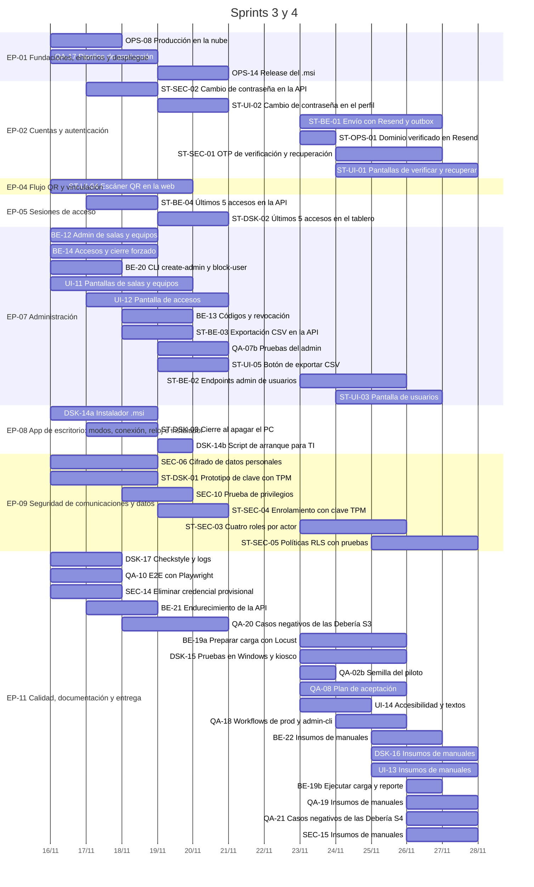
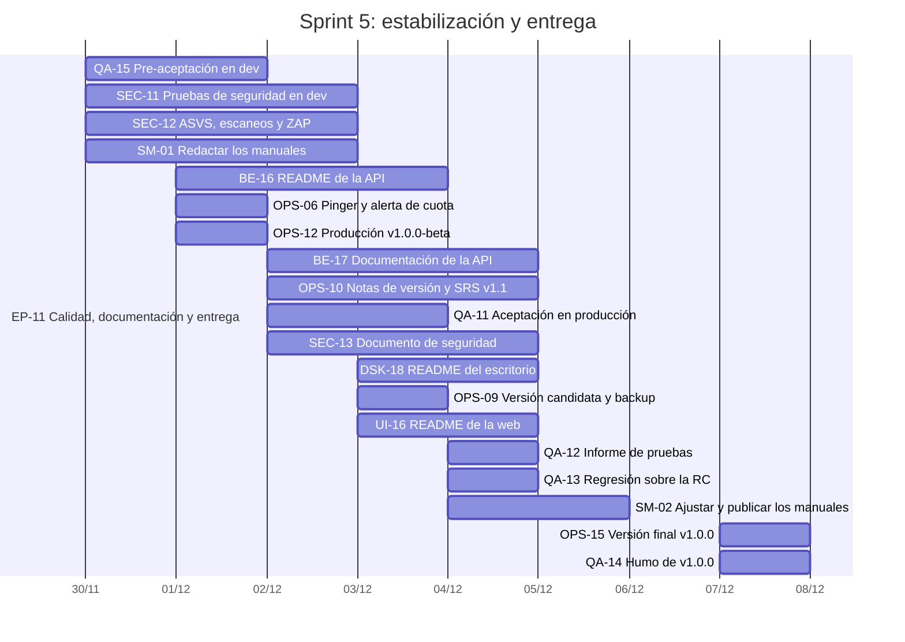

# Backlog del MVP: Sistema de Registro de Acceso a Equipos por QR

| Campo | Valor |
|---|---|
| Versión | 2.1 (el PO ya no maneja cuentas de nube: dev lo monta Backend al inicio del Sprint 2) |
| Fecha | 25 de octubre de 2026 |
| Referencia de requisitos | `docs/srs/SRS-registro-acceso-qr.md` (SRS-IC-001) |
| Revisiones que originan esta versión | `docs/backlog/revision-backlog.md` (ronda 1), `docs/backlog/revision-backlog-ronda2.md` (ronda 2) el cambio de calendario del 24/10 y el ajuste del carril del PO del 25/10 (anexo D) |
| Entrega final | **Lunes 7 de diciembre de 2026** (congelamiento: nadie cambia código) |
| Fuente de datos | `docs/backlog/backlog.csv` (mismo contenido, para importar con un script `gh`) |

## 1. Reglas del juego

- **Todo se construye desde cero.** El PoC no forma parte del proyecto.
- **Las tareas se asignan a equipos, no a personas.** Cada líder decide quién toma cada tarea y lo asigna en GitHub. Los repartos sugeridos de la sección 3 son una ayuda, no una obligación.
- **Granularidad:** ninguna tarea supera 6 h. Cada persona cierra 1 o 2 tareas por semana, y el tablero refleja el avance real día a día.
- **El PO (líder técnico) se encarga del producto** (carril OPS): el tablero, el repo, las solicitudes externas, las notas de versión y el SRS. No maneja cuentas de nube ni secretos: el entorno dev lo monta Backend al inicio del Sprint 2 (OPS-02, 03 y 04), y los secretos del repo los carga el líder de Seguridad y Testing, que es administrador del repo. Las horas del PO no consumen la capacidad de los equipos.
- **Testing es dueño de DevOps desde el Sprint 2:** la CI/CD (todos los workflows de GitHub Actions), los entornos en la nube (Neon, Render, Vercel y Resend; Backend crea las cuentas y monta dev en el Sprint 2), producción, los backups, el monitoreo y las etiquetas de versión. Las tareas OPS que pasaron a Testing conservan su ID. Su líder es administrador del repo en la organización `internet-cafe-org`, así que maneja los environments y los secretos. Todo despliegue a producción lo aprueban el PO o el SM.
- **Un solo líder para Seguridad y Testing.** Coordina los dos equipos, así que planifica ≈ 5 h de tareas por semana en lugar de 7. Se cuenta dentro de las 3 personas de Seguridad.
- **Manuales de usuario:** cada equipo entrega sus insumos (HU-35) y el Scrum Master redacta los documentos (SM-01 y SM-02). Las horas del SM no consumen la capacidad de los equipos.
- **Estimación:** las historias llevan story points y las tareas llevan horas (sección 5).
- **Suplente del PO:** el Scrum Master. **Respaldo de DevOps:** el PO conserva acceso de emergencia a las cuentas del equipo, y el runbook `docs/ops/runbook.md` describe cada operación.
- **Los IDs de tarea no son consecutivos a propósito:** se conservan entre versiones. Las tareas divididas llevan sufijo (`BE-07a`, `BE-07b`), y las que eran Debería conservan su prefijo `ST-`.

## 2. Calendario, ceremonias y dedicación

### Ritmo de un sprint

Los sprints van de lunes a lunes. La review del sprint que termina, la retro y el planning del siguiente se hacen el mismo lunes.

| Momento | Regla |
|---|---|
| **Lunes** · review, retro y planning | La review se hace sobre la etiqueta `sprint-N-review`. El PO calienta Render 15 min antes. |
| **Jueves** · refinamiento | 45 min con el PO y los líderes, para preparar el sprint siguiente. |
| **Viernes 22:00** · corte de PRs | Toda tarea de desarrollo del sprint tiene su PR **abierto con `ci-ok` en verde**. Lo que no llegue entra en la cola de caída. Las tareas de desarrollo de 3 h o más empiezan a más tardar el jueves (las de Testing siguen la regla del sábado a las 12:00). |
| **Sábado 12:00** · PRs de Testing | Testing abre sus PR `test/QA-xx` con los casos negativos. Quedan fuera del corte del viernes. |
| **Sábado hasta las 18:00** · fusión escalonada | Los PRs revisados se **fusionan** a medida que se aprueban, incluidos los de Testing. |
| **Sábado 18:00 – 19:00** · integración | Los líderes integran en dev y anotan lo que falla. |
| **Sábado 19:00 – 22:00** · correcciones | Solo arreglos de lo que falló en la integración. |
| **Sábado 22:00** · congelamiento | Se congelan las fusiones y se pone la etiqueta `sprint-N-review`. |
| **Domingo** | Libre. |
| **Campo Fin** | Fecha en que el PR queda fusionado, a más tardar el sábado a las 18:00. |

**El Sprint 2 dura dos semanas con la carga de una.** Tiene un solo corte (viernes 13) y una sola fusión (sábado 14). El lunes 9 no hay review: hay un seguimiento de 30 min (tablero, riesgos y cola de caída).

### Calendario

| Fecha | Evento | Qué sale de ahí |
|---|---|---|
| Vie 23 – Dom 25 oct | **Preparación** (carril del PO) | Repo, entornos de GitHub, tablero con la Preparación y el Sprint 1 (cargado antes de la socialización del sábado 24) y solicitudes externas enviadas. |
| Sáb 24 oct | **Socialización** (~2 h, no cuenta como sprint) | Los equipos conocen el SRS, la arquitectura, este backlog, el calendario hasta el 7 de diciembre y la dedicación esperada. **El PO aprueba la sección 4.** Los líderes reparten las tareas del Sprint 1. |
| Lun 26 oct | **Sprint Planning 1** · CI mínima con gitleaks (QA-16) | Compromiso del Sprint 1. El líder de Desktop da el visto bueno al wireframe del QR (UI-03). |
| Mar 27 oct | Hito: contrato v0.1 y wireframes del flujo principal aprobados | Desbloquea a la web y al escritorio. |
| Vie 30 oct | **Corte de PRs** (22:00) | Todo el Sprint 1 con PR abierto y CI en verde. |
| Sáb 31 oct | PRs de Testing a las 12:00 (QA-05) · fusión hasta las 18:00 · integración en local con Docker Compose · congelamiento a las 22:00 | La demo corre en local; dev en la nube llega en el Sprint 2. |
| Lun 2 nov | **Review 1 + Retro + Planning 2** · contrato v0.2 (latido y cierres) · wireframes de layout, historial, perfil y escritorio · vectores de firma | Compromiso del Sprint 2. |
| Mar 3 nov | Contrato v0.2 completo (`/me`, admin y firma) | Desbloquea el portal y el admin. |
| Vie 6 nov | **Dev en la nube con despliegue automático** (OPS-02 a OPS-04 de Backend y OPS-11 de Testing) | Las historias del Sprint 1 quedan desplegadas en dev. |
| Sáb 7 nov | Casos negativos del login fusionados (QA-04) | HU-07 cumple la DoD. |
| Lun 9 nov | Seguimiento de mitad de sprint (30 min) | No es review. |
| Mié 11 nov | **Dev pasa a `MACHINE_AUTH_MODE=signature`** (OPS-16) | Las peticiones del PC van firmadas en dev. |
| Vie 13 nov | **Corte de PRs** (22:00) | — |
| Sáb 14 nov | Fusión, integración y congelamiento | — |
| Lun 16 nov | **Review 2 + Retro + Planning 3** | Sesión completa y firmada en dev. |
| Vie 20 nov | Corte de PRs · fecha límite del dominio de correo para HU-24 | — |
| Sáb 21 nov | Fusión, integración y congelamiento | Producción montada, sin desplegar. |
| Lun 23 nov | **Review 3 + Retro + Planning 4** | Panel admin completo y datos cifrados. |
| Jue 26 nov | Prueba de carga en dev en la noche, con el rate limit apagado (BE-19b) | — |
| Vie 27 nov | Corte de PRs | — |
| Sáb 28 nov | Fusión, integración y **congelamiento de funcionalidades** | Desde aquí solo pruebas, defectos y documentación. |
| Lun 30 nov | **Review 4 + Retro + Planning 5** · pre-aceptación en dev (QA-15) · triaje diario de defectos (15 min, PO + líder de Seguridad y Testing) | Los defectos se corrigen esa misma semana. |
| Mar 1 dic | Producción `v1.0.0-beta` con administrador, datos y PCs del piloto (OPS-12) | Entorno de aceptación estable. |
| Mié 2 – Jue 3 dic | Aceptación en producción (QA-11) | — |
| Jue 3 dic | **Versión candidata `v1.0.0-rc.1`** en la noche, solo si QA-11 no dejó defectos críticos ni altos abiertos | — |
| Vie 4 dic | Regresión final e informe de pruebas · si hace falta, `rc.2` a las 14:00 | — |
| Sáb 5 dic | Ensayo de la demo | — |
| Dom 6 dic | Reserva | Solo defectos críticos aprobados por el PO. |
| **Lun 7 dic** | **Review final, entrega y congelamiento total** | Etiqueta `v1.0.0` (la última versión candidata con la regresión en verde, más la documentación terminada después) y prueba de humo. |

- **Daily asíncrona** de lunes a viernes, antes de las 9 p. m., en el canal del equipo: qué hice, qué haré y qué me bloquea. El Scrum Master revisa los bloqueos cada mañana.
- **La semana del 30 de noviembre es solo de pruebas y documentación** (Sprint 5).

**Iteraciones en GitHub Projects:**

| Iteración | Fechas | Carga |
|---|---|---|
| Preparación | 22 oct – 25 oct | Carril del PO |
| Sprint 1 | 26 oct – 1 nov | 1 semana |
| Sprint 2 | 2 nov – 15 nov | 1 semana repartida en 2 |
| Sprint 3 | 16 nov – 22 nov | 1 semana |
| Sprint 4 | 23 nov – 29 nov | 1 semana |
| Sprint 5 | 30 nov – 7 dic | 1 semana: pruebas, defectos y documentación |

### Dedicación esperada

| Rol | Semana de un sprint de 1 semana | Semana del Sprint 2 | Total del proyecto (24 oct – 7 dic) |
|---|---|---|---|
| Desarrollador | **≈ 11 h**: tareas 7 h, review, retro y planning 2 h, revisión de PRs 1 h, daily 0,5 h, fusión del sábado 0,5 h | **≈ 6,5 h** | ~60 h |
| Líder de equipo | **≈ 14 h**: lo anterior más refinamiento, integración y aprobaciones | ≈ 9 h | ~75 h |
| Líder de Seguridad y Testing | **≈ 16 h**: 5 h de tareas y la coordinación de los dos equipos | ≈ 11 h | ~85 h |
| PO (producto) | ≈ 4 h en el Sprint 1, ~4 h en los sprints 3 y 4 y ~9 h en el Sprint 5, más 11 h de preparación | ≈ 3 h | ~38 h |
| Scrum Master | **≈ 5 h**: ceremonias y seguimiento diario de bloqueos, más 10 h de manuales en el Sprint 5 | ≈ 4 h | ~43 h |

### Semana tipo de un sprint de 1 semana

| Día | Desarrollador | Líder | Qué pasa ese día |
|---|---|---|---|
| Lunes | 2 h · review, retro y planning | 2 h 45 · además asigna tareas y ordena el tablero | Cierre del sprint anterior y arranque del nuevo. |
| Martes | 2 h · tareas y revisar un PR | 2 h 45 · además aprueba contrato o wireframes | Entregables base: contrato y diseños. |
| Miércoles | 2 h · tareas y revisar un PR | 2 h 15 · además resuelve bloqueos | Trabajo en paralelo. |
| Jueves | 2 h · tareas | 2 h 45 · además el refinamiento | Última fecha para empezar tareas de 3 h o más. |
| Viernes | 2 h · tareas; PR abierto con CI en verde **antes de las 22:00** | 2 h 15 · además revisa los PRs de su equipo | Corte de PRs. |
| Sábado | 1 h · ajustes de la revisión y fusión **antes de las 18:00** (Testing abre sus PR a las 12:00) | 1 h 30 · además la integración de 18:00 a 19:00 | Fusión escalonada, integración, correcciones hasta las 22:00 y congelamiento. |
| Domingo | — | — | Libre. |
| **Total** | **≈ 11 h** | **≈ 14 h** | |

**En el Sprint 2** el ritmo es la mitad: un bloque de 1 h de martes a viernes, el seguimiento del lunes 9 y la fusión del sábado 14.

## 3. Capacidad

Se planifica con **≈ 7 h efectivas de tareas por persona y sprint** (el líder de Seguridad y Testing, 5 h). El Sprint 2 tiene la misma capacidad que un sprint de una semana.

**Apoyo entre equipos:** Testing es el equipo más cargado, porque tiene las pruebas y DevOps. Los apoyos los nombra el líder de Seguridad y Testing en el planning, y él revisa ese trabajo:
- **Sprint 2:** una persona de Backend dedica ≈ 4 h a casos negativos de código que no escribió (por ejemplo QA-04 o QA-09).
- **Sprints 3 y 5:** Backend y Seguridad dedican ≈ 2 h cada uno. Por ejemplo, QA-20 y QA-07b en el Sprint 3, y QA-15 y QA-14 en el Sprint 5.

Cada celda dice **horas planificadas / capacidad**.

| Equipo | Personas | Capacidad por sprint | Sprint 1 | Sprint 2 | Sprint 3 | Sprint 4 | Sprint 5 |
|---|---|---|---|---|---|---|---|
| UI | 3 | 21 | 21 / 21 | 18 / 21 | 16 / 21 | 13 / 21 | 2 / 21 |
| Desktop | 4 | 28 | 28 / 28 | 25 / 28 | 13 / 28 | 9 / 28 | 2 / 28 |
| Backend | 4 | 28 | 29 / 28 | 22 / 24 | 20 / 26 | 16 / 28 | 8 / 26 |
| Seguridad | 3 | 19 | 19 / 19 | 18 / 19 | 12 / 17 | 14 / 19 | 12 / 17 |
| Testing | 2 | 14 | 15 / 14 | 18 / 18 | 16 / 18 | 12 / 14 | 16 / 18 |
| **Total** | **16** | **110** | **112 / 110** | **101 / 110** | **77 / 110** | **64 / 110** | **40 / 110** |

**La capacidad libre de los sprints 3 a 5 es reserva**, no trabajo pendiente de asignar: absorbe la cola de caída, los defectos y las ausencias. Si sobra, el PO decide en el planning si entra alguno de los candidatos de la sección 4.

**Repartos sugeridos por persona** (cada uno ≤ 8 h):

| Equipo | Sprint 1 | Sprint 2 |
|---|---|---|
| Backend | BE-01 + BE-06 (7) · BE-02 + BE-05 (7) · BE-04 + BE-07a (8) · BE-03 + BE-07b (7) | BE-18 + BE-08 + BE-09a (8) · BE-09b + BE-11 (7) · OPS-02 + OPS-03 + OPS-04 (7, dev en la nube, lo primero del lunes 2) · apoyo a Testing (4) |
| Seguridad | SEC-00 + SEC-04 (7) · SEC-02 + SEC-01 (7) · SEC-05 (5, líder) | SEC-08 + SEC-07a (6) · SEC-07b + SEC-03a (6) · SEC-03b + SEC-09 (6, líder) |
| Testing | QA-16 + OPS-05a + QA-05 (8) · QA-01 + QA-02a + QA-03 (7) | QA-04 + OPS-11 (7) · QA-06 + OPS-05b + OPS-16 (7) · con el apoyo de Backend: QA-07a + QA-09 (4) |
| UI | UI-01 + UI-04a (6) · UI-02 + UI-05 (8) · UI-03 + UI-04b + UI-06 (7) | UI-07a + UI-07b + UI-07c + UI-17 (7) · UI-15 + UI-04c (6) · UI-08 + UI-10 (5) |
| Desktop | DSK-01 + DSK-02 (7) · DSK-03a + DSK-03b + DSK-04b (7) · DSK-04a + DSK-05a + DSK-05b (8) · DSK-07 + DSK-06 (6) | DSK-21 + DSK-09 + DSK-13 (6) · DSK-10 + DSK-08 (7) · DSK-11 + DSK-20 (6) · DSK-12a + DSK-12b (6) |

## 4. Alcance del MVP: recortes, desviaciones y riesgos aceptados

El PO aprueba esta sección el **sábado 24**. Es la entrada del plan de aceptación (QA-08) y del SRS v1.1 (OPS-10).

### Recortes (funcionalidad del SRS que no entra como Debe)

| Requisito del SRS | En el MVP | Queda como |
|---|---|---|
| Verificación de correo y recuperación de contraseña (RF-AUT-02, 03, 09; RF-NOT-01 a 04) | Las cuentas quedan activas al registrarse (`REQUIRE_EMAIL_VERIFICATION=false`). | **Debería** (HU-24, Sprint 4), solo si TI entrega el dominio (PEND-02) antes del 20/11. |
| Activación manual de cuentas (RF-AUT-04) y alerta de cuota de correo (RF-NOT-05) | No aplican sin correo. | Fuera |
| Cambio de contraseña (RF-AUT-10) | — | **Debería** (HU-25, Sprint 3) |
| Gestión de usuarios en el panel (RF-ADM-08) | El administrador inicial se crea y las cuentas se bloquean **por CLI** (BE-20: `create-admin` y `block-user`, que cumple RN-12). | **Debería** (HU-26, Sprint 4) |
| Escáner QR dentro de la web (RF-QR-03, RF-QR-04, RN-11) | El QR se abre con la cámara nativa del celular (RF-QR-01). | **Debería** (HU-12, Sprint 3) |
| Exportación CSV (RF-ADM-06) | La consulta con filtros sí entra. | **Debería** (HU-33, Sprint 3) |
| Últimos 5 accesos en el tablero del PC (parte de RF-EQU-09) | El tablero muestra nombre, código enmascarado, hora de inicio, cronómetro y "Cerrar sesión". | **Debería** (HU-11, Sprint 3) |
| Cierre al apagar el PC (RF-EQU-10, motivo `machine_shutdown`) | Lo cubre el cierre por inactividad (3 min). | **Debería** (HU-34, Sprint 3) |
| Relanzar la app si se cierra (parte de RF-EQU-02) | TI configura el arranque con un script (DSK-14b); no hay watchdog. | Fuera (candidato) |
| Cuatro roles de BD por actor con RLS (§12.8) | Dos roles: migrador (solo en los workflows de CI) y app (solo SELECT, INSERT y UPDATE). | **Podría** (HU-27, Sprint 4) |
| Clave del equipo no exportable con TPM (PEND-04) | Keystore PKCS12 en `ProgramData` con ACL. | **Podría** (HU-28, Sprint 3) |
| Piloto de una semana dentro de las cuotas (§15.4, punto 5) | La aceptación se hace con 3 equipos (2 en modo pasivo y 1 en kiosco) y al menos 10 estudiantes (QA-11). | Fuera |

Las historias Debería y Podría ya tienen sprint y fechas, pero **son lo primero que cae** si un sprint se atrasa.

**Candidatos para la capacidad libre** (no están en el plan; el PO decide en el planning de cada sprint):
- Watchdog que relanza la app si se cierra (Desktop, ≈ 4 h).
- Pruebas de componentes Vue con cobertura web ≥ 75 % (UI, ≈ 6 h).
- Simulador `tools/fake-pc` para la regresión (Backend, ≈ 5 h).

### Desviaciones técnicas aprobadas

| Tema | SRS v1.0 | MVP |
|---|---|---|
| Escenario E-01 | Registro con código de 6 dígitos | Registro sin OTP. La API responde siempre 202 y la web inicia sesión sola con las mismas credenciales; si falla, muestra "Si ya tienes cuenta, inicia sesión". |
| Escenario E-02 | Muestra "sus últimos accesos" en el PC | El PC muestra nombre, código enmascarado, hora de inicio y cronómetro (los últimos 5 accesos llegan con HU-11). |
| Escenario E-06 | Filtra y exporta a CSV | Filtra y consulta; la exportación llega con HU-33. |
| Kiosco (RF-EQU-04) | No se oculta con Alt+F4, Alt+Tab ni la tecla Windows | Bloquea Alt+F4 y cerrar o minimizar. **La tecla Windows, Alt+Tab y Ctrl+Alt+Supr quedan como limitación documentada.** |
| Tiempos de detección en el PC (RF-EQU-05, RF-SES-06, RF-SES-09) | ≤ 60 s | **≤ 65 s** (latido cada 60 s más la red) |
| AAD del cifrado (§12.7) | `tabla.columna.id` | `tabla.columna` (un `TypeDecorator` no conoce el id de la fila) |
| Pruebas (§15.1, RNF-MAN-03) | Pruebas de componentes Vue, cobertura web ≥ 75 % y simulador `tools/fake-pc` | Web: Vitest del módulo de token y de los guards (UI-15) y E2E con Playwright (QA-10), sin umbral de cobertura web. Simulador: la API simulada de Desktop (DSK-07) y el firmador Python de referencia (SEC-08). La cobertura de la API sí se mide con umbral (OPS-05b). |
| Entornos (§13.1) | Staging y ramas efímeras de Neon por PR | Dev y producción con proyectos Neon separados. La CI usa PostgreSQL como servicio. **Producción solo se despliega desde etiquetas `v*`**, y la primera es `v1.0.0-beta` el 1/12. |
| Credencial del equipo | Firma desde el enrolamiento | Credencial provisional en el Sprint 1 y `MACHINE_AUTH_MODE=dual` mientras se integra la firma. Dev pasa a `signature` el miércoles 11/11. Producción nace en `signature`. SEC-14 elimina la credencial provisional el lunes 16/11. |

### Riesgos aceptados

| Riesgo | Por qué se acepta | Mitigación |
|---|---|---|
| Sin verificación de correo, alguien puede registrarse con el correo de otro estudiante. | El correo depende del dominio (PEND-02). | Dominio institucional obligatorio (PEND-06). El administrador bloquea la cuenta con `block-user` (BE-20). Se cierra con HU-24. |
| El inicio de sesión automático tras el registro permite inferir que un correo ya existe si el login falla. | Es la misma información que da el login normal. | Mensaje genérico y rate limit (SEC-09). |
| La app corre con la cuenta del estudiante, que puede leer el PKCS12 de `ProgramData` y usar la clave en ese PC. | Sin TPM ni servicio de Windows no hay forma de impedirlo. | El alcance se limita a ese equipo y a su sesión (SRS T-15). Documentado en SEC-13. HU-28 investiga el TPM. |
| El kiosco se evade con la tecla Windows o con Ctrl+Alt+Supr. | Limitación de JavaFX. | Documentado para la universidad (DSK-15 y el manual de TI). |

## 5. Estructura en GitHub Projects

**Jerarquía:**
- Épicas, historias y tareas son issues. Las historias son *sub-issues* de su épica, y las tareas, *sub-issues* de su historia.
- El título lleva el ID entre corchetes y un nombre corto (menos de 256 caracteres), por ejemplo `[BE-07b] Claim`. La descripción completa va en el cuerpo del issue.
- Las historias llevan **story points**; las tareas llevan **horas**.

**Etiquetas:**
- **Tipo:** `tipo:epica`, `tipo:historia`, `tipo:tarea`, `tipo:defecto`.
- **Equipo:** `equipo:ui`, `equipo:desktop`, `equipo:backend`, `equipo:seguridad`, `equipo:testing`, `equipo:po`, `equipo:scrum`.
- **Otras:** `bloqueado`, `cola-de-caida`.

**Campos del proyecto:**

| Campo | Tipo | Valores |
|---|---|---|
| Status | Selección | Backlog · Por hacer · En progreso · En revisión · Hecho (la descripción de cada opción dice cuándo entra) |
| Equipo | Selección | UI · Desktop · Backend · Seguridad · Testing · PO · Scrum Master |
| Épica | Selección | EP-01 a EP-11 (para agrupar el Roadmap) |
| Iteración | Iteración | Preparación · Sprint 1 a Sprint 5 |
| Story points | Número | Solo en historias: 1, 2, 3, 5, 8 o 13 |
| Estimación (h) | Número | Solo en tareas: horas ideales |
| Prioridad | Selección | Debe · Debería · Podría |
| Inicio | Fecha | Día en que la tarea puede empezar |
| Fin | Fecha | Día en que el PR queda fusionado (sábado a más tardar a las 18:00) |
| Bloqueada por | Texto | Dependencias bloqueantes (las de integración van en el cuerpo) |
| Severidad | Selección (solo defectos) | Crítica · Alta · Media · Baja |

**Project:** [Registro de Acceso QR · MVP](https://github.com/orgs/internet-cafe-org/projects/1), privado, de la organización `internet-cafe-org` y vinculado al repo `internet-cafe`. Cada persona se agrega como colaboradora del Project (rol *Write*) cuando acepta la invitación al repo. El Project tiene un README con el flujo de trabajo y el ritmo del sprint.

**Vistas** (el diseño, el filtro y los campos visibles ya están creados; la última columna se configura en la interfaz):

| # | Vista | Diseño | Filtro | Configuración en la interfaz |
|---|---|---|---|---|
| 1 | Sprint actual | Tablero | `iteración:@current -label:tipo:epica -label:tipo:historia` | Columnas por Status, carriles por Equipo, límites WIP (En progreso 16, En revisión 8) y suma de Estimación (h) |
| 2 | Sprint backlog | Tabla | `iteración:@current` | Agrupar por Parent issue, ordenar por Fin y sumar Estimación (h) |
| 3 | Product backlog | Tabla | `label:tipo:historia` | Agrupar por Prioridad, ordenar por Iteración y sumar Story points |
| 4 | Progreso por épica | Tabla | `label:tipo:epica` | Barra de progreso con el campo Sub-issues progress |
| 5 | Roadmap | Roadmap | `label:tipo:epica,tipo:historia` | Fechas Inicio → Fin, agrupar por Épica, marcadores de Iteración y zoom por mes |
| 6 | Cronograma de tareas | Roadmap | `label:tipo:tarea` | Fechas Inicio → Fin, agrupar por Equipo, marcadores de Iteración y zoom por mes |
| 7 | Capacidad por equipo | Tabla | `iteración:@current label:tipo:tarea` | Agrupar por Equipo y sumar Estimación (h) |
| 8 | Bloqueadas | Tabla | `label:bloqueado -status:Hecho` | Ordenar por Fin |
| 9 | Atrasadas | Tabla | `label:tipo:tarea fin:<@today -status:Hecho` | Agrupar por Equipo y ordenar por Fin |
| 10 | Defectos | Tabla | `label:tipo:defecto` | Agrupar por Severidad |
| 11 | Mis tareas | Tabla | `assignee:@me -status:Hecho` | Ordenar por Fin |

**Barras de progreso:** las épicas y las historias muestran el campo *Sub-issues progress*, que se llena solo a medida que se cierran sus sub-issues.

**Gráficos (Insights):**

| Gráfico | Tipo | Configuración |
|---|---|---|
| Burn-up del sprint | Histórico | Filtro `iteración:@current -label:tipo:epica -label:tipo:historia` |
| Velocidad | Barras | Eje X: Iteración. Eje Y: suma de Story points. Filtro `label:tipo:historia status:Hecho` |
| Flujo acumulado | Área apilada histórica | Agrupado por Status. Filtro `label:tipo:tarea` |
| Carga por equipo | Barras apiladas | Eje X: Equipo. Eje Y: suma de Estimación (h). Agrupado por Status. Filtro `iteración:@current label:tipo:tarea` |
| Avance por épica | Barras apiladas | Eje X: Épica. Agrupado por Status. Filtro `label:tipo:historia` |

Los gráficos históricos dependen del plan de GitHub. Si no aparecen, el avance se sigue con las barras de progreso y con la vista "Sprint actual".

**Automatizaciones (Workflows del Project):**

| Workflow | Configuración |
|---|---|
| Auto-add to project | Agrega los issues abiertos de `internet-cafe` (filtro `is:issue is:open`) |
| Auto-add sub-issues to project | Agrega los sub-issues de lo que ya está en el tablero |
| Item added to project | Status = Backlog |
| Pull request linked to issue | Status = En revisión (el PR se abrió con `Closes #N`) |
| Code changes requested | Status = En progreso |
| Item reopened | Status = En progreso |
| Pull request merged | Status = Hecho |
| Item closed | Status = Hecho |
| Auto-close issue | Cierra el issue cuando su Status pasa a Hecho |
| Auto-archive items y Code review approved | Apagados: se conserva el historial para la velocidad y el burn-up |

**Estado del proyecto:** en cada review el PO publica un *status update* (En curso, En riesgo o Fuera de curso) con lo logrado y los riesgos. El rango del proyecto va del 22/10 al 07/12.
### Story points

- **Escala Fibonacci:** 1, 2, 3, 5, 8 y 13. Una historia que pase de 13 se divide.
- **Estimación inicial:** la pusieron el PO y el SM a partir de las horas de las tareas: hasta 4 h = 1, hasta 8 h = 2, hasta 13 h = 3, hasta 20 h = 5, hasta 32 h = 8 y más = 13. Las historias con riesgo técnico alto (criptografía, concurrencia, kiosco, correo externo y TPM) suben un escalón.
- **En cada planning** los equipos la revisan con planning poker. El número que cuenta es el que queda en el campo.
- **Velocidad:** suma de los puntos de las historias que cumplen la DoD por historia en la review. El Sprint 2 se compara como una semana de carga.
- Los puntos miden historias, no personas: no se convierten en horas para evaluar a nadie.

**Carga del tablero (OPS-01):**
- Un script `gh` + GraphQL que se puede **reanudar por `[ID]`**: primero crea los issues, luego los *sub-issues* y las dependencias.
- **Antes de la socialización del sábado 24** se cargan la Preparación y el Sprint 1. El Sprint 2 se carga antes del lunes 2, y cada sprint siguiente, antes de su planning. Los issues que ya existen se actualizan por `[ID]` (equipo, iteración, fechas y story points).

**Flujo de una tarea:**

1. El líder la asigna y la tarea pasa a "Por hacer".
2. Quien la toma la mueve a "En progreso". Límite: **una tarea en progreso por persona**.
3. Se trabaja en una rama `tipo/ID-descripcion` (por ejemplo, `feat/BE-07b-claim`).
4. Se abre un PR con `Closes #N` y la tarea se mueve a "En revisión".
5. Antes del corte del viernes, el PR tiene `ci-ok` en verde. Luego lo revisa un compañero.
6. Al fusionarlo, la tarea pasa sola a "Hecho".

**Reglas de código que evitan choques:**
- **Pruebas compartidas:**
  - El desarrollador fusiona su tarea con las pruebas del camino feliz.
  - Testing abre su PR `test/QA-xx` con los casos negativos el sábado a las 12:00, y se fusiona antes de las 18:00 (fuera del corte del viernes).
  - La historia se cierra cuando ambos están fusionados (DoD 4).
- **Migraciones de Alembic:** antes de fusionar, se hace rebase del `down_revision`. La CI exige una sola cabeza.
- **Llaves:** se generan solo con `tools/keys` (SEC-00), en una ruta ignorada por git. La CI usa llaves efímeras.
- **Workflows:**
  - En CODEOWNERS, `.github/workflows/` es de Testing (su líder aprueba). El resto de `.github/` es del PO.
  - Los secretos los maneja el líder de Seguridad y Testing, como administrador del repo, en los GitHub Environments `dev` (solo `main`, sin aprobación, para que el despliegue a dev sea automático) y `prod` (solo etiquetas `v*`, con aprobación del PO o del Scrum Master).

### Definition of Ready

1. La historia tiene criterios de aceptación verificables, una referencia al SRS o a la sección 4 y sus story points.
2. Sus tareas están estimadas, ninguna supera 6 h y sus dependencias están identificadas.
3. Si la tarea toca la API, el endpoint está en el contrato. Si toca pantallas, **el wireframe está aprobado antes de iniciar la tarea**.
4. Una bloqueante puede empezar el mismo día en que termina su dependencia, siempre que la dependencia se fusione en la mañana.

### Definition of Done

**Por tarea (pasa a "Hecho"):**
1. El PR está revisado por un compañero y fusionado en `main`, con la CI en verde.
2. Tiene pruebas del camino feliz del código nuevo:
   - **API:** prueba de integración.
   - **Escritorio:** JUnit de la lógica.
   - **Web:** captura o video corto en el PR. Además, Vitest en el módulo de token y en los guards (UI-15).
   - **Workflows y OPS:** runbook actualizado y verificado por el Scrum Master.
3. No hay secretos ni datos personales en el código ni en los logs. El contrato o el README están actualizados si aplica.

**Por historia (se muestra en la review):**
4. Están fusionados los casos negativos de Testing. **Excepción del Sprint 1:** los casos negativos de HU-07 (QA-04) dependen de la renovación de la sesión del Sprint 2, así que se fusionan el sábado 7 (HU-36) y HU-07 cuenta en la velocidad del Sprint 2.
5. La historia está desplegada en dev y sus criterios de aceptación están verificados con evidencia. **Excepción del Sprint 1:** dev en la nube llega el viernes 6 (HU-36); hasta entonces, las historias del Sprint 1 se verifican en local con Docker Compose y cuentan en la velocidad del Sprint 1.

### Gestión de defectos

- **Registro:** desde el Sprint 2, cada defecto es un issue `tipo:defecto` con Severidad.
- **En el Sprint 5:**
  - El PO y el líder de Seguridad y Testing hacen un triaje diario de 15 min.
  - Corrige el equipo dueño del código, según CODEOWNERS.
  - Testing verifica los críticos y altos; un compañero del equipo que corrigió verifica los medios y bajos.
- **Versión candidata:** exige 0 defectos críticos o altos abiertos.

## 6. Épicas

| ID | Épica | SRS |
|---|---|---|
| EP-01 | Fundaciones, entornos y despliegue | §7, §13, §14 |
| EP-02 | Cuentas y autenticación | RF-AUT |
| EP-03 | Equipos y enrolamiento | RF-EQU-01 |
| EP-04 | Flujo QR y vinculación | RF-QR, RN-02, RN-05, RN-06 |
| EP-05 | Sesiones de acceso | RF-SES, RN-01, RN-03, RN-04, RN-07 |
| EP-06 | Portal del estudiante | RF-EST |
| EP-07 | Administración | RF-ADM, RN-12 |
| EP-08 | App de escritorio: modos, conexión, reloj e instalador | RF-EQU |
| EP-09 | Seguridad de comunicaciones y datos | RNF-SEG, §12 |
| EP-10 | Diseño de interfaz | §9.1 |
| EP-11 | Calidad, documentación y entrega | §15 |

<!-- cronograma:start -->
### Fechas de las épicas

Cada tarea tiene una fecha de **inicio** y una fecha **fin**, que es el día en que su PR queda fusionado (a más tardar el sábado del corte, a las 18:00). Las historias y las épicas toman el rango de sus tareas. En GitHub Projects van en los campos de fecha "Inicio" y "Fin", que alimentan la vista Roadmap.

**Cómo leer "Depende de":**

- Casi todas las dependencias son **de integración**: la tarea puede empezar con datos simulados (el contrato, MSW o la API simulada), pero no puede terminar antes que su dependencia.
- Las **bloqueantes** no pueden empezar hasta que termine la otra (el mismo día vale si la dependencia se fusiona en la mañana). Son estas: BE-02 → BE-03, BE-01 → DSK-02, DSK-01 → DSK-02, UI-03 → DSK-04b, UI-03 → DSK-06, BE-01 → UI-04a, UI-01 → UI-04a, UI-02 → UI-05, UI-03 → DSK-03b, UI-07c → DSK-21, SEC-08 → DSK-12a, UI-07c → DSK-10, UI-07c → DSK-11, UI-02 → UI-08, UI-17 → UI-08, UI-07a → UI-10, UI-17 → UI-10, UI-07b → UI-11, UI-17 → UI-11, UI-07b → UI-12, UI-17 → UI-12, BE-12 → BE-13, OPS-12 → QA-11, OPS-09 → QA-13, OPS-15 → QA-14.

| ID | Épica | Inicio | Fin | Tareas | Horas de equipos | Horas del PO | Horas del SM |
|---|---|---|---|---|---|---|---|
| EP-01 | Fundaciones, entornos y despliegue | jue 22/10 | vie 20/11 | 29 | 66 | 16 | 0 |
| EP-02 | Cuentas y autenticación | lun 26/10 | vie 27/11 | 11 | 36 | 0 | 0 |
| EP-03 | Equipos y enrolamiento | lun 26/10 | vie 30/10 | 3 | 10 | 0 | 0 |
| EP-04 | Flujo QR y vinculación | lun 26/10 | jue 19/11 | 11 | 37 | 0 | 0 |
| EP-05 | Sesiones de acceso | mar 03/11 | vie 20/11 | 8 | 20 | 0 | 0 |
| EP-06 | Portal del estudiante | jue 05/11 | vie 13/11 | 3 | 9 | 0 | 0 |
| EP-07 | Administración | lun 16/11 | jue 26/11 | 11 | 34 | 0 | 0 |
| EP-08 | App de escritorio: modos, conexión, reloj e instalador | lun 02/11 | jue 19/11 | 8 | 20 | 0 | 0 |
| EP-09 | Seguridad de comunicaciones y datos | lun 02/11 | vie 27/11 | 17 | 49 | 0 | 0 |
| EP-10 | Diseño de interfaz | lun 26/10 | jue 05/11 | 5 | 11 | 0 | 0 |
| EP-11 | Calidad, documentación y entrega | lun 02/11 | lun 07/12 | 41 | 95 | 4 | 10 |

Las historias Debería y Podría también tienen fecha, pero son lo primero que cae si un sprint se atrasa (sección 4).

**Hitos que no se pueden mover:**

| Fecha | Hito |
|---|---|
| sáb 24/10 | Socialización del proyecto con el tablero de la Preparación y el Sprint 1 ya cargado |
| dom 25/10 | Repo y GitHub Environments (`dev` sin aprobación y `prod` con aprobación) |
| lun 26/10 | Planning 1 y CI mínima con gitleaks (QA-16) |
| mar 27/10 | Contrato v0.1 y wireframes del flujo principal aprobados |
| vie 30/10 | Corte de PRs del Sprint 1 (22:00) |
| sáb 31/10 | Fusión hasta las 18:00, integración en local y congelamiento (22:00) |
| lun 02/11 | Review 1 y Planning 2; contrato v0.2 (latido y cierres) y vectores de firma |
| mar 03/11 | Contrato v0.2 completo |
| vie 06/11 | Dev en la nube con despliegue automático (HU-36) |
| sáb 07/11 | Casos negativos del login fusionados (QA-04) |
| mié 11/11 | Dev en `MACHINE_AUTH_MODE=signature` (OPS-16) |
| sáb 14/11 | Fusión, integración y congelamiento del Sprint 2 |
| lun 16/11 | Review 2 y Planning 3; credencial provisional eliminada (SEC-14) |
| sáb 21/11 | Producción montada, sin desplegar (HU-32) |
| lun 23/11 | Review 3 y Planning 4 |
| sáb 28/11 | Congelamiento de funcionalidades |
| lun 30/11 | Review 4, Planning 5 y pre-aceptación en dev |
| mar 01/12 | Producción `v1.0.0-beta` con administrador, datos y PCs del piloto |
| jue 03/12 | Versión candidata `v1.0.0-rc.1` (si no hay defectos críticos ni altos) |
| vie 04/12 | Regresión final; `rc.2` a las 14:00 si hace falta |
| lun 07/12 | Review final, entrega `v1.0.0` y congelamiento total |

### Cronograma de la preparación y el Sprint 1

### Cronograma del Sprint 2

### Cronograma de los sprints 3 y 4

### Cronograma del Sprint 5

<!-- cronograma:end -->

## 7. Preparación (jue 22 – dom 25 oct)

### HU-00 · Repositorio, tablero y dependencias externas listos (EP-01) · Debe · 3 SP

**Fechas:** jue 22/10 → dom 25/10

*Como equipo, queremos el repositorio y el tablero listos antes del lunes, y las dependencias externas pedidas, para no perder el primer día del sprint.*

**Criterios de aceptación:**
- Los 16 aceptaron la invitación y CODEOWNERS está en el repo (`.github/workflows/` es de Testing y el resto de `.github/`, del PO).
- Están activos push protection, Dependabot y CodeQL.
- La protección de `main` exige PR con revisión. El check `ci-ok` con gitleaks (QA-16) se vuelve obligatorio el lunes 26, con el primer PR.
- Existen los GitHub Environments `dev` (sin aprobación) y `prod` (con aprobación del PO o del Scrum Master).
- La Preparación y el Sprint 1 están cargados en el tablero.
- La matriz de entornos y el runbook están publicados.
- Se pidieron PEND-02, PEND-06 y PEND-07, los 3 PCs y la sala del piloto, con fecha límite el 6/11.
- El repo y el Project están en la organización `internet-cafe-org`, y el líder de Seguridad y Testing es administrador del repo (maneja los environments y los secretos).

| ID | Tarea | Equipo | h | Depende de | Inicio | Fin |
|---|---|---|---|---|---|---|
| OPS-01 | GitHub Project: campos, vistas, etiquetas, iteraciones y plantillas de issue y PR; script de carga reanudable por `[ID]`; carga de la Preparación y el Sprint 1 | PO | 5 | — | jue 22/10 | sáb 24/10 |
| OPS-00 | Repo listo: esqueleto de carpetas, `.env.example`, CODEOWNERS (`.github/workflows/` de Testing), invitaciones, push protection, Dependabot, CodeQL, protección de `main`, GitHub Environments `dev` (sin aprobación) y `prod` (con aprobación), matriz de entornos y runbook | PO | 3 | — | vie 23/10 | dom 25/10 |
| OPS-13 | Solicitar las dependencias externas: dominio de correo (PEND-02), dominios permitidos (PEND-06), salas y equipos del piloto (PEND-07), 3 PCs y una sala para la aceptación, con fecha límite el 6/11 | PO | 1 | — | vie 23/10 | vie 23/10 |

## 8. Sprint 1 (26 oct – 2 nov)

**Objetivo del sprint:** *esqueleto de punta a punta, repetible.* Al final del sprint, en el entorno dev:
- Un estudiante se registra (con inicio de sesión automático) desde el celular.
- Un PC enrolado, que ya registró su clave pública con prueba de posesión, muestra el QR.
- El estudiante lo escanea con la cámara nativa y confirma.
- En menos de un segundo el PC muestra su nombre.
- La demo se puede repetir.

La review es el **lunes 2 de noviembre**, sobre la etiqueta `sprint-1-review` del sábado 31.

### HU-01 · Contrato de API acordado (EP-01) · Debe · 1 SP

**Fechas:** lun 26/10 → mar 27/10

*Como equipo de desarrollo, quiero un contrato OpenAPI acordado el martes para trabajar en paralelo sin esperarnos.*

**Criterios de aceptación:**
- `contracts/openapi.yaml` v0.1 incluye registro, login, refresh, logout, enroll, challenges, wait, preview y claim, con ejemplos.
- **Registro:** siempre responde 202, y la web inicia sesión con `/auth/login`.
- **Enroll:** recibe el JWK público y la firma del código de enrolamiento, y devuelve `keyid`.
- **Credencial provisional del equipo:** cabecera `Authorization: Machine <token>`, guardada como hash.
- **Long-poll:** responde `user{full_name, student_code_masked}` y `recent_accesses: []`.
- Lo aprueban los líderes de UI, Desktop, Backend y Seguridad antes del martes 27 en la noche.

| ID | Tarea | Equipo | h | Depende de | Inicio | Fin |
|---|---|---|---|---|---|---|
| BE-01 | Redactar el contrato OpenAPI v0.1 del Sprint 1 (registro con 202, enroll con JWK y prueba de posesión, credencial provisional, forma del long-poll) y acordarlo con UI, Desktop y Seguridad | Backend | 3 | — | lun 26/10 | mar 27/10 |

### HU-02 · Base de la API (EP-01) · Debe · 5 SP

**Fechas:** lun 26/10 → jue 29/10

*Como frente de API, quiero el esqueleto del servicio, la base de datos con sus tablas finales y el entorno de pruebas listos el miércoles.*

**Criterios de aceptación:**
- `/healthz` responde sin tocar la BD, y `/readyz` revisa la BD.
- Los logs son JSON sin datos personales.
- `alembic upgrade head` crea **todas** las tablas del MVP, con las columnas finales de datos personales (`*_ct` de tipo `bytea`, `*_bidx` con el HMAC de SEC-00) y `audit_log`.
- Seguridad revisa el contrato de la interfaz `pii`.
- `pytest` corre con el rol app y el reloj se puede controlar.
- Los errores salen en formato RFC 9457, y los 422 no devuelven el `input`.

| ID | Tarea | Equipo | h | Depende de | Inicio | Fin |
|---|---|---|---|---|---|---|
| BE-02 | Esqueleto FastAPI: estructura `app/`, configuración por entorno que no arranca sin llaves, `/healthz` y logs JSON sin datos personales (en pareja con BE-03) | Backend | 3 | SEC-00 | lun 26/10 | mar 27/10 |
| BE-03 | SQLAlchemy async, Alembic, `/readyz` y Docker Compose con los roles migrador y app | Backend | 3 | BE-02 | mar 27/10 | mar 27/10 |
| BE-04 | Modelos y migración inicial con la interfaz `pii` (contrato de tipos revisado por Seguridad): users, labs, machines (hash de la credencial provisional, `public_key_jwk`, `key_thumbprint`, modo, estado), enrollment_codes, login_challenges, access_sessions, refresh_tokens, audit_log y helper `audit()` | Backend | 6 | BE-03 | lun 26/10 | mié 28/10 |
| QA-01 | Entorno de pruebas: pytest, httpx, PostgreSQL con roles (las pruebas usan el rol app; la limpieza con TRUNCATE usa la conexión del migrador) y fixture de reloj controlable | Testing | 4 | BE-03 | lun 26/10 | mié 28/10 |
| QA-02a | Script de semilla idempotente en modo dev: administrador, salas, equipos y N códigos de enrolamiento a pedido | Testing | 1 | BE-04, SEC-00 | mié 28/10 | jue 29/10 |
| QA-03 | Manejador de errores RFC 9457 con `code` estable; los 422 no devuelven el campo `input` | Testing | 2 | BE-02 | lun 26/10 | mar 27/10 |

### HU-03 · Base de la web (EP-01) · Debe · 2 SP

**Fechas:** lun 26/10 → vie 30/10

*Como equipo UI, quiero el proyecto Vue listo, conectado al contrato y con la sesión manejada según el SRS.*

**Criterios de aceptación:**
- El proyecto corre en local con proxy a `/api`. El preview de Vercel con las cabeceras de OPS-04 llega en el Sprint 2 (HU-36).
- Lint, type-check y Vitest en verde.
- El access token vive en una variable privada del módulo HTTP; Pinia solo guarda el nombre y el rol.

| ID | Tarea | Equipo | h | Depende de | Inicio | Fin |
|---|---|---|---|---|---|---|
| UI-01 | Proyecto Vue 3 + Vite + TypeScript + Router + Pinia + PrimeVue, con ESLint, Prettier y Vitest | UI | 3 | — | lun 26/10 | mar 27/10 |
| UI-04a | Cliente de la API generado desde el contrato, API simulada con MSW y manejo global de errores RFC 9457 | UI | 3 | UI-01, BE-01 | mié 28/10 | jue 29/10 |
| UI-04b | Token en una variable privada del módulo HTTP y Pinia solo con nombre y rol | UI | 1 | UI-04a, SEC-02 | jue 29/10 | vie 30/10 |

### HU-04 · Base del escritorio (EP-01) · Debe · 3 SP

**Fechas:** lun 26/10 → jue 29/10

*Como equipo Desktop, quiero la app JavaFX lista para empaquetar y una API simulada para avanzar sin esperar al backend.*

**Criterios de aceptación:**
- La app abre su ventana.
- `org.beryx.jlink` genera la imagen con ZXing y Jackson.
- Spotless está activo desde el primer commit.
- El cliente HTTP consume la API simulada con los ejemplos del contrato.
- La URL de la API se configura por perfil.

| ID | Tarea | Equipo | h | Depende de | Inicio | Fin |
|---|---|---|---|---|---|---|
| DSK-01 | Proyecto Gradle + JavaFX con `org.beryx.jlink` (ZXing y Jackson como módulos automáticos), Spotless y estructura por pantallas | Desktop | 3 | — | lun 26/10 | mar 27/10 |
| DSK-02 | Cliente HTTP (`java.net.http` + Jackson), DTOs del contrato, `API_BASE_URL` por perfil y timeout de 35 s | Desktop | 4 | DSK-01, BE-01 | mié 28/10 | jue 29/10 |
| DSK-07 | API simulada local (WireMock o servidor fake) con las respuestas del contrato | Desktop | 3 | BE-01 | lun 26/10 | mar 27/10 |

### HU-05 · CI desde el primer PR (EP-01) · Debe · 1 SP

**Fechas:** lun 26/10 → jue 29/10

*Como equipo, queremos la CI funcionando desde el primer PR para que la integración del sábado solo sea conectar.*

**Criterios de aceptación:**
- **CI (Testing):** `ci-ok` con gitleaks corre desde el primer PR (lunes 26). Desde el jueves 29 agrega lint y pruebas por componente y el check de una sola cabeza de Alembic.
- **Integración del sábado en local:** la API y la base de datos corren con Docker Compose (BE-03), la web con su proxy a `/api` y los PCs apuntan a esa API. Dev en la nube llega en el Sprint 2 (HU-36).

| ID | Tarea | Equipo | h | Depende de | Inicio | Fin |
|---|---|---|---|---|---|---|
| QA-16 | CI mínima: workflow `ci-ok` con gitleaks en cada PR. Es el primer PR del repo, y el PO lo marca como check obligatorio de `main` | Testing | 1 | OPS-00 | lun 26/10 | lun 26/10 |
| OPS-05a | CI por componente: lint y pruebas con PostgreSQL de servicio y roles, y check de una sola cabeza de Alembic, todo agregado en `ci-ok` | Testing | 3 | BE-03, UI-01, DSK-01, QA-01, QA-16 | mar 27/10 | jue 29/10 |

### HU-06 · Diseños del flujo principal (EP-10) · Debe · 2 SP

**Fechas:** lun 26/10 → mar 27/10

*Como equipos de web y escritorio, queremos los wireframes del flujo principal para implementar sin adivinar.*

**Criterios de aceptación:**
- Hay guía de estilo mínima.
- **Wireframes web:**
  - login, sin enlace de recuperación;
  - registro con consentimiento, inicio de sesión automático y su mensaje genérico de error;
  - destino provisional después del login;
  - confirmar acceso con sus estados de error.
- **Wireframes de escritorio:** enrolamiento con errores, QR, tablero básico y sin conexión.
- **Aprobaciones:** el QR de escritorio lo aprueba el líder de Desktop el lunes 26; el PO aprueba el resto el martes 27.

| ID | Tarea | Equipo | h | Depende de | Inicio | Fin |
|---|---|---|---|---|---|---|
| UI-02 | Guía de estilo mínima y wireframes web: login, registro (consentimiento e inicio de sesión automático), destino provisional y confirmar acceso con sus estados de error | UI | 4 | — | lun 26/10 | mar 27/10 |
| UI-03 | Wireframes de escritorio: QR primero (el lunes), enrolamiento con errores, tablero básico y sin conexión | UI | 2 | — | lun 26/10 | mar 27/10 |

### HU-07 · Registro e inicio de sesión (EP-02) · Debe · 5 SP

**Fechas:** lun 26/10 → jue 29/10

*Como estudiante, quiero crear mi cuenta e iniciar sesión desde el celular para registrar mis accesos.*

**Criterios de aceptación:**
- Cumple RF-AUT-01 (sin OTP, sección 4), RF-AUT-05 y RF-AUT-11. La renovación de la sesión (RF-AUT-07) llega en el Sprint 2 (HU-21).
- El registro responde siempre 202. La web inicia sesión sola y, si falla, muestra el mensaje genérico.
- El access token es un JWT ES256 de 10 min (`alg` fijo) con `iss`, `aud=web`, `sub`, `role` y `jti`.
- La API no arranca sin llaves.
- Sus casos negativos (QA-04) se fusionan en la primera semana del Sprint 2 (HU-36).

| ID | Tarea | Equipo | h | Depende de | Inicio | Fin |
|---|---|---|---|---|---|---|
| SEC-00 | Llaves y utilidades criptográficas: `tools/keys` (PEM ES256, anillo `DATA_ENC_KEYS`, `BLIND_INDEX_KEY`) en una ruta ignorada por git, helpers de hash y HMAC, módulo JWT (emisión y verificación ES256 con `alg` fijo) y `.env.example` | Seguridad | 4 | — | lun 26/10 | mar 27/10 |
| SEC-01 | Hash Argon2id y política de contraseñas (10 a 128 caracteres) | Seguridad | 2 | — | lun 26/10 | lun 26/10 |
| SEC-02 | `POST /auth/register` (siempre 202) y `POST /auth/login` con el access JWT de SEC-00, sobre la interfaz `pii` | Seguridad | 5 | SEC-00, SEC-01, BE-01, BE-04 | mar 27/10 | jue 29/10 |
| SEC-04 | `require_user`, `require_admin` y `require_machine` (credencial provisional comparada por hash), con fixtures de usuario, admin y equipo | Seguridad | 3 | SEC-00, BE-04 | mar 27/10 | mié 28/10 |
| UI-05 | Pantallas de login y registro (inicio de sesión automático y mensaje genérico si falla) y página de destino provisional | UI | 4 | UI-02, UI-04a, SEC-02 | mié 28/10 | jue 29/10 |

### HU-08 · Enrolar un equipo con su clave pública (EP-03) · Debe · 5 SP

**Fechas:** lun 26/10 → vie 30/10

*Como personal de TI, quiero dar de alta un PC con un código de un solo uso, y que el PC registre su clave pública desde el primer día.*

**Criterios de aceptación:**
- Cumple RF-EQU-01, salvo la clave no exportable (sección 4).
- **En el PC:**
  - genera un par P-256 en un PKCS12, con certificado autofirmado;
  - envía el JWK y la firma del código de enrolamiento (prueba de posesión, SRS §8.4);
  - guarda la credencial, el `keyid` (comparado con su huella local), el código, la sala y el modo;
  - el enrolamiento se ejecuta como administrador (`--enroll` elevado).
- **En la API:**
  - valida que el JWK sea P-256 sin parte privada;
  - verifica la prueba de posesión y calcula la huella RFC 7638;
  - rechaza un código usado, vencido o inexistente;
  - audita el enrolamiento.

| ID | Tarea | Equipo | h | Depende de | Inicio | Fin |
|---|---|---|---|---|---|---|
| SEC-05 | `POST /machine/enroll`: código de un solo uso, validación del JWK, verificación de la prueba de posesión, huella RFC 7638, emisión de la credencial provisional y auditoría | Seguridad | 5 | BE-04, SEC-04 | mié 28/10 | vie 30/10 |
| DSK-03a | Par P-256 con certificado autofirmado en un PKCS12 de `ProgramData` (ACL), JWK y huella local, con JUnit | Desktop | 3 | DSK-01 | lun 26/10 | mar 27/10 |
| DSK-03b | Pantalla de enrolamiento (`--enroll` elevado): firma el código, envía el JWK y guarda la credencial, el `keyid`, el código, la sala y el modo | Desktop | 2 | DSK-03a, DSK-02, UI-03, SEC-05 | jue 29/10 | vie 30/10 |

### HU-09 · Registrar el acceso escaneando el QR (EP-04) · Debe · 13 SP

**Fechas:** lun 26/10 → sáb 31/10

*Como estudiante, quiero escanear el QR del PC y confirmar para empezar a usarlo.*

**Criterios de aceptación:**
- Cumple RF-QR-01, 02, 05, 06, 07, 08, 09 y 10; RF-SES-01, 02 y 03; y RN-01 a RN-06 y RN-08.
- **QR:** vence a los 60 s y rota según `rotate_after_s`, con máximo 2 vigentes.
- **Sesiones abiertas:**
  - Al crear un reto se cierra la sesión que haya quedado abierta en el equipo (RN-02), salvo que su reto de origen siga vigente.
  - Si el estudiante tenía sesión en otro equipo, esa se cierra como `superseded`.
- **Concurrencia:** dos confirmaciones simultáneas producen un solo acceso, y un equipo ocupado responde `MACHINE_BUSY`.
- **Login a mitad del flujo:** si el estudiante debe iniciar sesión, el token del QR se conserva en memoria.
- **Tiempo:** el PC muestra el nombre en menos de 1 s.
- **Demo repetible:** el perfil dev del PC tiene un botón "Volver al QR".
- Sus casos negativos (QA-05) se fusionan el sábado 31 con los PRs de Testing, así que HU-09 cumple la DoD 4 en el Sprint 1.

| ID | Tarea | Equipo | h | Depende de | Inicio | Fin |
|---|---|---|---|---|---|---|
| BE-05 | `POST /machine/challenges`: token de 256 bits guardado como hash, 60 s de vigencia, máximo 2 vigentes, `rotate_after_s`, servicio `close_session()`, RN-02 (respetando el reto de origen vigente), RN-08 y `now()` inyectable | Backend | 4 | BE-04, SEC-04 | mié 28/10 | jue 29/10 |
| BE-06 | `GET /machine/challenges/wait`: primero `events.py` (registro de eventos en memoria), luego suscribirse antes de leer, soltar la conexión de BD mientras espera y responder con los datos de la sesión | Backend | 4 | BE-04, BE-07b | mié 28/10 | vie 30/10 |
| BE-07a | `POST /scan/preview`: equipo, sala y aviso de sesión activa (no consume el reto) | Backend | 2 | BE-05, SEC-04 | mié 28/10 | jue 29/10 |
| BE-07b | `POST /scan/claim`: transacción con `FOR UPDATE`, idempotencia, `superseded`, `MACHINE_BUSY`, auditoría y `notify()` al equipo | Backend | 4 | BE-07a, BE-05, SEC-04 | mié 28/10 | jue 29/10 |
| DSK-04a | QR con ZXing y cuenta regresiva según `rotate_after_s`, con `System.nanoTime()` | Desktop | 3 | DSK-01 | lun 26/10 | mar 27/10 |
| DSK-04b | Maquetación de la pantalla QR según el wireframe (código del equipo, sala, estado de conexión) | Desktop | 2 | UI-03, DSK-04a | mié 28/10 | mié 28/10 |
| DSK-05a | Rotación del QR: pide un reto nuevo antes de que venza el anterior | Desktop | 2 | DSK-04a, DSK-02, BE-05 | mié 28/10 | jue 29/10 |
| DSK-05b | Long-poll en un hilo virtual con máquina de estados, paso al tablero y cancelación de la rotación al recibir `approved` | Desktop | 3 | DSK-05a, BE-06 | mié 28/10 | vie 30/10 |
| DSK-06 | Tablero básico: nombre, código enmascarado, hora de inicio y cronómetro; log con la hora de `approved` y la del tablero visible; botón "Volver al QR" solo en el perfil dev | Desktop | 3 | UI-03, DSK-05b | mié 28/10 | vie 30/10 |
| UI-06 | Ruta `/s#token`: leer el fragmento, limpiar la URL, conservar el token durante el login (RF-QR-05), vista previa con aviso de sesión activa, confirmar y mensajes de RF-QR-08 | UI | 4 | UI-05, UI-04b, BE-07b | mié 28/10 | vie 30/10 |
| QA-05 | Pruebas del flujo QR: vencido, usado, de otro equipo, confirmación concurrente, `superseded`, `MACHINE_BUSY`, máximo 2 vigentes, RN-02 y la carrera con la rotación | Testing | 4 | BE-07b, QA-01 | jue 29/10 | sáb 31/10 |

**Ruta crítica del Sprint 1:**
- **API:** SEC-00 y BE-01 (martes) → BE-04 y SEC-04 (miércoles) → BE-05, BE-07a y BE-07b (jueves) → BE-06 y SEC-05 (viernes) → corte de PRs el viernes en la noche → fusión e integración en local el sábado.
- **CI y pruebas:** QA-16 el lunes (primer PR) → OPS-05a el jueves → QA-05 del jueves al sábado.
- **Web y escritorio:** avanzan con MSW y con la API simulada hasta el jueves.

### Cola de caída del Sprint 1

Si el viernes en la noche algo no llega, se cae en este orden sin tocar el objetivo del sprint (≈ 5 h liberables, frente a +2 h de exceso). Lo que cae pasa a la primera semana del Sprint 2:

| Orden | Qué cae | Cómo queda |
|---|---|---|
| 1 | Cronómetro de DSK-06 | Solo la hora de inicio |
| 2 | Mensajes detallados de RF-QR-08 en UI-06 | Un mensaje genérico con "Escanea el código nuevo" |
| 3 | Validaciones en vivo de UI-05 | Validación al enviar |
| 4 | Idempotencia y auditoría del claim (BE-07b) | Se completan el martes 3 |

## 9. Sprint 2 (2 – 16 nov)

**Dos semanas con la carga de una.** Hay un solo corte (viernes 13), una sola fusión (sábado 14) y un seguimiento el lunes 9.

**Objetivo del sprint:** *sesión completa y firmada en dev.*
- Dev en la nube con despliegue automático, casos negativos del login y CI completa en la primera semana.
- Sesiones con latido y cierres desde el PC, la web y por inactividad.
- Inicio, historial y perfil del estudiante, con la sesión web renovada sola y protegida.
- Modos pasivo y kiosco con cambio remoto, reconexión y corrección de reloj.
- **Peticiones del PC firmadas y verificadas en dev desde el miércoles 11.**

### HU-36 · Dev en la nube, CI completa y casos negativos del login (EP-11) · Debe · 5 SP

**Fechas:** lun 02/11 → lun 09/11

*Como equipo, queremos dev en la nube con despliegue automático, la CI completa y los casos negativos del login, sin depender del PO para ninguna credencial.*

**Criterios de aceptación:**
- **Neon (Backend):** dev y prod son proyectos separados, con tope de 0,25 CU, roles y privilegios por defecto (la app solo puede SELECT, INSERT y UPDATE).
- **API en dev (Backend):** corre en Render dev con `--workers 1`, auto-deploy apagado y llaves propias de dev.
- **Web (Backend):** Vercel apunta a Render dev, y un commit de un colaborador despliega (PEND-03).
- **Cuentas:** Backend crea las de Neon, Render y Vercel con el correo del proyecto y 2FA, porque sus planes gratuitos no admiten miembros. Las guarda el líder de Seguridad y Testing en un gestor de contraseñas compartido. El PO no tiene credenciales de nube.
- **Secretos (líder de Seguridad y Testing, administrador del repo):** carga en el environment `dev` la URL del migrador y el deploy hook. Los workflows no los imprimen.
- **Despliegue (Testing):** desde el viernes 6, cada push a `main` verifica que haya una sola cabeza de Alembic, migra con el rol migrador, dispara el deploy hook y corre una prueba de humo. Con eso, las historias del Sprint 1 quedan desplegadas en dev.
- **Workflows manuales en dev (Testing):** `seed` y `reset`. El administrador de dev lo crea la semilla.
- QA-04 se fusiona a más tardar el sábado 7. Con él, HU-07 cumple la DoD 4.
- La CI mide la cobertura de la API con umbral, compara el contrato con oasdiff y corre pip-audit y npm audit dentro de `ci-ok`.

| ID | Tarea | Equipo | h | Depende de | Inicio | Fin |
|---|---|---|---|---|---|---|
| OPS-02 | Neon: proyectos dev y prod con tope de 0,25 CU, `bootstrap_roles.sql` (migrador y app) y privilegios por defecto de solo SELECT, INSERT y UPDATE | Backend | 3 | — | lun 02/11 | mar 03/11 |
| OPS-03 | Render dev: servicio con `--workers 1`, auto-deploy apagado, variables y llaves de dev generadas con `tools/keys` | Backend | 2 | BE-02, SEC-00, OPS-02 | mar 03/11 | mié 04/11 |
| OPS-04 | Vercel: Root `frontend/`, rewrite de `/api` a Render dev, cabeceras (CSP con `style-src`), Ignored Build Step, previews sin protección y prueba con commit de un colaborador (PEND-03) | Backend | 2 | UI-01, OPS-03 | mié 04/11 | mié 04/11 |
| OPS-11 | Despliegue en dev: pipeline en push a `main` (cabeza única → migración → deploy hook → humo) y workflows manuales `seed` y `reset` en el environment `dev` (el workflow del CLI de administración llega con QA-18) | Testing | 4 | BE-04, QA-02a, OPS-03, OPS-04, OPS-05a | jue 05/11 | vie 06/11 |
| QA-04 | Pruebas de auth, casos negativos: credenciales inválidas, registro con correo existente, refresh vencido o revocado, logout | Testing | 3 | SEC-03a, QA-01 | mar 03/11 | vie 06/11 |
| OPS-05b | CI completa: pytest-cov con umbral, oasdiff contra el contrato, pip-audit y npm audit, agregados en `ci-ok` | Testing | 2 | OPS-05a | jue 05/11 | lun 09/11 |

### HU-31 · Contrato v0.2, clientes al día y estructura de la web (EP-01) · Debe · 3 SP

**Fechas:** lun 02/11 → mar 10/11

*Como equipos de web y escritorio, queremos el contrato del Sprint 2 temprano y una web con navegación y sesión robustas.*

**Criterios de aceptación:**
- El contrato v0.2 sale en dos partes, aprobadas por los líderes y por Seguridad: el lunes 2, latido (con `mode`) y cierres; el martes 3, `/me`, admin y la cabecera de firma.
- El cliente web se regenera con cada parte.
- La web tiene layout, navegación por rol, guards y página 404, con Vitest en el módulo de token y en los guards.
- La renovación entre pestañas se coordina con Web Locks.
- Al recargar, la sesión se recupera con `/auth/refresh` (UI-04c).

| ID | Tarea | Equipo | h | Depende de | Inicio | Fin |
|---|---|---|---|---|---|---|
| BE-18 | Contrato v0.2 en dos entregas: lunes (latido con `mode` y cierres) y martes (`/me`, admin y firma), aprobado por los líderes y por Seguridad | Backend | 3 | BE-01 | lun 02/11 | mar 03/11 |
| UI-17 | Cliente y MSW con el contrato v0.2 (se regenera con cada entrega) | UI | 2 | BE-18 | lun 02/11 | mié 04/11 |
| UI-04c | Refresh al arrancar: al recargar, la sesión se recupera con `/auth/refresh` | UI | 1 | UI-04b, SEC-03a | mié 04/11 | jue 05/11 |
| UI-15 | Layout, navegación por rol, guards (estudiante, admin, `/s` con retorno tras el login), página 404, estados vacío y cargando, Web Locks, y Vitest del módulo de token y de los guards | UI | 5 | UI-04c, SEC-03b | mié 04/11 | mar 10/11 |

### HU-22 · Diseños restantes (EP-10) · Debe · 2 SP

**Fechas:** lun 02/11 → jue 05/11

*Como equipos de web y escritorio, queremos los wireframes del Sprint 2 antes de implementar cada pantalla.*

**Criterios de aceptación:**
- El martes 3 el PO aprueba los wireframes de layout, navegación, 404, historial, perfil y las variantes de escritorio (pasivo, bandeja, kiosco, fail-open, equipo deshabilitado y clave revocada).
- El jueves 5 aprueba los del admin (salas y equipos, accesos), que se implementan en el Sprint 3.

| ID | Tarea | Equipo | h | Depende de | Inicio | Fin |
|---|---|---|---|---|---|---|
| UI-07a | Wireframes de layout, navegación, página 404, historial y perfil | UI | 2 | UI-02 | lun 02/11 | mar 03/11 |
| UI-07b | Wireframes de admin: salas y equipos (crear y editar), y accesos | UI | 2 | UI-02 | mar 03/11 | jue 05/11 |
| UI-07c | Wireframes de las variantes de escritorio: pasivo, bandeja, kiosco, aviso de fail-open, y equipo deshabilitado o con clave revocada | UI | 1 | UI-03 | lun 02/11 | mar 03/11 |

### HU-10 · Sesión viva y cierre (EP-05) · Debe · 5 SP

**Fechas:** mar 03/11 → vie 13/11

*Como estudiante, quiero cerrar mi sesión desde el PC o el celular, y que se cierre sola si el PC se apaga.*

**Criterios de aceptación:**
- Cumple RF-SES-04 a 09, RN-07 y RF-EST-01.
- **Latido:** el PC lo envía siempre, con o sin sesión.
- **Cierre remoto:** el PC lo detecta en 65 s o menos y lo registra en el log.
- **Inactividad:** tras 3 min sin latido, la sesión se cierra con la hora del último latido.
- **Tarea periódica:** expira los retos y solo consulta la BD cuando hay sesiones o retos activos (para no gastar la cuota de Neon).

| ID | Tarea | Equipo | h | Depende de | Inicio | Fin |
|---|---|---|---|---|---|---|
| BE-08 | `POST /machine/heartbeat`: `last_seen_at`, último latido de la sesión, y respuesta con `mode`, `session_status` y `server_time` | Backend | 3 | BE-06 | mar 03/11 | jue 05/11 |
| BE-09a | `POST /machine/sessions/current/end` sobre `close_session()` | Backend | 2 | BE-08 | jue 05/11 | lun 09/11 |
| BE-09b | Tarea periódica en el `lifespan`: cada 30 s, y solo si hay actividad en memoria, cierra las sesiones sin latido por 3 min y expira retos; al arrancar hace un barrido de la BD (la actividad en memoria se pierde al reiniciar); función invocable desde las pruebas | Backend | 3 | BE-09a | lun 09/11 | mié 11/11 |
| DSK-08 | Latido siempre, detección de cierre remoto (≤ 65 s, registrada en el log) y botón "Cerrar sesión" | Desktop | 3 | DSK-05b, BE-08, BE-09a | jue 05/11 | mar 10/11 |
| UI-08 | Pantalla de inicio: sesión activa con botón "Terminar acceso", instrucciones para escanear con la cámara del celular y últimos 3 accesos | UI | 2 | UI-02, UI-17, UI-15, BE-11 | mar 10/11 | jue 12/11 |
| QA-06 | Pruebas de sesiones: latido, cierre desde el PC, `superseded` e inactividad con reloj controlado | Testing | 4 | BE-09b | mar 10/11 | vie 13/11 |

### HU-13 · Historial y perfil (EP-06) · Debe · 3 SP

**Fechas:** jue 05/11 → vie 13/11

*Como estudiante, quiero ver mi historial de accesos y mi perfil, y cerrar mi sesión web.*

**Criterios de aceptación:**
- Cumple RF-EST-02, RF-EST-03 (sin cambio de contraseña, sección 4) y RF-AUT-08.
- **Historial:** pagina de 20 en 20 y cada estudiante solo ve lo suyo.
- **Perfil:** la API devuelve el código ya enmascarado.
- "Cerrar sesión web" es distinto de "Terminar acceso".

| ID | Tarea | Equipo | h | Depende de | Inicio | Fin |
|---|---|---|---|---|---|---|
| BE-11 | `GET /me` (código enmascarado), `GET /me/sessions` paginado, `GET /me/sessions/active` y `POST /me/sessions/{id}/end` | Backend | 4 | BE-09a | jue 05/11 | mar 10/11 |
| UI-10 | Pantallas de historial y perfil (código enmascarado y botón "Cerrar sesión web") | UI | 3 | UI-07a, UI-17, UI-15, BE-11 | mar 10/11 | vie 13/11 |
| QA-07a | Pruebas de `/me` y del cierre web, y acceso a los recursos de otro estudiante (IDOR) | Testing | 2 | BE-11 | jue 12/11 | vie 13/11 |

### HU-21 · Sesión web renovada y cuentas protegidas (EP-09) · Debe · 3 SP

**Fechas:** lun 02/11 → vie 13/11

*Como universidad, quiero que la sesión web se renueve sola sin quedar expuesta, y cuentas resistentes a ataques.*

**Criterios de aceptación:**
- Cumple RF-AUT-06, RF-AUT-07 y el §12.2 del SRS.
- **Cookie:** `__Secure-rt` es HttpOnly, Secure y SameSite=Strict, con `Path=/api/v1/auth`. La pone el login, `/auth/refresh` la rota y `/auth/logout` la revoca.
- **Refresh:** un refresh reutilizado fuera de la gracia de 10 s revoca toda la familia.
- **Origin:** se valida contra `FRONTEND_BASE_URL` (en dev también se aceptan los previews).
- **Rate limit:**
  - limita primero por cuenta y luego por IP, con los saltos confiables de `X-Forwarded-For` configurados por ruta;
  - el umbral por IP es configurable y el refresh no cuenta para el límite por IP;
  - se apaga con `RATE_LIMIT_ENABLED` y cubre `/auth/*`, `/scan/claim` y `/machine/enroll`.

| ID | Tarea | Equipo | h | Depende de | Inicio | Fin |
|---|---|---|---|---|---|---|
| SEC-03a | Cookie de refresh puesta por el login, `/auth/refresh` rotativo y `/auth/logout` | Seguridad | 3 | SEC-02 | lun 02/11 | jue 05/11 |
| SEC-03b | Detección de reuso del refresh, gracia de 10 s y validación de `Origin` | Seguridad | 3 | SEC-03a | jue 05/11 | mar 10/11 |
| SEC-09 | Bloqueo tras 5 intentos fallidos (15 min) y rate limit por cuenta e IP con saltos confiables por ruta, umbral configurable y `RATE_LIMIT_ENABLED` | Seguridad | 3 | SEC-02 | mar 10/11 | vie 13/11 |

### HU-19 · Peticiones del PC que no se pueden alterar (EP-09) · Debe · 8 SP

**Fechas:** lun 02/11 → jue 12/11

*Como universidad, quiero que nadie pueda modificar ni repetir lo que el PC envía a la API.*

**Criterios de aceptación:**
- Cumple RNF-SEG-02.
- **Rechazos:** un body alterado, una URL alterada o una petición repetida responden 401, y un equipo no activo se rechaza.
- **Modos de autenticación:** `MACHINE_AUTH_MODE=token|dual|signature`. En `dual`, el PC envía token y firma.
- **Despliegue:** **dev pasa a `signature` el miércoles 11** (OPS-16), y el latido y los retos firmados se aceptan en Render dev.
- **URI firmada:** se arma desde `PUBLIC_API_BASE_URL`, no desde la URL interna detrás del proxy de Render.
- **Vectores de prueba:** comparan la base de firma y el digest (ECDSA no es determinista) e incluyen una coordenada con cero inicial.
- **MITM:** un proxy local como mitmproxy no puede leer el tráfico.

| ID | Tarea | Equipo | h | Depende de | Inicio | Fin |
|---|---|---|---|---|---|---|
| SEC-08 | Vectores de prueba (base de firma, digest, petición GET sin cuerpo, coordenada con cero inicial) y firmador Python de referencia en `contracts/test-vectors/` | Seguridad | 3 | SEC-05 | lun 02/11 | mié 04/11 |
| SEC-07a | Verificación RFC 9421, parte 1: base de firma con `PUBLIC_API_BASE_URL`, Content-Digest y verificación contra los vectores | Seguridad | 3 | SEC-05, SEC-08 | mié 04/11 | vie 06/11 |
| SEC-07b | Verificación RFC 9421, parte 2: ventana de ±30 s, nonce, `MACHINE_CLOCK_SKEW`, solo equipos activos, `MACHINE_AUTH_MODE` (`token`, `dual`, `signature`) y fixture de equipo firmado | Seguridad | 3 | SEC-07a | vie 06/11 | mar 10/11 |
| DSK-12a | Firmador RFC 9421 en Java (conversión DER → r‖s), con JUnit contra los vectores | Desktop | 4 | SEC-08, DSK-03a | mié 04/11 | lun 09/11 |
| DSK-12b | Firmar todas las peticiones del equipo y verificar en Render dev, en modo `dual`, que el servidor valida cada firma (después OPS-16 pasa dev a `signature`) | Desktop | 2 | DSK-12a, SEC-07b | mar 10/11 | mié 11/11 |
| DSK-13 | Truststore propio con las raíces de Render, sin proxy del sistema y solo TLS 1.3 | Desktop | 2 | DSK-02 | lun 02/11 | mié 04/11 |
| QA-09 | Pruebas de firma: alteración, repetición, desfase de reloj, equipo no activo y modos `dual` y `signature` | Testing | 2 | SEC-07b | mar 10/11 | jue 12/11 |
| OPS-16 | Pasar Render dev a `MACHINE_AUTH_MODE=signature` el miércoles 11 y verificar el latido firmado | Testing | 1 | DSK-12b, SEC-07b, OPS-11 | mié 11/11 | mié 11/11 |

### HU-17 · Conexión inestable y reloj desfasado (EP-08) · Debe · 1 SP

**Fechas:** lun 02/11 → vie 13/11

*Como estudiante, quiero que el PC se recupere solo si se cae la red, la API está despertando o su reloj está mal.*

**Criterios de aceptación:**
- Cumple RF-EQU-06 y RF-EQU-08.
- **Sin conexión:** muestra "Conectando…" y reintenta a los 2, 4, 8… s, hasta 30 s entre intentos.
- **Reloj desfasado:** corrige el desfase con la cabecera `Date` y reintenta una vez ante `MACHINE_CLOCK_SKEW`. Se verifica en dev con la firma activa.

| ID | Tarea | Equipo | h | Depende de | Inicio | Fin |
|---|---|---|---|---|---|---|
| DSK-09 | Pantalla sin conexión y reintentos con espera exponencial | Desktop | 2 | DSK-05b, UI-03 | lun 02/11 | mié 04/11 |
| DSK-20 | Corrección de reloj: desfase calculado con la cabecera `Date` y reintento ante `MACHINE_CLOCK_SKEW`, verificado en dev con la firma activa | Desktop | 2 | SEC-07b, DSK-12b, OPS-16 | mié 11/11 | vie 13/11 |

### HU-16 · Modos pasivo y kiosco con cambio remoto (EP-08) · Debe · 5 SP

**Fechas:** mar 03/11 → jue 12/11

*Como universidad, quiero elegir por equipo si el registro es opcional o si el PC se bloquea hasta autenticarse, y cambiarlo desde el panel.*

**Criterios de aceptación:**
- Cumple RF-EQU-03, 05 y 07, y RF-EQU-04 con las limitaciones de la sección 4.
- **Cambio de modo:** el modo que llega en el latido se aplica en caliente.
- **Instancia única:** se usa un FileLock.
- **Modo pasivo:** usa la bandeja de `java.awt.SystemTray`.
- **Modo kiosco:**
  - libera la pantalla cuando hay una sesión activa y la vuelve a bloquear al cerrarse;
  - si la API no responde durante 3 min, se libera (fail-open) y vuelve a bloquear cuando la API regresa.

| ID | Tarea | Equipo | h | Depende de | Inicio | Fin |
|---|---|---|---|---|---|---|
| DSK-21 | Gestor de ventana y modo: aplica en caliente el `mode` del latido, instancia única con FileLock y transiciones del kiosco (contra la API simulada) | Desktop | 2 | UI-07c, BE-18, BE-08 | mar 03/11 | jue 05/11 |
| DSK-10 | Modo pasivo: "Omitir" minimiza a la bandeja (`java.awt.SystemTray`) y detiene los QR; "Registrar acceso" los reanuda | Desktop | 4 | DSK-21, UI-07c | jue 05/11 | mié 11/11 |
| DSK-11 | Modo kiosco: pantalla completa, siempre encima, sin cerrar ni minimizar; libera con sesión activa; fail-open a los 3 min y vuelve a bloquear cuando la API regresa | Desktop | 4 | DSK-21, DSK-09, UI-07c | vie 06/11 | jue 12/11 |

### Cola de caída del Sprint 2

El Sprint 2 se planifica por debajo de la capacidad para absorber lo que se caiga del Sprint 1. Si aun así algo no llega el viernes 13, cae en este orden y pasa al Sprint 3:

| Orden | Qué cae | Cómo queda |
|---|---|---|
| 1 | Estados vacío y cargando de UI-15 | Solo layout, guards, 404 y Web Locks |
| 2 | Bandeja del sistema de DSK-10 | "Omitir" minimiza la ventana |
| 3 | Umbral por ruta de SEC-09 | Un umbral global |
| 4 | IDOR entre estudiantes de QA-07a | Lo cubre QA-07b |

## 10. Sprint 3 (16 – 23 nov)

**Objetivo del sprint:** *panel de administración completo, datos cifrados, instalador y producción montada.*
- Salas, equipos y accesos desde el panel, cierre forzado y bloqueo de cuentas por CLI.
- Datos personales cifrados y privilegios mínimos comprobados.
- Instalador `.msi` con script de arranque y credencial provisional eliminada.
- Producción montada y lista para recibir `v1.0.0-beta`, sin desplegar nada todavía.
- Historias Debería: cambio de contraseña, últimos 5 accesos, CSV, escáner web y cierre al apagar.

### HU-14 · Gestión de salas y equipos (EP-07) · Debe · 3 SP

**Fechas:** lun 16/11 → jue 19/11

*Como administrador, quiero gestionar salas y equipos y generar sus códigos de enrolamiento.*

**Criterios de aceptación:**
- Cumple RF-ADM-01 a 04, RF-ADM-09 y RN-08.
- **Estado:** un equipo aparece "en línea" si su último contacto fue hace 2 min o menos.
- **Modo:** se crea, edita y cambia desde aquí.
- **Deshabilitar:** cancela los retos del equipo, y la API responde `MACHINE_DISABLED`.
- **Código de enrolamiento:** se muestra una sola vez.
- **Auditoría:** toda acción queda registrada.

| ID | Tarea | Equipo | h | Depende de | Inicio | Fin |
|---|---|---|---|---|---|---|
| BE-12 | Endpoints admin de salas y equipos: crear, editar, listar con estado, cambiar modo y deshabilitar (cancela retos), con auditoría | Backend | 5 | BE-04, SEC-04 | lun 16/11 | mié 18/11 |
| BE-13 | Códigos de enrolamiento (se muestran una vez) y revocación de la clave del equipo, con auditoría | Backend | 2 | BE-12 | mié 18/11 | jue 19/11 |
| UI-11 | Admin: salas y equipos con estado y modo; crear y editar sala o equipo; y en cada equipo generar código, cambiar modo, deshabilitar y revocar la clave | UI | 5 | UI-07b, UI-17, UI-15, BE-12, BE-13 | lun 16/11 | jue 19/11 |

### HU-15 · Consulta de accesos, cierre forzado y bloqueo de cuentas (EP-07) · Debe · 3 SP

**Fechas:** lun 16/11 → vie 20/11

*Como administrador, quiero filtrar los accesos, forzar el cierre de una sesión y bloquear una cuenta.*

**Criterios de aceptación:**
- Cumple RF-ADM-05, RF-ADM-07, RF-ADM-09, RF-SES-08 y RN-12.
- El filtro por estudiante usa el correo o el código exacto, a través del blind index.
- **CLI:** `create-admin` crea el administrador inicial y `block-user` bloquea la cuenta, revoca sus sesiones web y cierra su acceso activo (RN-12). Ambos corren desde el workflow `admin-cli`.

| ID | Tarea | Equipo | h | Depende de | Inicio | Fin |
|---|---|---|---|---|---|---|
| BE-14 | `GET /admin/sessions` con filtros (estudiante exacto por blind index, sala, equipo, fechas, activas) y `POST /admin/sessions/{id}/end` con auditoría | Backend | 4 | BE-09a | lun 16/11 | mié 18/11 |
| UI-12 | Admin: accesos con filtros y botón de forzar cierre | UI | 3 | UI-07b, UI-17, UI-15, BE-14 | mar 17/11 | vie 20/11 |
| BE-20 | CLI `create-admin` y `block-user` (revoca las sesiones web y cierra el acceso activo: RN-12), ejecutable desde el workflow `admin-cli` | Backend | 3 | SEC-03b, BE-09a | lun 16/11 | mar 17/11 |
| QA-07b | Pruebas del admin (salas, equipos, códigos, accesos), cierre forzado, `block-user` y acceso a recursos ajenos (IDOR) por rol | Testing | 3 | BE-12, BE-13, BE-14, BE-20 | jue 19/11 | vie 20/11 |

### HU-20 · Datos personales cifrados y mínimo privilegio (EP-09) · Debe · 3 SP

**Fechas:** lun 16/11 → jue 19/11

*Como universidad, quiero que una filtración de la base no exponga datos de los estudiantes.*

**Criterios de aceptación:**
- Cumple RNF-SEG-03, con AAD = `tabla.columna` (sección 4).
- La interfaz `pii` pasa a cifrar con AES-256-GCM. Nada más del código cambia.
- En dev se vuelven a sembrar solo los usuarios y sus sesiones; los equipos enrolados se conservan.
- **Privilegios:** una prueba demuestra que el rol app no puede hacer DDL, DELETE ni TRUNCATE, y que `audit_log` solo admite INSERT.

| ID | Tarea | Equipo | h | Depende de | Inicio | Fin |
|---|---|---|---|---|---|---|
| SEC-06 | Implementación real de la interfaz `pii`: AES-256-GCM con AAD `tabla.columna`; nueva siembra de usuarios y sesiones en dev con el workflow `reset` | Seguridad | 4 | SEC-00, BE-04 | lun 16/11 | mié 18/11 |
| SEC-10 | Prueba de privilegios del rol app (sin DDL, DELETE ni TRUNCATE; `audit_log` solo INSERT) | Seguridad | 2 | OPS-02, BE-04 | mié 18/11 | jue 19/11 |

### HU-18 · Instalador y arranque del escritorio (EP-08) · Debe · 1 SP

**Fechas:** lun 16/11 → jue 19/11

*Como personal de TI, quiero instalar y actualizar la app con un instalador que ya apunte al entorno correcto.*

**Criterios de aceptación:**
- El `.msi` incluye el runtime con JavaFX y el truststore propio.
- Se construye con WiX 3.14 fijo y con `--win-upgrade-uuid` fijo, así que reinstalar conserva `ProgramData`.
- La URL de la API se elige por entorno.
- TI configura el arranque al iniciar sesión con un script `schtasks` (DSK-14b).

| ID | Tarea | Equipo | h | Depende de | Inicio | Fin |
|---|---|---|---|---|---|---|
| DSK-14a | Instalador `.msi` con jpackage (runtime con los jmods de OpenJFX, WiX 3.14, `--win-upgrade-uuid` fijo y versiones crecientes), truststore propio y `API_BASE_URL` por entorno | Desktop | 3 | DSK-01, DSK-13 | lun 16/11 | mié 18/11 |
| DSK-14b | Script `schtasks` para que TI configure el arranque al iniciar sesión | Desktop | 1 | DSK-14a | jue 19/11 | jue 19/11 |

### HU-38 · Endurecimiento y pruebas antes de producción (EP-11) · Debe · 3 SP

**Fechas:** lun 16/11 → vie 20/11

*Como equipo, queremos cerrar los caminos provisionales y probar de punta a punta antes de montar producción.*

**Criterios de aceptación:**
- La credencial provisional desaparece del código: un token responde 401 y solo vale la firma (SEC-14).
- La API tiene `TrustedHostMiddleware`, límite de tamaño del cuerpo y cabeceras de seguridad (BE-21).
- El escritorio pasa Checkstyle y sus logs no tienen datos personales (DSK-17).
- Playwright cubre registro, login, el enlace `/s#token`, la confirmación y los guards por rol (QA-10).
- Las historias Debería del sprint tienen sus casos negativos (QA-20).

| ID | Tarea | Equipo | h | Depende de | Inicio | Fin |
|---|---|---|---|---|---|---|
| SEC-14 | Eliminar el camino del token de la credencial provisional (el código queda solo con firma) y verificar que un token responde 401 | Seguridad | 2 | SEC-07b, DSK-12b, OPS-16 | lun 16/11 | mar 17/11 |
| BE-21 | Endurecimiento de la API: `TrustedHostMiddleware` (hosts de Render y Vercel), límite de tamaño del cuerpo y cabeceras de seguridad | Backend | 2 | — | mar 17/11 | mié 18/11 |
| DSK-17 | Checkstyle del escritorio y revisión de logs sin datos personales | Desktop | 2 | — | lun 16/11 | mar 17/11 |
| QA-10 | Pruebas E2E con Playwright: registro, login, enlace `/s#token`, confirmación y guards por rol | Testing | 3 | SEC-08, UI-15 | lun 16/11 | mar 17/11 |
| QA-20 | Casos negativos de las historias Debería del sprint: cambio de contraseña (HU-25), exportación CSV (HU-33) y cierre al apagar (HU-34) | Testing | 2 | ST-SEC-02, ST-BE-03, ST-DSK-03 | mié 18/11 | vie 20/11 |

### HU-32 · Producción montada (EP-01) · Debe · 2 SP

**Fechas:** lun 16/11 → vie 20/11

*Como PO, quiero producción montada una semana antes de la beta, sin desplegar nada hasta entonces.*

**Criterios de aceptación:**
- **Separación (Testing):** Render prod, Neon prod y un segundo proyecto de Vercel están separados de dev.
- **Configuración (Testing):** las llaves de prod tienen respaldo cifrado fuera de línea, y `MACHINE_AUTH_MODE=signature`.
- **Despliegue solo por etiquetas `v*` (Testing):** la API, desde el environment `prod`, que exige aprobación; la web, con la CLI de Vercel.
- **Instalador (Testing):** el `.msi` se publica en Releases con la URL de prod.

| ID | Tarea | Equipo | h | Depende de | Inicio | Fin |
|---|---|---|---|---|---|---|
| OPS-08 | Producción en la nube: Render prod, Neon prod, segundo proyecto de Vercel, secretos del environment `prod`, llaves de prod con respaldo cifrado fuera de línea y `MACHINE_AUTH_MODE=signature` | Testing | 3 | OPS-02, OPS-11 | lun 16/11 | mar 17/11 |
| QA-17 | Pipeline de producción desde etiquetas `v*`: la API con la aprobación del environment `prod` (cabeza única, migración, deploy hook y humo) y la web con la CLI de Vercel | Testing | 3 | OPS-08, OPS-11, OPS-05b | lun 16/11 | mié 18/11 |
| OPS-14 | Workflow de release que publica el `.msi` de prod (con `API_BASE_URL` de prod) en GitHub Releases | Testing | 2 | DSK-14a, DSK-12b, QA-17 | jue 19/11 | vie 20/11 |

### HU-25 · Cambio de contraseña (EP-02) · Debería · 1 SP

**Fechas:** mar 17/11 → vie 20/11

*Como estudiante, quiero cambiar mi contraseña desde el perfil.*

**Criterios de aceptación:**
- Cumple RF-AUT-10.
- Pide la contraseña actual, aplica la política de 10 a 128 caracteres y revoca las demás sesiones web.

| ID | Tarea | Equipo | h | Depende de | Inicio | Fin |
|---|---|---|---|---|---|---|
| ST-SEC-02 | `PATCH /me/password` | Seguridad | 2 | SEC-03b, BE-11 | mar 17/11 | mié 18/11 |
| ST-UI-02 | Wireframe y formulario en el perfil | UI | 1 | ST-SEC-02, UI-10 | jue 19/11 | vie 20/11 |

### HU-11 · Últimos 5 accesos en el tablero del PC (EP-05) · Debería · 1 SP

**Fechas:** mar 17/11 → vie 20/11

*Como estudiante, quiero ver en el PC mis últimos accesos.*

**Criterios de aceptación:**
- Completa la parte de RF-EQU-09 que quedó fuera (sección 4).
- `GET /machine/sessions/current` devuelve los últimos 5 accesos del estudiante (equipo, sala y duración), y el tablero los lista.

| ID | Tarea | Equipo | h | Depende de | Inicio | Fin |
|---|---|---|---|---|---|---|
| ST-BE-04 | `GET /machine/sessions/current` con los últimos 5 accesos | Backend | 2 | BE-06 | mar 17/11 | mié 18/11 |
| ST-DSK-02 | Lista en el tablero | Desktop | 1 | ST-BE-04, DSK-06 | jue 19/11 | vie 20/11 |

### HU-33 · Exportación CSV (EP-07) · Debería · 1 SP

**Fechas:** mié 18/11 → vie 20/11

*Como administrador, quiero exportar a CSV los accesos que filtré.*

**Criterios de aceptación:**
- Cumple RF-ADM-06 y completa el escenario E-06.
- El archivo usa UTF-8 con BOM (se abre bien en Excel), respeta los filtros y tiene zona horaria configurable.

| ID | Tarea | Equipo | h | Depende de | Inicio | Fin |
|---|---|---|---|---|---|---|
| ST-BE-03 | `GET /admin/sessions/export` en UTF-8 con BOM y zona horaria configurable | Backend | 2 | BE-14 | mié 18/11 | jue 19/11 |
| ST-UI-05 | Botón con fetch y Blob | UI | 1 | ST-BE-03, UI-12 | jue 19/11 | vie 20/11 |

### HU-12 · Escáner QR dentro de la web (EP-04) · Debería · 2 SP

**Fechas:** lun 16/11 → jue 19/11

*Como estudiante, quiero escanear el QR desde la web si la cámara nativa no abre el enlace.*

**Criterios de aceptación:**
- Cumple RF-QR-03, RF-QR-04 y RN-11.
- Solo acepta URLs del propio dominio con la ruta `/s`, y el WASM se sirve desde el propio dominio (CSP).
- Si se niega el permiso de cámara, explica cómo usar la cámara nativa.

| ID | Tarea | Equipo | h | Depende de | Inicio | Fin |
|---|---|---|---|---|---|---|
| ST-UI-04 | Wireframe y escáner con cámara (vue-qrcode-reader, WASM desde el propio dominio, `location.origin`) | UI | 6 | UI-06 | lun 16/11 | jue 19/11 |

### HU-34 · Cierre al apagar el PC (EP-08) · Debería · 1 SP

**Fechas:** mar 17/11 → mié 18/11

*Como estudiante, quiero que mi acceso se cierre cuando el PC se apaga, sin esperar 3 minutos.*

**Criterios de aceptación:**
- Cumple RF-EQU-10 con el motivo `machine_shutdown`.
- Si el cierre no alcanza a salir, lo cubre el cierre por inactividad.

| ID | Tarea | Equipo | h | Depende de | Inicio | Fin |
|---|---|---|---|---|---|---|
| ST-DSK-03 | Shutdown hook que cierra la sesión | Desktop | 2 | BE-09a, DSK-08 | mar 17/11 | mié 18/11 |

### HU-28 · Clave del equipo no exportable con TPM (EP-09) · Podría · 3 SP

**Fechas:** lun 16/11 → vie 20/11

*Como universidad, quiero que la clave del PC no se pueda copiar a otro equipo.*

**Criterios de aceptación:**
- Investiga PEND-04: un prototipo con SunMSCAPI y el proveedor de TPM de Windows firma una petición válida.
- Si funciona, el enrolamiento acepta la clave nueva. Si no, queda documentado y se mantiene el PKCS12.

| ID | Tarea | Equipo | h | Depende de | Inicio | Fin |
|---|---|---|---|---|---|---|
| ST-DSK-01 | Investigación y prototipo con SunMSCAPI | Desktop | 4 | DSK-03a | lun 16/11 | mié 18/11 |
| ST-SEC-04 | Ajuste del enrolamiento | Seguridad | 2 | ST-DSK-01, SEC-05 | jue 19/11 | vie 20/11 |

### Cola de caída del Sprint 3

| Orden | Qué cae | Cómo queda |
|---|---|---|
| 1 | HU-28 (Podría) | Sale entera; el PKCS12 se mantiene |
| 2 | HU-12 (escáner web) | Sale; queda la cámara nativa |
| 3 | Botón "Revocar clave" de UI-11 | Queda por API (BE-13) |
| 4 | Filtros de UI-12 por equipo y por estudiante | Quedan sala, fechas y "activas" (lo que pide E-06) |
| 5 | HU-33 (CSV) | Sale; queda la consulta con filtros |

## 11. Sprint 4 (23 – 30 nov)

**Objetivo del sprint:** *funcionalidades completas y congeladas el sábado 28.*
- Gestión de usuarios en el panel y, si llegó el dominio, verificación de correo.
- Roles de base de datos por actor con RLS (Podría).
- Aceptación preparada: plan de pruebas, semilla del piloto y workflows de producción.
- Insumos de los manuales de usuario.
- Prueba de carga, revisión de accesibilidad y pruebas del `.msi` en Windows.

**El sábado 28 se congelan las funcionalidades.** Después solo entran pruebas, defectos y documentación.

### HU-26 · Gestión de usuarios en el panel (EP-07) · Debería · 2 SP

**Fechas:** lun 23/11 → jue 26/11

*Como administrador, quiero buscar usuarios, bloquearlos o desbloquearlos y cambiar su rol desde el panel.*

**Criterios de aceptación:**
- Cumple RF-ADM-08 y RN-12: bloquear revoca las sesiones web y cierra el acceso activo, igual que `block-user`.
- La búsqueda es exacta por correo o código, a través del blind index.

| ID | Tarea | Equipo | h | Depende de | Inicio | Fin |
|---|---|---|---|---|---|---|
| ST-BE-02 | Endpoints admin de usuarios | Backend | 3 | BE-12, SEC-06 | lun 23/11 | mié 25/11 |
| ST-UI-03 | Wireframe y pantalla de usuarios | UI | 3 | ST-BE-02, UI-11 | mar 24/11 | jue 26/11 |

### HU-24 · Verificación de correo y recuperación de contraseña (EP-02) · Debería · 8 SP

**Fechas:** lun 23/11 → vie 27/11

*Como universidad, quiero que solo el dueño del correo pueda activar la cuenta y recuperar la contraseña.*

**Criterios de aceptación:**
- Cumple RF-AUT-02, 03 y 09, y RF-NOT-01 a 04.
- **Condición:** solo entra si TI entregó el dominio (PEND-02) antes del viernes 20. Si no, sale del sprint y sus horas pasan a la reserva.
- El código y el correo se crean en la misma transacción (outbox), con reintentos. Los OTP duran 10 min y admiten 5 intentos.
- Después del registro, la web lleva a la pantalla de verificar.

| ID | Tarea | Equipo | h | Depende de | Inicio | Fin |
|---|---|---|---|---|---|---|
| ST-OPS-01 | Dominio verificado en Resend (SPF, DKIM y DMARC) | Testing | 1 | — | lun 23/11 | lun 23/11 |
| ST-BE-01 | Envío con Resend y outbox con reintentos | Backend | 6 | BE-04, ST-OPS-01 | lun 23/11 | jue 26/11 |
| ST-SEC-01 | OTP de verificación y recuperación | Seguridad | 4 | ST-BE-01, SEC-02 | mar 24/11 | jue 26/11 |
| ST-UI-01 | Wireframes y pantallas de verificar y recuperar, y el registro pasa a "verificar" | UI | 4 | ST-SEC-01, UI-05 | mar 24/11 | vie 27/11 |

### HU-27 · Roles de BD por actor con RLS (EP-09) · Podría · 3 SP

**Fechas:** lun 23/11 → vie 27/11

*Como universidad, quiero que cada parte de la API use solo los permisos de base de datos que necesita.*

**Criterios de aceptación:**
- Cumple el §12.8 del SRS: cuatro roles de runtime (web, máquina, admin y tareas) con RLS en las tablas que tienen dueño.
- Sin `app.*` definido, las políticas devuelven 0 filas, y una prueba lo demuestra.

| ID | Tarea | Equipo | h | Depende de | Inicio | Fin |
|---|---|---|---|---|---|---|
| ST-SEC-03 | Cuatro roles por actor | Seguridad | 4 | SEC-10 | lun 23/11 | mié 25/11 |
| ST-SEC-05 | Políticas RLS con pruebas | Seguridad | 4 | ST-SEC-03 | mié 25/11 | vie 27/11 |

### HU-23 · Aceptación preparada (EP-11) · Debe · 2 SP

**Fechas:** lun 23/11 → mié 25/11

*Como equipo, queremos saber antes del 30 de noviembre cómo vamos a demostrar que el MVP cumple, y tener producción lista para recibir la beta.*

**Criterios de aceptación:**
- Los casos cubren los escenarios E-01 a E-06 con las desviaciones de la sección 4.
- Cada caso tiene datos, pasos y resultado esperado.
- **Medición de tiempos:**
  - "menos de 1 s": video a 60 fps que capture el celular y el PC, 20 corridas en caliente, p95 = la corrida 19;
  - cierre remoto en 65 s o menos: cronómetro y el log de DSK-08.
- Se usa primero en la pre-aceptación en dev (QA-15) y luego en producción (QA-11).
- El script de semilla tiene el modo piloto, con las salas y los equipos reales (QA-02b).
- Los workflows `seed`, `reset` y `admin-cli` existen en `prod`, y `admin-cli` también en `dev` (QA-18).

| ID | Tarea | Equipo | h | Depende de | Inicio | Fin |
|---|---|---|---|---|---|---|
| QA-08 | Plan de pruebas de aceptación: casos para E-01 a E-06 según la sección 4, configuración de 2 equipos pasivos y 1 kiosco, y método de medición de tiempos | Testing | 4 | — | lun 23/11 | mié 25/11 |
| QA-02b | Modo piloto del script de semilla: administrador, salas y equipos reales del piloto (PEND-07) | Testing | 1 | QA-02a | lun 23/11 | lun 23/11 |
| QA-18 | Workflows manuales `seed`, `reset` y `admin-cli` en el environment `prod`, y `admin-cli` en `dev` | Testing | 2 | BE-20, QA-17, QA-02b | mar 24/11 | mié 25/11 |

### HU-35 · Insumos de los manuales de usuario (EP-11) · Debe · 3 SP

**Fechas:** mié 25/11 → vie 27/11

*Como Scrum Master, quiero que cada equipo me entregue el contenido de su parte para redactar los manuales del estudiante, del administrador y de TI.*

**Criterios de aceptación:**
- Cada equipo entrega sus insumos en `docs/manuales/insumos/<equipo>.md` a más tardar el viernes 27.
- Los insumos traen pasos, capturas de dev y los mensajes tal como aparecen en pantalla. No hace falta redactarlos como manual.
- El SM redacta los manuales en el Sprint 5 (SM-01 y SM-02).

| ID | Tarea | Equipo | h | Depende de | Inicio | Fin |
|---|---|---|---|---|---|---|
| UI-13 | Insumos para los manuales del estudiante y del administrador: recorrido de cada pantalla con capturas de dev, textos de los botones y mensajes de error | UI | 3 | UI-11, UI-12 | mié 25/11 | vie 27/11 |
| DSK-16 | Insumos para el manual de TI: instalación del `.msi`, enrolamiento con `--enroll`, cambio de modo, script de arranque, limitaciones del kiosco y solución de problemas, con capturas | Desktop | 3 | DSK-14b, DSK-11 | mié 25/11 | vie 27/11 |
| BE-22 | Insumos para los manuales: códigos de error de la API con su mensaje para el usuario, reglas visibles (una sesión activa, QR de 60 s, cierre a los 3 min) y uso del CLI `create-admin` y `block-user` | Backend | 2 | BE-20 | mié 25/11 | jue 26/11 |
| SEC-15 | Insumos para los manuales: privacidad y seguridad para el usuario (contraseña, bloqueo tras 5 intentos, qué datos se guardan y cómo se protegen, consentimiento) | Seguridad | 2 | — | jue 26/11 | vie 27/11 |
| QA-19 | Insumos para los manuales: preguntas frecuentes y problemas conocidos según las pruebas, y lista para validar el manual en la regresión | Testing | 2 | QA-10 | jue 26/11 | vie 27/11 |

### HU-39 · Prueba de carga, accesibilidad y pruebas en Windows (EP-11) · Debe · 5 SP

**Fechas:** lun 23/11 → vie 27/11

*Como equipo, queremos medir la carga, revisar la accesibilidad y probar el escritorio en Windows antes del congelamiento, para corregir con tiempo.*

**Criterios de aceptación:**
- La prueba de carga corre en dev el jueves 26 en la noche, con el rate limit apagado (300 equipos con latido y long-poll), y deja un reporte.
- La web pasa una revisión de accesibilidad básica y de textos.
- El `.msi` se prueba en Windows 10 y 11 con la lista de verificación del kiosco.
- Las historias Debería del sprint tienen sus casos negativos (QA-21).

| ID | Tarea | Equipo | h | Depende de | Inicio | Fin |
|---|---|---|---|---|---|---|
| BE-19a | Datos y script de carga con Locust (firmador Python de referencia) para 300 equipos en dev, con el rate limit apagado | Backend | 3 | SEC-07b, SEC-08, QA-02a | lun 23/11 | mié 25/11 |
| BE-19b | Ejecución de la prueba de carga en dev (jueves 26 en la noche) y reporte | Backend | 2 | BE-19a | jue 26/11 | jue 26/11 |
| UI-14 | Revisión de accesibilidad básica y de los textos de la web | UI | 3 | — | lun 23/11 | mar 24/11 |
| DSK-15 | Pruebas en Windows 10 y 11 con el `.msi`, instancia única, transiciones del kiosco y su lista de verificación | Desktop | 6 | DSK-14b | lun 23/11 | mié 25/11 |
| QA-21 | Casos negativos de las historias Debería del sprint: gestión de usuarios (HU-26) y, si entra, verificación de correo (HU-24) | Testing | 2 | ST-BE-02, ST-UI-03 | jue 26/11 | vie 27/11 |

### Cola de caída del Sprint 4

| Orden | Qué cae | Cómo queda |
|---|---|---|
| 1 | HU-27 (Podría) | Sale entera; quedan los dos roles |
| 2 | HU-24 (correo) | Sale si no hay dominio o si se atrasa; las cuentas siguen activas al registrarse |
| 3 | Pantalla de HU-26 | Queda el bloqueo por CLI (`block-user`) |

## 12. Sprint 5: estabilización y entrega (30 nov – 7 dic)

**Regla:** no entra ninguna funcionalidad nueva. Solo se permiten pruebas, corrección de defectos (issues `tipo:defecto`), documentación y las tareas de entrega de abajo.

### HU-29 · Pruebas de sistema y de seguridad (EP-11) · Debe · 5 SP

**Fechas:** lun 30/11 → lun 07/12

*Como equipo, queremos encontrar los defectos antes de la versión candidata y dejar margen para corregirlos.*

**Criterios de aceptación:**
- La pre-aceptación en dev (lunes 30 y martes 1) encuentra los defectos con 3 días de margen.
- Las pruebas de seguridad corren en dev y terminan el miércoles 2, antes de la versión candidata. SEC-11 prueba el rate limit encendido; la prueba de carga ya corrió el jueves 26 (HU-39).
- La aceptación en producción usa 2 PCs en modo pasivo y 1 en kiosco, con al menos 10 estudiantes.
- La versión candidata solo se crea con 0 defectos críticos o altos abiertos.

| ID | Tarea | Equipo | h | Depende de | Inicio | Fin |
|---|---|---|---|---|---|---|
| QA-15 | Pre-aceptación en dev con los casos de QA-08 (incluye inicio, historial, admin y `block-user` de RN-12) | Testing | 2 | QA-08, SEC-14 | lun 30/11 | mar 01/12 |
| SEC-11 | Pruebas de seguridad en dev: MITM con el `.msi` instalado, CSRF y `Origin`, enumeración, rate limit a través de Vercel, credencial retirada y revisión de logs | Seguridad | 5 | SEC-14, BE-21 | lun 30/11 | mié 02/12 |
| SEC-12 | OWASP ASVS de los capítulos aplicables, revisión de los resultados de pip-audit, npm audit y CodeQL, y ZAP baseline contra dev | Seguridad | 4 | BE-21 | lun 30/11 | mié 02/12 |
| QA-11 | Aceptación E-01 a E-06 sobre `v1.0.0-beta` en producción, con 2 PCs pasivos, 1 kiosco y al menos 10 estudiantes | Testing | 3 | QA-15, OPS-12, DSK-15, BE-21 | mié 02/12 | jue 03/12 |
| QA-13 | Regresión final sobre la última versión candidata | Testing | 2 | OPS-09 | vie 04/12 | vie 04/12 |
| QA-12 | Informe de pruebas: cobertura, resultados y defectos abiertos | Testing | 1 | QA-11, QA-13 | vie 04/12 | vie 04/12 |
| QA-14 | Prueba de humo de `v1.0.0` | Testing | 1 | OPS-15 | lun 07/12 | lun 07/12 |

### HU-30 · Entrega en producción (EP-11) · Debe · 2 SP

**Fechas:** mar 01/12 → lun 07/12

*Como universidad, queremos recibir el sistema en producción, con una versión final reproducible.*

**Criterios de aceptación:**
- Producción tiene administrador, datos y PCs del piloto (2 pasivos y 1 kiosco).
- El pinger y el monitor de disponibilidad apuntan a producción.
- `v1.0.0` es la última versión candidata con la regresión en verde, más los cambios que solo tocan documentación, y tiene backup.

| ID | Tarea | Equipo | h | Depende de | Inicio | Fin |
|---|---|---|---|---|---|---|
| OPS-12 | Producción `v1.0.0-beta`: reset de prod con el workflow, administrador inicial y datos del piloto, y enrolamiento con TI de los 3 PCs del piloto (2 pasivos y 1 kiosco) | Testing | 3 | QA-18, QA-02b, BE-21, SEC-14, QA-17 | mar 01/12 | mar 01/12 |
| OPS-06 | Pinger a producción en horario de salas, monitor de disponibilidad y alerta al 70 % de la cuota de Neon | Testing | 1 | OPS-12 | mar 01/12 | mar 01/12 |
| OPS-09 | Versión candidata `v1.0.0-rc.1` (jueves 3 en la noche, si QA-11 no deja defectos críticos ni altos), `rc.2` el viernes 4 a las 14:00 si hace falta, y backup `pg_dump` cifrado fuera de GitHub. El PO o el SM aprueban el despliegue en `prod` | Testing | 2 | QA-11 | jue 03/12 | jue 03/12 |
| OPS-15 | Versión final `v1.0.0`: la última versión candidata con la regresión en verde más los cambios que solo tocan `docs/` y archivos `.md`; nuevo backup. El PO o el SM aprueban el despliegue en `prod` | Testing | 1 | OPS-09 | lun 07/12 | lun 07/12 |

### HU-40 · Documentación y manuales (EP-11) · Debe · 8 SP

**Fechas:** lun 30/11 → sáb 05/12

*Como universidad, queremos la documentación técnica y los manuales de usuario del sistema tal como quedó.*

**Criterios de aceptación:**
- Existen README de la API, de la web y del escritorio, documentación de la API, documento de seguridad y notas de versión.
- **Manuales:** el SM redacta los del estudiante, el administrador y TI con los insumos de HU-35, y Testing los valida durante la regresión (QA-13).
- Los manuales se publican en `docs/manuales/` en Markdown y PDF.
- La documentación puede entrar después de la versión candidata.

| ID | Tarea | Equipo | h | Depende de | Inicio | Fin |
|---|---|---|---|---|---|---|
| BE-16 | README de la API y guía para levantarla en local | Backend | 4 | — | mar 01/12 | jue 03/12 |
| BE-17 | Documentación de la API publicada desde el contrato, con ejemplos | Backend | 4 | — | mié 02/12 | vie 04/12 |
| SEC-13 | Documento de seguridad tal como quedó: desviaciones y riesgos aceptados de la sección 4 | Seguridad | 3 | — | mié 02/12 | vie 04/12 |
| UI-16 | README de la web | UI | 2 | — | jue 03/12 | vie 04/12 |
| DSK-18 | README de la app de escritorio | Desktop | 2 | — | jue 03/12 | vie 04/12 |
| OPS-10 | Notas de versión y SRS v1.1 con la sección 4 aprobada | PO | 3 | — | mié 02/12 | vie 04/12 |
| SM-01 | Redactar los manuales del estudiante (web), del administrador (panel y CLI) y de TI (instalación, enrolamiento y modos) con los insumos de los equipos | Scrum Master | 8 | UI-13, DSK-16, BE-22, SEC-15, QA-19 | lun 30/11 | mié 02/12 |
| SM-02 | Ajustar los manuales con las observaciones de Testing en la regresión y publicarlos en `docs/manuales/` (Markdown y PDF) | Scrum Master | 2 | SM-01, QA-13 | vie 04/12 | sáb 05/12 |

### Reserva para defectos

| Equipo | Tareas (h) | Reserva (h) |
|---|---|---|
| UI | 2 | 19 |
| Desktop | 2 | 26 |
| Backend | 8 | 18 |
| Seguridad | 12 | 5 |
| Testing | 16 | 2 (verifica los defectos críticos y altos) |

## 13. Riesgos y mitigaciones

| Riesgo | Probabilidad | Mitigación |
|---|---|---|
| El contrato de API se atrasa y bloquea a web y escritorio | Media | El líder de Backend lo prioriza (martes 27). La v0.2 sale en dos entregas, lunes 2 y martes 3. |
| Poca experiencia con FastAPI asíncrono, JavaFX, Vue o criptografía | Alta | Tareas de 6 h o menos, trabajo en pares, repartos sugeridos, vectores de firma y firmador de referencia. |
| La integración del sábado falla | Media | Corte de PRs con CI en verde el viernes, APIs simuladas desde el día 1, integración en local con Docker Compose en el Sprint 1, despliegue automático en dev desde el Sprint 2 y cola de caída. |
| Dev en la nube llega en el Sprint 2 y la review del Sprint 1 se muestra en local | Media | OPS-02 a OPS-04 son lo primero de Backend el lunes 2 y OPS-11 lo primero de Testing el jueves 5; si se atrasan, pasan delante de BE-09b. |
| La firma falla al desplegarse (proxy TLS de Render, DER → r‖s) | Media | `PUBLIC_API_BASE_URL`, vectores con cero inicial, modo `dual`, dev en `signature` el miércoles 11 y SEC-14 el lunes 16. |
| Testing es el equipo más cargado: pruebas y DevOps con 2 personas | Alta | Backend monta dev en el Sprint 2 (OPS-02, 03 y 04), apoyo de Backend en el Sprint 2 y de Backend y Seguridad en los sprints 3 y 5, casos negativos del login en la primera semana del Sprint 2, runbook, y aprobación del PO o el SM para todo despliegue a producción. |
| Las cuentas gratuitas de Neon, Render y Vercel no admiten miembros | Media | Cuentas del equipo con el correo del proyecto y 2FA, creadas por Backend y guardadas por el líder de Seguridad y Testing en un gestor compartido, y tokens de API guardados como secretos del repo. El PO no tiene credenciales de nube. |
| El líder de Seguridad y Testing coordina dos equipos | Media | Planifica ≈ 5 h de tareas, hace un solo refinamiento para ambos y el SM toma el seguimiento diario de bloqueos de los dos equipos. |
| La extensión diluye el ritmo de trabajo | Media | Sprints semanales con corte fijo, objetivo de sprint y velocidad en story points visible en cada review. La capacidad libre no se llena sin decisión del PO. |
| Secretos expuestos en el repo público | Media | Environment `prod` con aprobación del PO o el SM, CODEOWNERS de `.github/workflows/`, gitleaks desde el primer PR (QA-16) y push protection. |
| Se pierden las llaves de cifrado de producción | Baja | Respaldo cifrado fuera de línea (OPS-08); llaves distintas en dev y prod. |
| Se agota la cuota de Neon | Media | Tope de 0,25 CU, tarea periódica solo con actividad, prueba de carga con Locust solo en dev y alerta al 70 %. |
| Las dependencias externas (salas, PCs, dominio) no llegan | Media | Se pidieron el 23/10 (OPS-13) con fecha límite el 6/11. Si no llegan el 20/11, HU-24 sale y la aceptación usa 3 equipos genéricos. |
| Ausencias por parciales o entregas de otras materias | Alta | El SM revisa la capacidad en cada planning y aplica la cola de caída. Los sprints 3 a 5 tienen reserva. |

## 14. Resumen de compromiso

| Iteración | Historias | Story points | Tareas de equipos | Horas de equipos | Capacidad | Tareas del PO | Tareas del SM |
|---|---|---|---|---|---|---|---|
| Preparación | HU-00 | 3 | 0 | — | — | 3 (9 h) | — |
| Sprint 1 | HU-01, HU-02, HU-03, HU-04, HU-05, HU-06, HU-07, HU-08 y HU-09 | 37 | 36 | 112 | 110 | — | — |
| Sprint 2 | HU-10, HU-13, HU-16, HU-17, HU-19, HU-21, HU-22, HU-31 y HU-36 | 35 | 38 | 101 | 110 | — | — |
| Sprint 3 | HU-11, HU-12, HU-14, HU-15, HU-18, HU-20, HU-25, HU-28, HU-32, HU-33, HU-34 y HU-38 | 24 | 29 | 77 | 110 | — | — |
| Sprint 4 | HU-23, HU-24, HU-26, HU-27, HU-35 y HU-39 | 23 | 21 | 64 | 110 | — | — |
| Sprint 5 | HU-29, HU-30 y HU-40 | 15 | 16 | 40 | 110 | 1 (3 h) | 2 (10 h) |

Total: 11 épicas, 40 historias (137 story points) y 146 tareas, todas con fecha. El carril del PO suma 12 h, y el del SM, 10 h.

## Anexo A. Cambios de la v1.2 frente a la v1.1

*Historial: las fechas, los números y las secciones citados son los de esa versión.*

Cada cambio responde a un hallazgo de `docs/backlog/revision-backlog.md`. Los principales:
- **Bloqueantes:** OPS-11 y roles base (B1); JWK desde el Sprint 1 y retiro de la credencial provisional (B2); RN-02, `superseded` y `MACHINE_BUSY` (B3); versión candidata el jueves 12 (B4); `create-admin` y la beta (B5).
- **Altas:**
  - tareas divididas y colas de caída;
  - SEC-00 para las llaves;
  - OPS-00 para el repo y la CI;
  - interfaz `pii` desde BE-04;
  - SEC-03a y SEC-03b;
  - firmador de referencia;
  - DSK-20 (reloj) y DSK-21 (modo);
  - instalador dividido;
  - UI-15 y UI-17;
  - sección 4 ampliada.
- **Capacidad:**
  - escáner, CSV y últimos 5 accesos pasan a Debería;
  - tareas de entrega pasan a la estabilización;
  - media persona de Backend en UI.

## Anexo B. Cambios de la v1.3 frente a la v1.2

*Historial: las fechas, los números y las secciones citados son los de esa versión.*

Cada cambio responde a un hallazgo de `docs/backlog/revision-backlog-ronda2.md`.

| Hallazgo | Cambio en la v1.3 |
|---|---|
| R2-1 corte frente a fechas | Corte del jueves = PR abierto con `ci-ok`; fusión hasta el viernes a las 18:00; Fin = fusionado. BE-07 dividida en 07a y 07b; BE-06 empieza el miércoles con `events.py`. |
| R2-2 firma sin desplegar | `MACHINE_AUTH_MODE=token\|dual\|signature`. Dev en `signature` el viernes 6 (OPS-16, después de DSK-12b). `PUBLIC_API_BASE_URL` en SEC-07a. Producción nace en `signature`. SEC-14 elimina el camino del token. OPS-14 depende de DSK-12b. |
| R2-3 repartos por persona | SEC-07 dividida (07a y 07b), DSK-03 dividida (03a y 03b), módulo JWT en SEC-00 (SEC-04 termina el miércoles), DSK-21 se adelanta al lunes, y repartos sugeridos en la sección 3. |
| R2-4 producción y secretos | Workflows `seed` y `reset` en dev (OPS-11) y `admin-cli` en dev y prod (OPS-12). GitHub Environments `dev` sin aprobación y `prod` con aprobación, y `.github/` del PO (OPS-00). Pipeline con cabeza única, migración, deploy hook y humo. Producción solo desde `v*`, con Vercel por CLI (OPS-08). `pg_dump` cifrado (OPS-09). |
| R2-5 recortes prometidos | E-02, E-06 y RF-EQU-05 en la sección 4. `block-user` en BE-20 (RN-12). QA-11 con 2 pasivos y 1 kiosco. |
| R2-6 margen tras la aceptación | Pre-aceptación en dev (QA-15). SEC-11 y SEC-12 en dev del 9 al 11. OPS-09 depende de QA-11. `rc.2` el viernes 13. Prueba de carga con Locust en dev. |
| R2-7 pruebas y DoD | Testing abre su PR `test/QA-xx` hasta el viernes a las 18:00. DoD de la web con Vitest del token y los guards (UI-15) y evidencia. pytest-cov y oasdiff en OPS-05. La cobertura web pasa a desviación. |
| R2-8 capacidad del PO | Dedicación declarada (sección 2). Carga parcial del tablero antes del sábado. gitleaks en el `ci-ok` mínimo. Suplente con workflows. OPS-13 para las dependencias externas. |
| R2-9 cuota de Neon | Tope de 0,25 CU (OPS-02), BE-09b solo con actividad, alerta al 70 % (OPS-06) y carga solo en dev. |
| Medias y bajas | Ver la lista abajo. |

**Medias y bajas corregidas:**

- **Autenticación:** inicio de sesión automático con 202 genérico; validación de `Origin` que acepta los previews en dev.
- **Enrolamiento:** prueba de posesión y validación del JWK (SEC-05, DSK-03b); `--enroll` elevado y enrolamiento de los PCs del piloto (OPS-12).
- **Sesiones:**
  - carrera entre RN-02 y la rotación (BE-05, DSK-05b, QA-05);
  - `close_session()` en BE-05;
  - botón "Volver al QR" en el perfil dev.
- **Contrato y datos:**
  - BE-18 en dos entregas (3 h);
  - contrato de la interfaz `pii` revisado por Seguridad;
  - SEC-06 solo vuelve a sembrar usuarios y sesiones;
  - logs sin datos personales en BE-02, y BE-21 sin `APP_TIMEZONE`.
- **Seguridad:** rate limit con saltos confiables por ruta; privilegios mínimos por defecto y TRUNCATE con el migrador.
- **Escritorio:**
  - kiosco con transiciones, FileLock y `SystemTray`;
  - `org.beryx.jlink`, WiX 3.14 y `--win-upgrade-uuid` fijos;
  - Spotless desde DSK-01;
  - `System.nanoTime()` desde DSK-04a.
- **Web:**
  - UI-17 bloquea a las pantallas del Sprint 2;
  - layout y 404 en UI-07a;
  - UI-11 con edición;
  - destino provisional en UI-05.
- **Pruebas:** medición de tiempos con video a 60 fps; colas de caída con ítems que sí liberan horas.
- **Projects:** campos Épica y "Bloqueada por"; vista de defectos visible; títulos cortos; script reanudable.
- **Dependencias:**
  - dependencias propias en cada tarea Debería;
  - regla de bloqueantes en el mismo día;
  - DSK-09 depende de UI-03;
  - criterios de aceptación en HU-29 y HU-30.

**Validación final de la v1.3** (agente de integración, 23/10): sin bloqueantes. Se corrigieron sus hallazgos:

- **Corte del jueves:** las tareas de 3 h o más empiezan a más tardar el miércoles (BE-07b, BE-14, DSK-05b, UI-12).
- **Viernes:** PRs de Testing a las 12:00, fusión escalonada hasta las 18:00, integración de 18:00 a 19:00 y correcciones hasta las 22:00.
- **CSV:** ahora incluye los criterios anidados y las referencias RN completas.
- **Environments:** `dev` sin aprobación y `prod` con aprobación.
- **Workflows:** `admin-cli` en OPS-12, y RN-12 en QA-15.
- **Estabilización:** BE-20 queda como excepción operativa.
- **Cola de caída del S2:** conserva los filtros que pide E-06.
- **`v1.0.0`:** incluye la documentación terminada después de la versión candidata.
- **Firma:** DSK-20 depende de DSK-12b, y OPS-16 pasa dev a `signature`.
- **Franjas en dev:** separadas para la prueba de carga y la de seguridad.
- **BE-09b:** hace un barrido de la BD al arrancar.
- **Bajas:** Locust en lugar de k6, una sola fecha de carga del tablero, la tabla de §13 y OPS-14 sin "firmado".

## Anexo C. Cambios de la v2.0 frente a la v1.3

Responden al cambio de calendario del 24/10.

- **Calendario:**
  - la entrega pasa del 16 de noviembre al **lunes 7 de diciembre**;
  - las reviews pasan al lunes, junto con la retro y el planning;
  - el corte de PRs pasa al viernes, y la fusión, la integración y el congelamiento, al sábado.
- **Sprints:**
  - el Sprint 1 termina el lunes 2;
  - el Sprint 2 dura dos semanas con la carga de una;
  - los sprints 3, 4 y 5 son semanales;
  - el Sprint 5 queda solo para pruebas y documentación, y las funcionalidades se congelan el sábado 28.
- **Reparto:** el contenido del antiguo Sprint 2 se reparte entre los sprints 2 y 3. Las historias Debería y Podría ya tienen sprint y fechas.
- **Story points:** todas las historias tienen puntos, con una escala Fibonacci derivada de las horas y del riesgo. Se agregan el campo, la vista y la velocidad en Insights.
- **DevOps a Testing:**
  - la CI/CD pasa a Testing: QA-16 (CI mínima), OPS-05a, OPS-05b, OPS-11, QA-17, OPS-14 y QA-18 (separada de OPS-12);
  - desde el Sprint 2 también la nube: OPS-16, OPS-08, ST-OPS-01, OPS-12, OPS-06, OPS-09 y OPS-15;
  - el PO monta dev por última vez en el Sprint 1 (OPS-02, 03 y 04) y lo entrega el lunes 2 (OPS-17, nueva);
  - el PO conserva el producto: tablero (OPS-01), repo (OPS-00), solicitudes externas (OPS-13) y notas de versión y SRS (OPS-10);
  - Backend y Seguridad apoyan a Testing con ≈ 2 h cada uno en los sprints 3 y 5.
- **Organización:** el repo pasó a `internet-cafe-org/internet-cafe`, y el Project, a la organización. El líder de Seguridad y Testing es administrador del repo, así que maneja los environments y los secretos.
- **Liderazgo:** un solo líder para Seguridad y Testing, con ≈ 5 h de tareas por semana.
- **Manuales:**
  - UI-13 y DSK-16 dejan de redactar manuales y pasan a ser insumos;
  - BE-22, SEC-15 y QA-19 son insumos nuevos;
  - el SM redacta y publica los manuales (SM-01 y SM-02).
- **Tareas divididas o nuevas:**
  - QA-02a y QA-02b (semilla dev y piloto);
  - UI-04b y UI-04c (token y refresh);
  - QA-07a y QA-07b (pruebas del estudiante y del admin);
  - QA-20 y QA-21 (casos negativos de las Debería).
- **Historias nuevas:**
  - HU-36 (casos negativos del Sprint 1 y CI completa);
  - HU-38 (endurecimiento antes de producción);
  - HU-35 (insumos de los manuales);
  - HU-39 (carga, accesibilidad y Windows);
  - HU-40 (documentación y manuales), que se separa de HU-30.
- **Historias que cambian:**
  - SEC-03a pasa de HU-07 a HU-21 (renovación de la sesión);
  - SEC-10 pasa a HU-20;
  - BE-20 deja de ser una excepción de la estabilización y entra en HU-15;
  - UI-12 vuelve a UI.

## Anexo D. Cambios de la v2.1 frente a la v2.0

El 25/10, antes de empezar el Sprint 1, el PO deja de manejar cuentas de nube y credenciales:

- **OPS-02, OPS-03 y OPS-04** (Neon, Render y Vercel de dev, 7 h) pasan del carril del PO a **Backend**, al inicio del Sprint 2 (lunes 2 a miércoles 4). Backend tenía 9 h libres en ese sprint y queda en 22 de 24.
- **OPS-11** (despliegue automático en dev) pasa al jueves 5 y viernes 6 del Sprint 2, porque necesita Render y Vercel.
- **QA-05** (casos negativos del flujo QR) sube al Sprint 1 (jueves 29 a sábado 31) y pasa a HU-09, que así cumple la DoD 4 en su sprint. Testing queda igual: 15 de 14 en el Sprint 1 y 18 de 18 en el Sprint 2.
- **OPS-17** (traspaso de credenciales) se elimina: ya no hay nada que traspasar.
- **Cuentas y secretos:** Backend crea las cuentas con el correo del proyecto y 2FA; el líder de Seguridad y Testing las guarda y, como administrador del repo, carga los secretos.
- **HU-05** queda como «CI desde el primer PR» (1 SP) y **HU-36** pasa a «Dev en la nube, CI completa y casos negativos del login» (5 SP).
- La integración y la demo del Sprint 1 corren en local con Docker Compose; las historias del Sprint 1 se despliegan en dev el viernes 6.
- El carril del PO baja de 20 h a 12 h, y el total del plan, de 139 a 137 story points y de 147 a 146 tareas.
