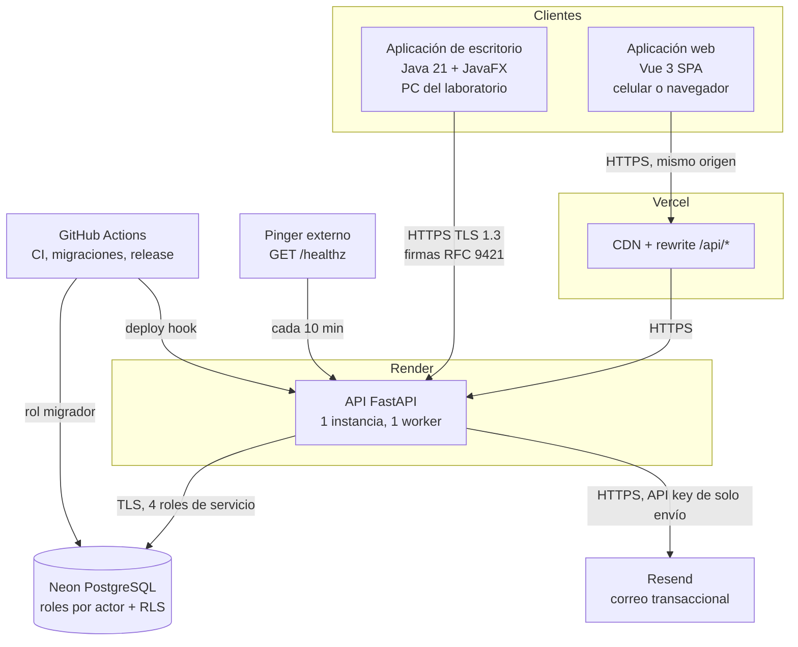
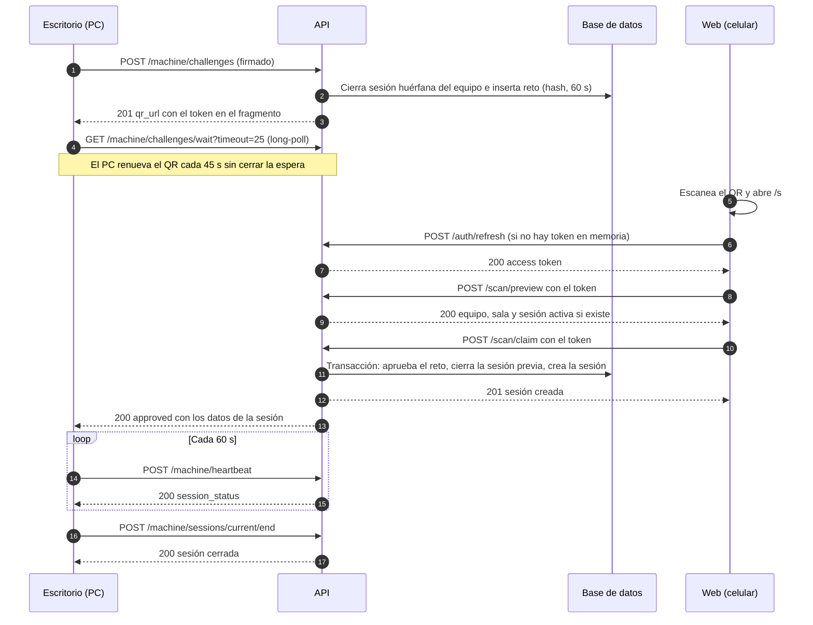
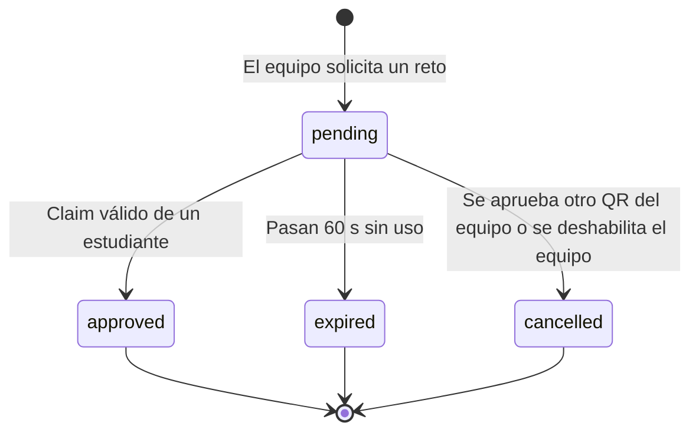
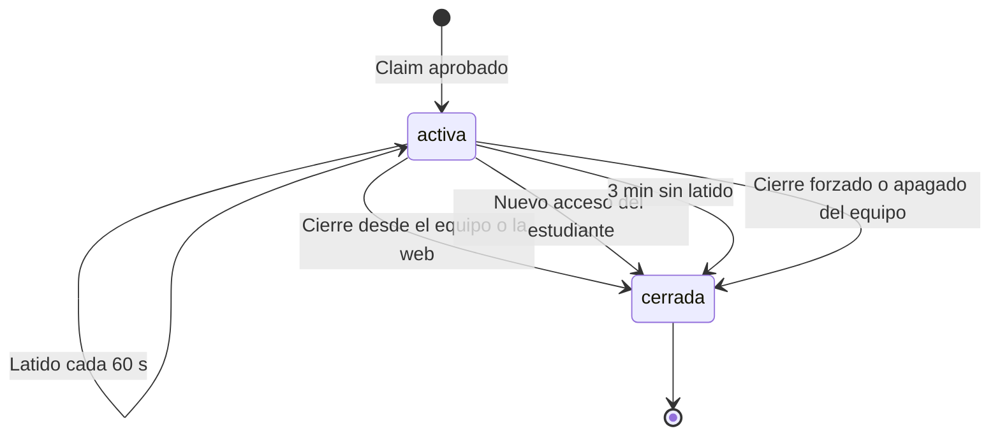
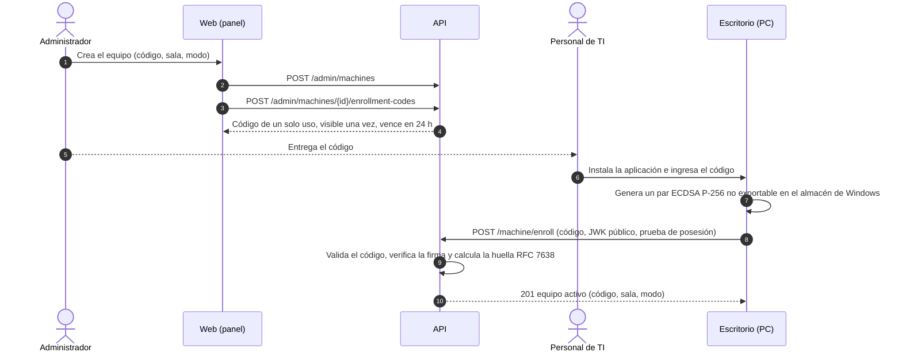
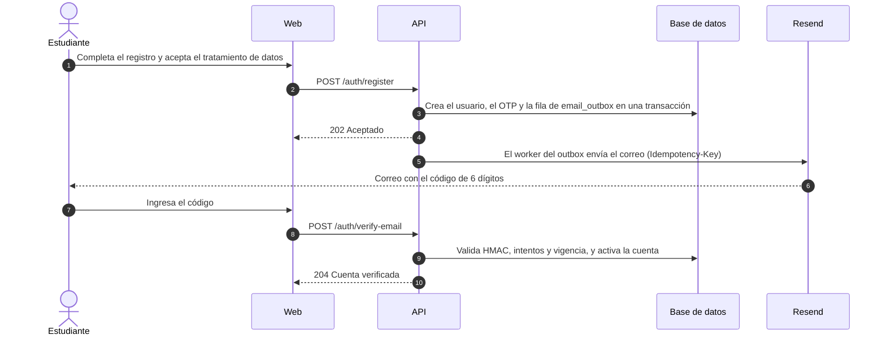
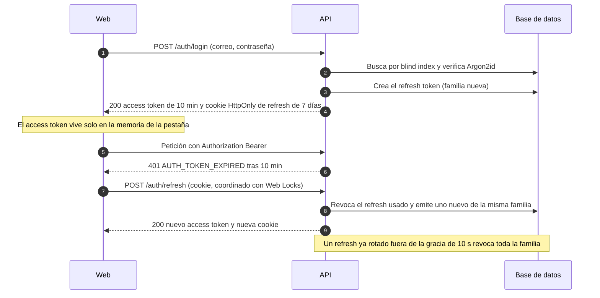
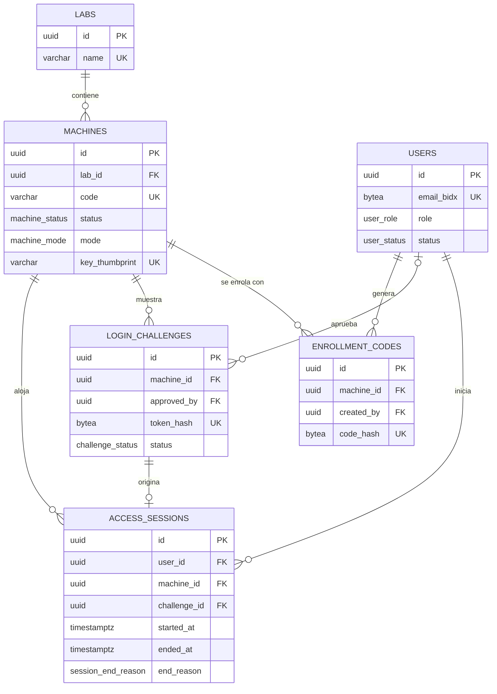
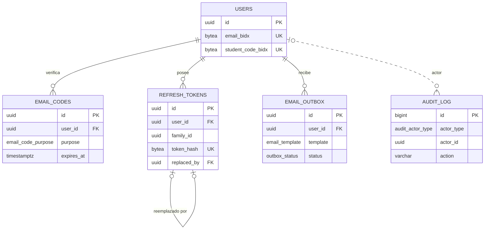

<!-- docx:skip-start -->
# Especificación de Requisitos de Software (SRS)

## Sistema de Registro de Acceso a Equipos por QR

| Campo | Valor |
|---|---|
| Identificador | SRS-IC-001 |
| Versión | 1.0 |
| Estado | Borrador para revisión |
| Fecha | 19 de octubre de 2026 |
| Repositorio | `internet-cafe` |
| Norma de referencia | ISO/IEC/IEEE 29148:2018 |
| Clasificación | Uso interno |

> Este documento integra el **PRD** (Parte I, requisitos de producto) y el **TRD** (Parte II, requisitos técnicos) del MVP. Los mockups de interfaz están pendientes (ver PEND-01).

**Contenido**

1. Introducción
2. Descripción general
3. Parte I · PRD: visión y objetivos del producto
4. Parte I · PRD: usuarios y escenarios de uso
5. Parte I · PRD: requisitos funcionales
6. Parte I · PRD: requisitos no funcionales
7. Parte II · TRD: arquitectura del sistema
8. Parte II · TRD: flujos del sistema
9. Parte II · TRD: interfaces externas
10. Parte II · TRD: especificación de la API
11. Parte II · TRD: modelo de datos
12. Parte II · TRD: arquitectura de seguridad
13. Parte II · TRD: infraestructura y despliegue
14. Parte II · TRD: estándares de código y calidad
15. Verificación y validación
16. Pendientes y elementos por definir
17. Anexo A: glosario
<!-- docx:skip-end -->

## Control del documento

### Historial de versiones

| Versión | Fecha | Autor | Descripción |
|---|---|---|---|
| 1.0 | 19/10/2026 | Liderazgo técnico del proyecto | Versión inicial: PRD, TRD, flujos, modelo de datos y arquitectura de seguridad del MVP |

### Aprobaciones

| Rol | Nombre | Firma | Fecha |
|---|---|---|---|
| Líder técnico | | | |
| Representante de la universidad | | | |
| Responsable de seguridad / TI | | | |

# 1. Introducción

## 1.1 Propósito

Este documento especifica los requisitos de producto y técnicos del **Sistema de Registro de Acceso a Equipos por QR** en su versión MVP. Sirve como referencia única para diseño, desarrollo, pruebas y aceptación, y como contrato de entendimiento entre el equipo de desarrollo y la universidad.

La estructura sigue la norma ISO/IEC/IEEE 29148:2018 (contenido de una especificación de requisitos de software) y organiza los requisitos en dos partes:

- **Parte I · PRD (Product Requirements):** problema, objetivos, usuarios, alcance, requisitos funcionales y no funcionales, con criterios de aceptación verificables.
- **Parte II · TRD (Technical Requirements):** arquitectura, flujos, interfaces, contrato de API, modelo de datos, seguridad, infraestructura y estándares de calidad.

## 1.2 Alcance del producto

El sistema registra **quién accede a cada computador de las salas de la universidad, cuándo inicia y cuándo termina su uso**. Se compone de tres aplicaciones:

1. **Aplicación de escritorio** (Windows, Java): se instala en cada PC, le da una identidad criptográfica al equipo, muestra un código QR y, una vez autenticado el estudiante, un tablero con sus datos e historial.
2. **Aplicación web** (Vue, desplegada en Vercel): el estudiante crea su cuenta, inicia sesión, escanea el QR del equipo con la cámara del celular y consulta su historial. Incluye un panel de administración mínimo.
3. **API** (FastAPI, desplegada en Render) con base de datos PostgreSQL en Neon: fuente única de verdad de identidades, equipos y sesiones de acceso.

**Fuera de alcance del MVP:**

- Rastrear o registrar las acciones que el usuario realiza dentro del equipo.
- Inicio de sesión con proveedores de identidad institucionales (SSO).
- Bloqueo del sistema operativo a nivel de Windows (Credential Provider, Assigned Access o Shell Launcher).
- Prueba de proximidad física del estudiante al equipo.

## 1.3 Audiencia y uso del documento

| Audiencia | Secciones de mayor interés |
|---|---|
| Universidad y patrocinadores | 1, 2, 3, 4, 6, 16 |
| Producto y diseño | 3, 4, 5, 8, 9.1 |
| Desarrollo backend | 5, 7, 8, 10, 11, 12, 13 |
| Desarrollo frontend web | 5, 7, 8, 9, 10, 12.2 |
| Desarrollo de escritorio | 5, 7, 8, 9, 10, 12.4 |
| QA y seguridad | 6, 12, 15 |

## 1.4 Definiciones, acrónimos y abreviaturas

| Término | Definición |
|---|---|
| Equipo / PC | Computador de una sala de la universidad donde se instala la aplicación de escritorio. |
| Sala | Espacio físico que agrupa equipos (laboratorio, sala de cómputo). |
| Enrolamiento | Proceso único por el cual un equipo genera su par de claves y registra su clave pública en la API. |
| Reto QR (challenge) | Registro de un solo uso, de vida corta, cuyo token se codifica en el QR que muestra el equipo. |
| Sesión de acceso | Registro del uso de un equipo por un estudiante, con inicio, último latido, fin y motivo de cierre. |
| Sesión web | Autenticación del usuario en la aplicación web (access token + refresh token). |
| Latido (heartbeat) | Petición periódica del equipo que confirma que sigue activo. |
| Long-poll | Petición HTTP que el servidor mantiene abierta hasta que hay novedades o vence un tiempo máximo. |
| Modo pasivo | Modo del escritorio en el que el registro es opcional y el equipo puede usarse sin escanear. |
| Modo kiosco | Modo del escritorio que ocupa la pantalla hasta que existe una sesión activa. |
| Fail-open | Comportamiento del modo kiosco que libera el equipo si la API no responde durante un tiempo configurado. |
| OTP | Código de un solo uso (6 dígitos) enviado por correo. |
| JWT | JSON Web Token (RFC 7519). |
| JWK | JSON Web Key (RFC 7517). |
| RLS | Row-Level Security de PostgreSQL. |
| Blind index | HMAC determinista de un dato cifrado que permite búsquedas exactas sin descifrarlo. |
| PII | Información personal identificable. |
| MVP | Producto mínimo viable. |
| PRD / TRD | Documento de requisitos de producto / técnicos. |
| CU-h | Unidad de cómputo-hora de Neon. |
| MoSCoW | Priorización: Debe, Debería, Podría, No en esta versión. |

## 1.5 Referencias

| Referencia | Título |
|---|---|
| ISO/IEC/IEEE 29148:2018 | Systems and software engineering — Life cycle processes — Requirements engineering |
| RFC 9421 | HTTP Message Signatures |
| RFC 9530 | Digest Fields (Content-Digest) |
| RFC 7638 | JSON Web Key (JWK) Thumbprint |
| RFC 7519 / RFC 7517 | JSON Web Token / JSON Web Key |
| RFC 9457 | Problem Details for HTTP APIs |
| RFC 8628 | OAuth 2.0 Device Authorization Grant (patrón de flujo entre dispositivos) |
| RFC 7636 / RFC 9700 | PKCE / OAuth 2.0 Security Best Current Practice |
| OWASP ASVS 4.0.3 | Application Security Verification Standard |
| OWASP Password Storage Cheat Sheet | Parámetros de Argon2id |
| NIST SP 800-63B | Digital Identity Guidelines: Authentication and Lifecycle Management |
| WCAG 2.1 | Web Content Accessibility Guidelines |

## 1.6 Convenciones del documento

- **Identificadores:** `RF-<módulo>-<nn>` (requisito funcional), `RNF-<categoría>-<nn>` (no funcional), `RN-<nn>` (regla de negocio), `T-<nn>` (amenaza), `PEND-<nn>` (pendiente).
- **Prioridad (MoSCoW):** **Debe** (obligatorio para el MVP), **Debería** (importante, se incluye salvo bloqueo), **Podría** (deseable, fuera del MVP si compromete fechas).
- **Lenguaje normativo:** "debe" expresa obligación verificable; "debería" expresa recomendación; "puede" expresa opción.
- **Rutas de la API:** se escriben sin el prefijo `/api/v1`, que es común a todos los endpoints.

# 2. Descripción general

## 2.1 Perspectiva del producto

Es un sistema nuevo, sin dependencia de sistemas institucionales existentes en el MVP. Opera sobre servicios en la nube con planes gratuitos y sobre los equipos Windows de las salas.

El principio rector del diseño es que **la API es la única fuente de verdad**: el equipo nunca declara quién lo usa ni a qué hora; la sesión la crea el estudiante autenticado desde su celular y el servidor fija todas las marcas de tiempo.

## 2.2 Funciones del producto

| Función | Descripción |
|---|---|
| Cuentas | Registro con correo institucional, verificación por OTP, inicio y cierre de sesión, recuperación y cambio de contraseña. |
| Identidad de equipos | Enrolamiento con código de un solo uso y par de claves no exportable por equipo. |
| Vinculación por QR | El equipo muestra un QR rotativo; el estudiante lo escanea, revisa el equipo y confirma. |
| Sesiones de acceso | Apertura, latidos, cierre manual, remoto, por inactividad o forzado. |
| Portal del estudiante | Sesión activa, historial de accesos y perfil. |
| Tablero del equipo | Datos del estudiante y sus últimos accesos mientras la sesión está activa. |
| Administración | Salas, equipos, códigos de enrolamiento, modo pasivo o kiosco, consulta y exportación de accesos, gestión de usuarios. |
| Notificaciones | Correos de verificación, recuperación y aviso de cambio de contraseña. |

## 2.3 Clases y características de usuarios

| Clase | Descripción | Frecuencia | Nivel técnico |
|---|---|---|---|
| Estudiante | Usa los equipos de las salas; se registra y escanea desde su celular. | Diaria | Básico |
| Administrador | Personal de la universidad que gestiona salas, equipos, usuarios y reportes. | Semanal | Medio |
| Personal de TI | Instala y enrola la aplicación de escritorio en cada equipo. | Puntual | Alto |
| Equipo (actor de sistema) | Aplicación de escritorio que se autentica con su clave privada. | Continua | — |

## 2.4 Entorno operativo

| Componente | Entorno |
|---|---|
| Aplicación de escritorio | Windows 10 (22H2) y Windows 11, x64. Runtime de Java incluido en el instalador. TPM 2.0 opcional. |
| Aplicación web (estudiante) | Safari en iOS 16 o superior, Chrome en Android 10 o superior, con cámara. |
| Aplicación web (administrador) | Últimas dos versiones de Chrome, Edge y Firefox de escritorio. |
| API | Render, servicio web gratuito, Python 3.12, una instancia. |
| Base de datos | Neon, PostgreSQL 17, plan gratuito. |
| Correo | Resend, plan gratuito, dominio verificado. |

## 2.5 Restricciones de diseño e implementación

1. **Stack obligatorio:** Java 21 LTS + JavaFX (escritorio), Vue 3 + TypeScript (web), FastAPI + SQLAlchemy 2 (API), PostgreSQL en Neon.
2. **Planes gratuitos:** Vercel Hobby, Render Free (se suspende tras 15 min sin tráfico; 750 h/mes por workspace), Neon Free (100 CU-h/mes por proyecto, 0,5 GB, suspensión tras 5 min sin uso), Resend Free (100 correos/día, 3.000/mes).
3. **Repositorio público** en GitHub: requisito de Vercel Hobby para despliegues con colaboradores. Implica que el repositorio no contiene secretos.
4. **Sin reescritura del historial de Git** para eludir restricciones del proveedor.
5. **Una instancia de API con un solo proceso**, que habilita estado en memoria (eventos de long-poll, caché de nonces, rate limit).
6. **Datos personales cifrados a nivel de aplicación**, lo que impide búsquedas parciales sobre nombre, correo o código (solo coincidencia exacta).

## 2.6 Supuestos y dependencias

| ID | Supuesto o dependencia |
|---|---|
| S-01 | Los estudiantes disponen de un celular con cámara y conexión a internet en las salas. |
| S-02 | La universidad provee (o autoriza) un dominio o subdominio para el envío de correo (ver PEND-02). |
| S-03 | Los equipos tienen acceso saliente HTTPS (puerto 443) a la API. |
| S-04 | Los estudiantes inician sesión en Windows con cuentas sin privilegios de administrador. |
| S-05 | El reloj de los equipos está sincronizado razonablemente; el sistema corrige desfases (RF-EQU-08). |
| S-06 | El volumen del piloto es de hasta 300 equipos y del orden de cientos de estudiantes. |
| S-07 | La disponibilidad depende de los niveles de servicio de planes gratuitos, que no ofrecen SLA. |

# 3. Parte I · PRD: visión y objetivos del producto

## 3.1 Problema

La universidad no tiene un registro confiable de quién usa cada computador de sus salas ni durante cuánto tiempo. Los controles manuales (planillas, carné) son lentos, fáciles de omitir o falsificar y no generan datos consultables.

## 3.2 Visión

Registrar cada acceso a un equipo en segundos, sin hardware adicional, usando el celular del estudiante como factor de identidad y un QR de un solo uso como prueba de presencia ante el equipo, con un registro que no pueda ser alterado desde el equipo.

## 3.3 Objetivos y métricas de éxito

| ID | Objetivo | Métrica | Meta del piloto |
|---|---|---|---|
| O-01 | Registrar accesos de forma rápida | Tiempo desde el escaneo hasta el tablero en el PC (estudiante con sesión web activa) | Mediana ≤ 10 s; actualización del PC tras confirmar ≤ 1 s |
| O-02 | Registros confiables | Sesiones creadas sin firma válida o sin estudiante autenticado | 0 |
| O-03 | Adopción en el piloto | Porcentaje de usos de equipos piloto con registro | ≥ 80 % en modo kiosco; medición de referencia en modo pasivo |
| O-04 | Información consultable | Accesos exportables por sala, equipo, estudiante y rango de fechas | 100 % de las sesiones |
| O-05 | Protección de datos | PII almacenada en claro en la base de datos | 0 columnas |
| O-06 | Costo de operación | Costo mensual de infraestructura del piloto | USD 0 (planes gratuitos) |

## 3.4 Alcance del MVP

| Incluido | Excluido | Pendiente |
|---|---|---|
| Cuentas propias con verificación por correo | SSO institucional | Mockups de interfaz (PEND-01) |
| Enrolamiento criptográfico de equipos | Monitoreo de actividad en el equipo | Política de retención de datos (PEND-05) |
| QR rotativo y vinculación desde el celular | Bloqueo de Windows a nivel de sistema operativo | Dominio de correo verificado (PEND-02) |
| Sesiones con latido y cinco vías de cierre | Prueba de proximidad física | |
| Modos pasivo y kiosco | Webhook de rebotes de correo | |
| Historial del estudiante y tablero del equipo | Desbloqueo de emergencia por TOTP | |
| Panel de administración mínimo y exportación CSV | Escalado a múltiples instancias | |

# 4. Parte I · PRD: usuarios y escenarios de uso

## 4.1 Perfiles

| Perfil | Necesidad principal | Dolor actual |
|---|---|---|
| Estudiante | Empezar a usar el equipo sin demoras y consultar su historial. | Planillas manuales y filas. |
| Administrador | Saber quién usó qué equipo y cuándo; gestionar equipos y usuarios. | Sin datos o datos incompletos. |
| Personal de TI | Instalar y dar de alta equipos de forma segura y repetible. | Sin procedimiento estándar. |

## 4.2 Escenarios principales

**E-01. Primer uso.** Ana crea su cuenta desde el celular con su correo institucional, recibe un código de 6 dígitos, verifica la cuenta y queda con la sesión web iniciada.

**E-02. Registro de acceso habitual.** Ana se sienta en LAB3-PC12, escanea el QR con la cámara del celular, ve "Vas a iniciar sesión en LAB3-PC12 (Sala 3)", toca "Confirmar" y en menos de un segundo el equipo muestra su nombre, su código enmascarado y sus últimos accesos.

**E-03. Cambio de equipo.** Ana olvida cerrar sesión en LAB1-PC03 y escanea otro equipo. La vista previa le avisa que la sesión anterior se cerrará; al confirmar, el sistema la cierra y abre la nueva.

**E-04. Cierre.** Ana toca "Cerrar sesión" en el equipo, o lo hace desde su celular. Si se va sin cerrar y el equipo se apaga, el sistema cierra la sesión tras 3 minutos sin latidos, con la hora del último latido.

**E-05. Alta de equipos.** El administrador crea el equipo LAB3-PC12 en el panel y genera un código de enrolamiento. El personal de TI instala la aplicación, ingresa el código y el equipo queda activo.

**E-06. Consulta y exportación.** El administrador filtra los accesos de la Sala 3 en la última semana y los exporta a CSV.

# 5. Parte I · PRD: requisitos funcionales

## 5.1 Autenticación y cuenta (RF-AUT)

| ID | Requisito | Prioridad | Criterio de aceptación |
|---|---|---|---|
| RF-AUT-01 | El sistema debe permitir el registro con correo institucional, código estudiantil, nombre completo, contraseña y aceptación explícita del tratamiento de datos. | Debe | Un correo de un dominio no permitido se rechaza con 422. Con datos válidos la respuesta es 202 genérica; si el correo o el código ya existen no se crea otra cuenta y no se revela cuál existe. La cuenta queda en `pending_verification`. |
| RF-AUT-02 | El sistema debe verificar el correo mediante un OTP de 6 dígitos con vigencia de 10 minutos y máximo 5 intentos. | Debe | Un OTP correcto y vigente activa la cuenta. Tras 5 intentos fallidos o al vencer, el OTP queda inválido y se debe pedir uno nuevo. |
| RF-AUT-03 | El sistema debe permitir reenviar el OTP con un máximo de 3 envíos por hora por cuenta. | Debe | El cuarto reenvío en una hora no genera correo. La respuesta siempre es 202. |
| RF-AUT-04 | El sistema debería permitir que un administrador active cuentas manualmente cuando la verificación por correo esté desactivada por configuración. | Debería | Con `REQUIRE_EMAIL_VERIFICATION=false`, el administrador puede pasar una cuenta a `active` y la acción queda auditada. |
| RF-AUT-05 | El sistema debe permitir el inicio de sesión con correo y contraseña solo a cuentas activas. | Debe | Credenciales inválidas devuelven `AUTH_INVALID_CREDENTIALS` sin distinguir si el correo existe. Una cuenta sin verificar devuelve `AUTH_EMAIL_NOT_VERIFIED`. |
| RF-AUT-06 | El sistema debe bloquear la cuenta 15 minutos tras 5 intentos fallidos consecutivos. | Debe | El sexto intento dentro del bloqueo devuelve `AUTH_ACCOUNT_LOCKED`, incluso con la contraseña correcta. |
| RF-AUT-07 | El sistema debe mantener la sesión web hasta 7 días mediante renovación transparente del access token. | Debe | Al vencer el access token (10 min), la aplicación lo renueva sin intervención del usuario. Tras 7 días sin renovación se exige iniciar sesión. |
| RF-AUT-08 | El sistema debe permitir cerrar la sesión web. | Debe | Tras cerrar sesión, el refresh token y su familia quedan revocados y la cookie se elimina. |
| RF-AUT-09 | El sistema debe permitir recuperar la contraseña mediante un OTP enviado por correo. | Debe | La solicitud responde 202 exista o no el correo. Al restablecer la contraseña se revocan todas las sesiones web del usuario. |
| RF-AUT-10 | El sistema debe permitir al usuario autenticado cambiar su contraseña indicando la actual. | Debe | Con la contraseña actual incorrecta responde 401. Tras el cambio se envía un aviso por correo. |
| RF-AUT-11 | El sistema debe exigir contraseñas de 10 a 128 caracteres. | Debe | Contraseñas fuera de rango se rechazan con 422. |

## 5.2 Aplicación de escritorio y equipos (RF-EQU)

| ID | Requisito | Prioridad | Criterio de aceptación |
|---|---|---|---|
| RF-EQU-01 | La aplicación debe enrolar el equipo con un código de un solo uso, generando un par de claves no exportable y registrando la clave pública en la API. | Debe | Con un código válido el equipo pasa a `active`. Un código usado, vencido o inexistente se rechaza con `ENROLLMENT_CODE_INVALID`. La clave privada no puede exportarse desde el almacén de Windows. |
| RF-EQU-02 | La aplicación debe iniciarse automáticamente al iniciar sesión en Windows y relanzarse si se cierra. | Debe | Tras iniciar sesión en Windows la aplicación está visible en ≤ 30 s. Si se termina el proceso, se relanza en ≤ 10 s. |
| RF-EQU-03 | En modo pasivo, la aplicación debe mostrar el QR con la opción "Omitir", que la minimiza a la bandeja y detiene la generación de QR. | Debe | Mientras está minimizada no se crean retos. "Registrar acceso" en la bandeja reanuda el ciclo. |
| RF-EQU-04 | En modo kiosco, la aplicación debe ocupar la pantalla completa, permanecer encima y no poder cerrarse ni minimizarse mientras no haya una sesión activa. | Debe | Alt+F4, Alt+Tab y la tecla Windows no ocultan la ventana. Las limitaciones (Ctrl+Alt+Supr, Administrador de tareas) quedan documentadas. |
| RF-EQU-05 | El modo de cada equipo debe ser configurable por un administrador y aplicarse sin reinstalar. | Debe | El cambio de modo en el panel se refleja en el equipo en ≤ 60 s. |
| RF-EQU-06 | La aplicación debe indicar el estado de conexión y reintentar con espera exponencial cuando la API no responde. | Debe | Muestra "Conectando…" y reintenta a los 2, 4, 8… s hasta un máximo de 30 s entre intentos. |
| RF-EQU-07 | En modo kiosco, la aplicación debe liberar el equipo (fail-open) si la API no responde durante el tiempo configurado. | Debe | Con fail-open activado y 3 minutos sin respuesta, el equipo queda usable y lo indica en pantalla. |
| RF-EQU-08 | La aplicación debe corregir el desfase de su reloj respecto al servidor. | Debe | Ante `MACHINE_CLOCK_SKEW`, calcula el desfase con el header `Date` y la siguiente petición firmada es aceptada. |
| RF-EQU-09 | Con una sesión activa, la aplicación debe mostrar un tablero con nombre, código enmascarado, hora de inicio, tiempo transcurrido, últimos 5 accesos y el botón "Cerrar sesión". | Debe | El tablero no muestra el correo ni el código completo. |
| RF-EQU-10 | La aplicación debería notificar el cierre de la sesión al apagarse el equipo. | Debería | En un apagado ordenado la sesión queda cerrada con motivo `machine_shutdown`. |

## 5.3 Código QR y vinculación (RF-QR)

| ID | Requisito | Prioridad | Criterio de aceptación |
|---|---|---|---|
| RF-QR-01 | El equipo debe mostrar un QR que codifica la URL de la aplicación web con un token de un solo uso en el fragmento (`/s#token`), junto con el código del equipo, la sala y una cuenta regresiva. | Debe | El QR escaneado con la cámara nativa abre la aplicación web en la ruta `/s`. |
| RF-QR-02 | Cada QR debe tener una vigencia de 60 s y renovarse cada 45 s; un equipo puede tener como máximo 2 QR vigentes. | Debe | Un QR con más de 60 s se rechaza con `CHALLENGE_EXPIRED`. Un QR reemplazado sigue siendo válido hasta su vencimiento. |
| RF-QR-03 | La aplicación web debe ofrecer un escáner propio además de la cámara nativa, y aceptar solo URLs del dominio propio con la ruta `/s`. | Debe | Un QR de otro dominio muestra "Este código no pertenece al sistema" y no navega. |
| RF-QR-04 | La aplicación web debe gestionar el permiso de cámara: solicitarlo, explicar cómo habilitarlo si se deniega y ofrecer la cámara nativa como alternativa. | Debe | Con el permiso denegado, la pantalla muestra instrucciones por navegador y no queda en blanco. |
| RF-QR-05 | Si el estudiante debe iniciar sesión tras escanear, la aplicación debe conservar el token en memoria y continuar el flujo después del inicio de sesión. | Debe | Tras iniciar sesión se muestra la vista previa del equipo escaneado sin volver a escanear, si el QR sigue vigente. |
| RF-QR-06 | Antes de confirmar, la aplicación debe mostrar el equipo y la sala, y advertir si el estudiante tiene una sesión activa en otro equipo. | Debe | La vista previa no consume el QR. Con sesión activa en otro equipo se muestra "Esto cerrará tu sesión en <equipo>". |
| RF-QR-07 | La sesión de acceso solo debe crearse cuando el estudiante confirma explícitamente. | Debe | Escanear sin confirmar no crea sesión ni cambia el estado del equipo. |
| RF-QR-08 | El sistema debe informar con mensajes accionables los casos de QR vencido, ya usado, inválido o de equipo deshabilitado. | Debe | Cada caso muestra un mensaje distinto y una acción (por ejemplo, "Escanea el código nuevo"). |
| RF-QR-09 | El equipo debe reflejar la sesión en menos de 1 s tras la confirmación. | Debe | Medido en caliente, p95 ≤ 1 s entre la respuesta 201 del claim y el tablero visible. |
| RF-QR-10 | Un QR debe poder usarse una sola vez; ante confirmaciones simultáneas solo la primera debe prosperar. | Debe | Dos claims concurrentes del mismo QR producen un 201 y un `CHALLENGE_ALREADY_USED`. Un segundo claim del mismo usuario devuelve la misma sesión. |

## 5.4 Sesiones de acceso (RF-SES)

| ID | Requisito | Prioridad | Criterio de aceptación |
|---|---|---|---|
| RF-SES-01 | El sistema debe registrar cada sesión con estudiante, equipo, reto de origen, inicio, último latido, fin y motivo de cierre, usando la hora del servidor. | Debe | Ningún endpoint acepta marcas de tiempo enviadas por el cliente. |
| RF-SES-02 | Un estudiante debe tener como máximo una sesión activa; una nueva sesión cierra la anterior con motivo `superseded`. | Debe | Tras confirmar en un segundo equipo, la sesión del primero queda cerrada. |
| RF-SES-03 | Un equipo debe tener como máximo una sesión activa. | Debe | Una restricción única parcial en la base de datos lo garantiza aun ante condiciones de carrera (`MACHINE_BUSY`). |
| RF-SES-04 | El equipo debe enviar un latido cada 60 s y recibir el estado de su sesión. | Debe | `last_heartbeat_at` se actualiza en cada latido. |
| RF-SES-05 | El estudiante debe poder cerrar la sesión desde el equipo. | Debe | Motivo `user_logout_pc`; el equipo vuelve a mostrar el QR. |
| RF-SES-06 | El estudiante debe poder cerrar su sesión activa desde la aplicación web. | Debe | Motivo `user_logout_web`; el equipo vuelve al QR en ≤ 60 s. |
| RF-SES-07 | El sistema debe cerrar automáticamente las sesiones sin latido durante 3 minutos, fijando como fin la hora del último latido. | Debe | Motivo `heartbeat_timeout`; `ended_at = last_heartbeat_at`. |
| RF-SES-08 | Un administrador debe poder forzar el cierre de una sesión. | Debe | Motivo `admin_forced`; la acción queda en `audit_log`. |
| RF-SES-09 | El equipo debe detectar un cierre remoto y volver al QR. | Debe | Tras un cierre desde la web o el panel, el equipo muestra el QR en ≤ 60 s. |

## 5.5 Portal del estudiante (RF-EST)

| ID | Requisito | Prioridad | Criterio de aceptación |
|---|---|---|---|
| RF-EST-01 | La pantalla de inicio debe mostrar la sesión activa (si existe) con opción de cerrarla, el acceso al escáner y los últimos 3 accesos. | Debe | Los datos coinciden con `GET /me/sessions/active` y `GET /me/sessions`. |
| RF-EST-02 | El estudiante debe poder consultar su historial paginado con equipo, sala, inicio, fin y duración. | Debe | Paginación por cursor, 20 elementos por defecto y máximo 50. Solo ve sus propias sesiones. |
| RF-EST-03 | El estudiante debe poder ver su perfil (con el código enmascarado), cambiar su contraseña y cerrar sesión. | Debe | El perfil no permite editar correo ni código en el MVP. |

## 5.6 Administración (RF-ADM)

| ID | Requisito | Prioridad | Criterio de aceptación |
|---|---|---|---|
| RF-ADM-01 | El administrador debe poder crear, editar y listar salas. | Debe | El nombre de la sala es único. |
| RF-ADM-02 | El administrador debe poder crear, editar (sala y modo), deshabilitar y listar equipos con su estado de conexión. | Debe | Un equipo se muestra "en línea" si su último contacto fue hace ≤ 2 min. Un equipo deshabilitado recibe `MACHINE_DISABLED`. |
| RF-ADM-03 | El administrador debe poder generar un código de enrolamiento de un solo uso para un equipo. | Debe | El código se muestra una sola vez y vence en 24 h. |
| RF-ADM-04 | El administrador debe poder revocar la clave de un equipo. | Debe | El equipo pasa a `pending_enrollment` y sus peticiones firmadas se rechazan. |
| RF-ADM-05 | El administrador debe poder consultar accesos filtrando por estudiante (correo o código exacto), sala, equipo, rango de fechas y estado. | Debe | Los filtros por estudiante usan coincidencia exacta (restricción 2.5-6). |
| RF-ADM-06 | El administrador debe poder exportar los accesos filtrados a CSV. | Debe | CSV en UTF-8 con BOM, separador coma, columnas: estudiante, código, equipo, sala, inicio, fin, duración en minutos, motivo de cierre. Horas en la zona horaria de la universidad. |
| RF-ADM-07 | El administrador debe poder forzar el cierre de una sesión activa. | Debe | Ver RF-SES-08. |
| RF-ADM-08 | El administrador debe poder buscar usuarios por correo o código exacto, bloquearlos, desbloquearlos y cambiar su rol. | Debe | Bloquear revoca las sesiones web y cierra la sesión de acceso activa del usuario. |
| RF-ADM-09 | Toda acción administrativa debe quedar registrada en la auditoría. | Debe | Cada acción genera una fila en `audit_log` con actor, acción y objetivo, sin PII. |

## 5.7 Notificaciones por correo (RF-NOT)

| ID | Requisito | Prioridad | Criterio de aceptación |
|---|---|---|---|
| RF-NOT-01 | El sistema debe enviar el correo de verificación con el OTP. | Debe | El correo llega con el código y su vigencia; no contiene enlaces con token. |
| RF-NOT-02 | El sistema debe enviar el correo de recuperación de contraseña con el OTP. | Debe | Igual que RF-NOT-01. |
| RF-NOT-03 | El sistema debe avisar por correo cuando la contraseña cambia. | Debe | El aviso se envía tras RF-AUT-09 y RF-AUT-10. |
| RF-NOT-04 | El envío debe ser confiable ante fallos temporales del proveedor o reinicios de la API. | Debe | Los correos pendientes se reintentan con espera de 1, 5 y 30 min, hasta 5 intentos, sin duplicados. |
| RF-NOT-05 | El sistema debería alertar cuando el consumo diario de correo alcance el 80 % de la cuota. | Debería | Al llegar a 80 correos en el día se registra una alerta. |
| RF-NOT-06 | El sistema podría procesar los rebotes y quejas que notifique el proveedor. | Podría | Fuera del MVP (webhook firmado). |

# 6. Parte I · PRD: requisitos no funcionales

## 6.1 Rendimiento (RNF-REN)

| ID | Requisito | Métrica / verificación |
|---|---|---|
| RNF-REN-01 | La creación de la sesión debe ser rápida con carga de piloto. | p95 de `POST /scan/claim` < 500 ms en caliente, con 300 equipos en long-poll y latido y 50 claims por minuto (prueba k6). |
| RNF-REN-02 | El equipo debe reflejar la sesión casi de inmediato. | p95 ≤ 1 s desde el 201 del claim hasta el tablero visible. |
| RNF-REN-03 | Las lecturas deben responder con baja latencia. | p95 < 300 ms en endpoints de lectura, en caliente. |
| RNF-REN-04 | Una instancia debe soportar el piloto. | 300 equipos concurrentes sin errores 5xx ni agotamiento de conexiones. |
| RNF-REN-05 | La web debería cargar rápido en redes móviles. | LCP < 2,5 s en 4G simulado (Lighthouse). |

## 6.2 Disponibilidad y fiabilidad (RNF-DIS)

| ID | Requisito | Métrica / verificación |
|---|---|---|
| RNF-DIS-01 | El servicio debería estar disponible en el horario de las salas. | Objetivo 99 % mensual medido por el monitor externo; sin SLA contractual por usar planes gratuitos. |
| RNF-DIS-02 | La API no debe suspenderse por inactividad en horario de servicio. | Pinger externo cada 10 min a `/healthz`, que no consulta la base de datos. |
| RNF-DIS-03 | Ningún registro debe perderse por un reinicio de la API. | La base de datos es la fuente de verdad; los clientes reintentan; prueba de reinicio en caliente. |
| RNF-DIS-04 | Los correos deben sobrevivir a reinicios. | Outbox transaccional (RF-NOT-04). |
| RNF-DIS-05 | Una caída de la API no debe dejar equipos inutilizables en modo kiosco. | Fail-open (RF-EQU-07). |

## 6.3 Seguridad (RNF-SEG)

| ID | Requisito | Métrica / verificación |
|---|---|---|
| RNF-SEG-01 | Todo el tráfico debe viajar cifrado. | HTTPS con TLS 1.2 o superior; TLS 1.3 obligatorio en la aplicación de escritorio. |
| RNF-SEG-02 | Las peticiones del equipo deben ser íntegras, autenticadas y no repetibles. | Firma RFC 9421 por petición (sección 12.4); pruebas de alteración y repetición. |
| RNF-SEG-03 | Los datos personales deben almacenarse cifrados. | Correo, código y nombre cifrados con AES-256-GCM; verificación por inspección del esquema. |
| RNF-SEG-04 | Cada componente debe operar con privilegios mínimos en la base de datos. | Roles de servicio y RLS (sección 12.8); suite de pruebas de permisos. |
| RNF-SEG-05 | El repositorio no debe contener secretos. | gitleaks y secret scanning con push protection en verde. |
| RNF-SEG-06 | La aplicación debería cumplir OWASP ASVS 4.0.3 nivel 2 en los capítulos aplicables. | Lista de verificación ASVS revisada antes de la entrega. |

## 6.4 Privacidad (RNF-PRI)

| ID | Requisito | Métrica / verificación |
|---|---|---|
| RNF-PRI-01 | El registro debe requerir el consentimiento explícito del tratamiento de datos. | `privacy_consent_at` no nulo en todas las cuentas. |
| RNF-PRI-02 | El equipo debe mostrar solo los datos mínimos. | Nombre y código enmascarado; nunca el correo. |
| RNF-PRI-03 | Los registros técnicos no deben contener PII ni secretos. | Revisión de logs; redacción de `Authorization`, `Cookie` y `Signature`. |
| RNF-PRI-04 | Los datos deben conservarse según la política institucional. | Pendiente de definición (PEND-05). |
| RNF-PRI-05 | El sistema no debe registrar la actividad del usuario dentro del equipo. | Fuera de alcance por diseño. |

## 6.5 Usabilidad y accesibilidad (RNF-USA)

| ID | Requisito | Métrica / verificación |
|---|---|---|
| RNF-USA-01 | La web debe diseñarse primero para móvil. | Usable desde 360 px de ancho sin desplazamiento horizontal. |
| RNF-USA-02 | Todas las interfaces deben estar en español. | Revisión de textos. |
| RNF-USA-03 | La web debería cumplir WCAG 2.1 nivel AA. | Sin violaciones críticas en axe-core. |
| RNF-USA-04 | Con sesión web activa, registrar un acceso debe requerir solo escanear y confirmar. | Prueba de usabilidad del flujo E-02. |
| RNF-USA-05 | Los errores deben indicar qué hacer a continuación. | Revisión de los mensajes del catálogo de errores. |

## 6.6 Mantenibilidad (RNF-MAN)

| ID | Requisito | Métrica / verificación |
|---|---|---|
| RNF-MAN-01 | La API debe desarrollarse a partir de un contrato OpenAPI versionado. | `oasdiff` sin diferencias no aprobadas entre el contrato y la API. |
| RNF-MAN-02 | El código debe pasar los linters definidos para cada lenguaje. | CI bloquea la fusión si fallan (sección 14). |
| RNF-MAN-03 | El código debe mantener una cobertura mínima de pruebas. | ≥ 85 % en los módulos de dominio y seguridad de la API; ≥ 75 % global en API y web. |
| RNF-MAN-04 | Las decisiones de arquitectura deben documentarse. | Un ADR por decisión de la sección 7.3. |
| RNF-MAN-05 | La configuración debe hacerse por variables de entorno. | Ningún valor de entorno embebido en el código. |

## 6.7 Portabilidad y compatibilidad (RNF-POR)

| ID | Requisito | Métrica / verificación |
|---|---|---|
| RNF-POR-01 | La aplicación de escritorio debe funcionar en Windows 10 (22H2) y 11 x64 sin instalar Java aparte. | Instalador `.msi` con runtime incluido, probado en ambas versiones. |
| RNF-POR-02 | La web debe funcionar en los navegadores del entorno operativo. | Pruebas E2E en Safari iOS, Chrome Android y navegadores de escritorio. |

## 6.8 Operación en planes gratuitos (RNF-OPE)

| ID | Requisito | Métrica / verificación |
|---|---|---|
| RNF-OPE-01 | El sistema debe operar dentro de las cuotas gratuitas de los proveedores. | Render ≤ 750 h/mes; Neon ≤ 100 CU-h/mes y ≤ 0,5 GB; Resend ≤ 100 correos/día. |
| RNF-OPE-02 | El consumo de cuotas debe ser observable. | Revisión semanal de los paneles de los proveedores y alerta de correo (RF-NOT-05). |

# 7. Parte II · TRD: arquitectura del sistema

## 7.1 Vista de componentes



*Figura 1. Vista de componentes y comunicaciones.*

## 7.2 Descripción de componentes

| Componente | Tecnología | Responsabilidad | Despliegue |
|---|---|---|---|
| Aplicación de escritorio | Java 21, JavaFX, ZXing, `java.net.http` | Identidad del equipo, QR, long-poll, tablero, latidos, modos pasivo y kiosco. | Instalador `.msi` (jpackage) en cada PC. |
| Aplicación web | Vue 3, TypeScript, Pinia, Vue Router, PrimeVue | Cuentas, escaneo, confirmación, historial y panel de administración. | Vercel (estático) con rewrite de `/api/*`. |
| API | Python 3.12, FastAPI, SQLAlchemy 2 async, asyncpg | Autenticación, autorización, retos QR, sesiones, administración, outbox de correo, tareas periódicas. | Render, servicio web, 1 instancia, `--workers 1`. |
| Base de datos | PostgreSQL 17 (Neon) | Persistencia, restricciones de integridad, RLS. | Neon, ramas `main`, `staging` y efímeras por PR. |
| Correo | Resend | Envío de OTP y avisos. | SaaS. |
| Pinger | UptimeRobot o cron-job.org | Evitar la suspensión de la API y monitorear disponibilidad. | SaaS. |
| CI/CD | GitHub Actions | Linters, pruebas, migraciones, despliegue de la API y publicación del instalador. | GitHub. |

## 7.3 Decisiones de arquitectura

| Decisión | Alternativa descartada | Justificación |
|---|---|---|
| Repositorio público en Vercel Hobby | Reescribir el autor de los commits de `main` | Vercel documenta colaboración gratuita en repos públicos. Reescribir autores elude una restricción del proveedor (riesgo de bloqueo), exige force-push y destruye la trazabilidad. |
| Cuentas propias sin PKCE | OAuth/OIDC con PKCE | Sin proveedor de identidad externo no hay authorization code que proteger (sección 12.3). |
| Reto QR de un solo uso con confirmación | QR estático por equipo | Un QR estático puede fotografiarse y reutilizarse; el reto es efímero y de un solo uso (patrón de RFC 8628). |
| Firma por petición RFC 9421 con clave no exportable | Token bearer o JWT para el equipo | Un token bearer robado sirve desde cualquier lugar y no protege el cuerpo; la firma cubre método, URL y cuerpo, y la clave no sale del equipo. |
| Long-poll por equipo | Polling corto o WebSocket | Aviso inmediato con pocas peticiones y sin la complejidad de conexiones persistentes. |
| Mismo origen mediante rewrite de Vercel | CORS con cookies entre sitios | Las cookies de terceros se bloquean en Safari; el mismo origen evita CORS y facilita la protección CSRF. |
| Pinger externo | Autoping desde la propia API | Si la instancia se reinicia, el autoping muere con ella; el pinger externo además monitorea. |
| Contract-first con OpenAPI | Contrato generado desde el código | Permite desarrollar web, escritorio y API en paralelo. |
| Roles de base de datos por actor + RLS | Un único usuario de aplicación | Contiene el impacto de un fallo o inyección al ámbito de un actor. |
| Outbox transaccional para correo | Envío síncrono en la petición | Ningún correo se pierde por fallos del proveedor o reinicios. |
| Una instancia de API | Varias instancias | Suficiente para el piloto; habilita estado en memoria. Escalar requiere `LISTEN/NOTIFY` o Redis. |

## 7.4 Stack tecnológico

| Capa | Tecnología | Versión |
|---|---|---|
| Escritorio | Java (Temurin), JavaFX (OpenJFX) | 21 LTS |
| Escritorio | ZXing, Jackson, Gradle (Kotlin DSL), jlink + jpackage | Estables vigentes |
| Web | Vue, Vite, TypeScript, Pinia, Vue Router | Vue 3.5 |
| Web | PrimeVue, vue-qrcode-reader, openapi-typescript, openapi-fetch | Estables vigentes |
| API | Python, FastAPI, Pydantic | 3.12, v0.11x, v2 |
| API | SQLAlchemy (async) + asyncpg, Alembic, uv | 2.x |
| API | cryptography, pwdlib (Argon2), PyJWT, slowapi, Jinja2, httpx | Estables vigentes |
| Datos | PostgreSQL (Neon) | 17 |
| Plataforma | Vercel Hobby, Render Free, Neon Free, Resend Free, GitHub Actions | — |

## 7.5 Estructura del repositorio

```text
backend/    API FastAPI: app/{api,domain,security,db,schemas}, alembic/, tests/
frontend/   Aplicación web Vue
desktop/    Aplicación de escritorio Java
contracts/  openapi.yaml, .spectral.yaml, test-vectors/, examples/
docs/       srs/, adr/, diagrams/
tools/      fake-pc/ (simulador de equipo), scripts de semilla y rotación de llaves
.github/    workflows/, CODEOWNERS, plantilla de PR
```

# 8. Parte II · TRD: flujos del sistema

## 8.1 Flujo principal: del QR a la sesión



*Figura 2. Flujo principal entre el equipo, la API y la aplicación web.*

| Paso | Actor | Acción | Petición | Efecto en datos |
|---|---|---|---|---|
| 1 | Equipo | Arranca, carga su clave y comprueba conexión y modo. | `POST /machine/heartbeat` | `machines.last_seen_at` |
| 2 | Equipo | Pide un QR y lo muestra con cuenta regresiva. | `POST /machine/challenges` | Inserta `login_challenges` (pending); cierra sesión huérfana del equipo. |
| 3 | Equipo | Espera el aviso; renueva el QR cada 45 s. | `GET /machine/challenges/wait` | Solo lecturas. |
| 4 | Estudiante | Escanea; la web toma el token del fragmento y lo borra de la URL. | — | — |
| 5 | Web | Asegura un access token (renueva o pide login). | `POST /auth/refresh` o `POST /auth/login` | Rota `refresh_tokens`. |
| 6 | Web | Muestra la vista previa del equipo. | `POST /scan/preview` | Solo lecturas. |
| 7 | Estudiante | Confirma; la API crea la sesión en una transacción y avisa al equipo. | `POST /scan/claim` | `login_challenges`, `access_sessions`, `audit_log`. |
| 8 | Equipo | Recibe `approved` con los datos y muestra el tablero. | Respuesta del long-poll | — |
| 9 | Equipo | Envía latidos y detecta cierres remotos. | `POST /machine/heartbeat` | `access_sessions.last_heartbeat_at` |
| 10 | Estudiante / sistema | Cierra la sesión por cualquiera de las vías de la sección 8.3. | Varias | `access_sessions.ended_at`, `end_reason` |

### Transacción de confirmación (paso 7)

1. `SELECT … FOR UPDATE` del reto por `token_hash`.
2. Validar `status = pending` y `expires_at > now()`; si no, `CHALLENGE_EXPIRED` o `CHALLENGE_ALREADY_USED`. Si el reto ya fue aprobado por el mismo usuario, devolver la misma sesión (idempotencia).
3. Cerrar la sesión activa del estudiante en otro equipo (`superseded`).
4. Marcar el reto `approved` (con `approved_by` y `approved_at`) y cancelar los demás retos pendientes del equipo.
5. Insertar la `access_session` con `started_at = now()`.
6. Insertar el evento en `audit_log` y confirmar (COMMIT).
7. Tras el COMMIT, despertar el long-poll del equipo.

### Algoritmo del long-poll

1. Suscribirse al evento en memoria del equipo **antes** de leer la base de datos.
2. Si el equipo ya tiene una sesión activa, responder `approved` con sus datos.
3. Si no, esperar el evento hasta `timeout` (máximo 25 s) sin retener conexiones de base de datos.
4. Al despertar, responder `approved` con la sesión; al vencer, responder `waiting`.

Este orden evita perder un aviso si el claim confirma entre la lectura y la suscripción. Si el claim ocurre entre dos long-polls, la lectura inicial del siguiente lo detecta; el retraso máximo es un viaje de red.

## 8.2 Ciclo de vida del reto QR



*Figura 3. Estados del reto QR.*

| Estado | Significado | Transición de entrada | ¿Terminal? |
|---|---|---|---|
| `pending` | QR visible y utilizable. | Creación por el equipo. | No |
| `approved` | Un estudiante confirmó; existe una sesión que lo referencia. | Claim válido. | Sí |
| `expired` | Venció sin uso. | `now() > expires_at` (evaluación al leer y tarea periódica). | Sí |
| `cancelled` | Invalidado por otro QR aprobado del mismo equipo o por deshabilitar el equipo. | Claim de otro reto; cambio de estado del equipo. | Sí |

## 8.3 Ciclo de vida de la sesión de acceso



*Figura 4. Estados de la sesión de acceso.*

| Motivo (`end_reason`) | Origen | Petición | El equipo se entera |
|---|---|---|---|
| `user_logout_pc` | Estudiante en el equipo | `POST /machine/sessions/current/end` | Inmediato |
| `user_logout_web` | Estudiante en la web | `POST /me/sessions/{id}/end` | Próximo latido (≤ 60 s) |
| `superseded` | Nuevo acceso del estudiante en otro equipo, o nuevo reto del mismo equipo | Claim / creación de reto | Próximo latido |
| `admin_forced` | Administrador | `POST /admin/sessions/{id}/end` | Próximo latido |
| `machine_shutdown` | Apagado ordenado del equipo | `POST /machine/sessions/current/end` (mejor esfuerzo) | — |
| `heartbeat_timeout` | Tarea periódica de la API | — | — |

## 8.4 Enrolamiento de un equipo



*Figura 5. Enrolamiento de un equipo.*

## 8.5 Registro y verificación de cuenta



*Figura 6. Registro y verificación de correo.*

## 8.6 Inicio de sesión y renovación de tokens



*Figura 7. Inicio de sesión y renovación del access token.*

## 8.7 Recuperación de contraseña

1. El usuario solicita la recuperación con su correo (`POST /auth/password/forgot`); la respuesta es siempre 202.
2. Si la cuenta existe y está activa, se crea un OTP con propósito `reset_password` y se encola el correo en la misma transacción.
3. El usuario envía correo, código y nueva contraseña (`POST /auth/password/reset`).
4. La API valida el OTP (HMAC, intentos, vigencia), actualiza el hash Argon2id, revoca todas las familias de refresh tokens y encola el aviso de contraseña cambiada.

## 8.8 Reglas de negocio

| ID | Regla |
|---|---|
| RN-01 | El servidor fija todas las marcas de tiempo; ningún endpoint acepta horas del cliente. |
| RN-02 | Crear un reto cierra cualquier sesión abierta del mismo equipo (`superseded`). |
| RN-03 | Un estudiante tiene como máximo una sesión activa; la nueva cierra la anterior (`superseded`). |
| RN-04 | Un equipo tiene como máximo una sesión activa. |
| RN-05 | Un reto se usa una sola vez y solo mientras está `pending` y vigente. |
| RN-06 | Un equipo tiene como máximo 2 retos vigentes; al aprobarse uno, se cancelan los demás pendientes. |
| RN-07 | Una sesión sin latido durante 3 min se cierra con `ended_at = last_heartbeat_at`. |
| RN-08 | Solo los equipos `active` pueden crear retos, enviar latidos o tener sesiones. |
| RN-09 | Solo las cuentas `active` pueden iniciar sesión web y confirmar accesos. |
| RN-10 | En modo pasivo, "Omitir" detiene la creación de retos hasta que el usuario reanude. |
| RN-11 | El escáner de la web solo acepta URLs del dominio propio con la ruta `/s`. |
| RN-12 | Bloquear a un usuario revoca sus sesiones web y cierra su sesión de acceso activa. |

## 8.9 Parámetros temporales

| Parámetro | Valor | Configurable |
|---|---|---|
| Vigencia de un reto QR | 60 s | Sí (servidor) |
| Renovación del QR en el equipo | 45 s | Sí (servidor, vía respuesta) |
| Retos vigentes por equipo | 2 | No |
| Duración máxima del long-poll | 25 s (timeout del cliente: 35 s) | Sí |
| Intervalo de latido | 60 s | Sí |
| Cierre por inactividad | 3 min | Sí |
| Tolerancia de reloj de firmas | ±30 s | Sí |
| Ventana de nonces | 60 s | Sí |
| Vida del access token | 10 min | Sí |
| Vida del refresh token | 7 días | Sí |
| Gracia de rotación de refresh | 10 s | Sí |
| Vigencia del OTP | 10 min | Sí |
| Vigencia del código de enrolamiento | 24 h | Sí |
| Bloqueo por intentos fallidos | 5 intentos, 15 min | Sí |
| Fail-open del modo kiosco | 3 min sin respuesta | Sí (por equipo) |
| Equipo "en línea" | Último contacto ≤ 2 min | Sí |

# 9. Parte II · TRD: interfaces externas

## 9.1 Interfaces de usuario

Los mockups están pendientes (PEND-01). Esta sección define el inventario de pantallas que deben diseñarse.

**Aplicación web (13 pantallas, diseño mobile-first):**

| # | Pantalla | Contenido principal | Requisitos |
|---|---|---|---|
| W-01 | Inicio de sesión | Correo, contraseña, enlaces a registro y recuperación. | RF-AUT-05 |
| W-02 | Registro | Correo institucional, código, nombre, contraseña, consentimiento. | RF-AUT-01 |
| W-03 | Verificar correo | Código de 6 dígitos y reenvío. | RF-AUT-02, RF-AUT-03 |
| W-04 | Recuperar contraseña | Solicitud de código y nueva contraseña. | RF-AUT-09 |
| W-05 | Inicio | Sesión activa, botón Escanear, últimos 3 accesos. | RF-EST-01 |
| W-06 | Escanear QR | Cámara y estados de permiso. | RF-QR-03, RF-QR-04 |
| W-07 | Confirmar acceso | Equipo, sala, aviso de sesión activa, confirmar o cancelar, resultados. | RF-QR-06 a RF-QR-08 |
| W-08 | Historial | Lista paginada de accesos. | RF-EST-02 |
| W-09 | Perfil | Datos, cambio de contraseña, cerrar sesión. | RF-EST-03 |
| W-10 | Admin · Salas y equipos | Lista con estado y modo; creación. | RF-ADM-01, RF-ADM-02 |
| W-11 | Admin · Detalle de equipo | Código de enrolamiento, modo, deshabilitar, revocar clave, historial. | RF-ADM-02 a RF-ADM-04 |
| W-12 | Admin · Accesos | Filtros, cierre forzado, exportación CSV. | RF-ADM-05 a RF-ADM-07 |
| W-13 | Admin · Usuarios | Búsqueda exacta, bloqueo, rol. | RF-ADM-08 |

Componentes transversales: layout base, estados vacío, cargando y error, y página 404.

**Aplicación de escritorio (4 pantallas y menú de bandeja):**

| # | Pantalla | Contenido principal | Requisitos |
|---|---|---|---|
| D-01 | Enrolamiento | Ingreso del código y confirmación de equipo y sala. | RF-EQU-01 |
| D-02 | QR | QR, código del equipo, sala, cuenta regresiva, estado de conexión, "Omitir" en modo pasivo. | RF-QR-01, RF-EQU-03, RF-EQU-04 |
| D-03 | Tablero de sesión | Nombre, código enmascarado, inicio, cronómetro, últimos 5 accesos, "Cerrar sesión". | RF-EQU-09 |
| D-04 | Sin servicio / Conectando | Estado de reconexión y fail-open en kiosco. | RF-EQU-06, RF-EQU-07 |

## 9.2 Interfaces de hardware

| Hardware | Uso | Requisito |
|---|---|---|
| Cámara del celular | Escaneo del QR mediante `getUserMedia` o la cámara nativa. | Contexto seguro (HTTPS). |
| TPM 2.0 del equipo | Almacenamiento no exportable de la clave del equipo (Microsoft Platform Crypto Provider). | Opcional; si no existe, se usa el proveedor de software de Windows con clave no exportable. |
| Pantalla del equipo | QR legible a 40–60 cm. | QR de al menos 6 cm de lado. |

## 9.3 Interfaces de software

| Sistema | Interfaz | Uso | Credencial |
|---|---|---|---|
| Neon PostgreSQL | Protocolo PostgreSQL sobre TLS | Persistencia | Un rol por actor (sección 12.8) |
| Resend | API HTTPS | Envío de correos | API key con permiso de solo envío restringida al dominio |
| Vercel | Integración con Git; `vercel.json` | Hosting web, rewrite y cabeceras | Cuenta del propietario |
| Render | Integración con Git; deploy hook | Hosting de la API | Deploy hook como secreto de CI |
| UptimeRobot / cron-job.org | HTTP GET | Keep-alive y monitoreo | Ninguna (endpoint público sin datos) |
| GitHub Actions | Workflows | CI, migraciones, release | Secretos de entorno con aprobación |
| Almacén de claves de Windows | SunMSCAPI (`Windows-MY-LOCALMACHINE`) | Firma con la clave del equipo | ACL de la clave |

## 9.4 Interfaces de comunicación

- **Protocolo:** HTTPS. TLS 1.3 obligatorio desde la aplicación de escritorio; TLS 1.2+ en la web.
- **Formato:** JSON UTF-8; errores en `application/problem+json` (RFC 9457).
- **Web → API:** mismo origen mediante el rewrite `/api/:path*` de Vercel. Autenticación por `Authorization: Bearer` y cookie `__Secure-rt` solo en `/api/v1/auth`.
- **Escritorio → API:** conexión directa a Render, sin proxy del sistema (`NO_PROXY`), con truststore propio que solo contiene las autoridades raíz de Render. Cada petición incluye las cabeceras `Content-Digest`, `Signature-Input` y `Signature`.
- **Notificación al equipo:** long-poll HTTP de hasta 25 s.

# 10. Parte II · TRD: especificación de la API

## 10.1 Convenciones

- **Base:** `/api/v1`. Un cambio incompatible exige una nueva versión de ruta o un periodo de deprecación.
- **Contrato:** `contracts/openapi.yaml` (OpenAPI 3.1) es la fuente de verdad; Spectral lo valida.
- **Nombres:** JSON en `snake_case`.
- **Fechas:** ISO 8601 en UTC con sufijo `Z`. **Identificadores:** UUID en texto.
- **Paginación:** por cursor: `{ "items": [...], "next_cursor": "opaco o null" }` con `?limit=` (máximo 50).
- **Validación:** campos desconocidos se rechazan con 422 (`extra="forbid"`).
- **Errores:** RFC 9457 con un campo `code` estable (sección 10.5).

## 10.2 Autenticación por tipo de actor

| Actor | Mecanismo | Endpoints |
|---|---|---|
| Público | Ninguno, con rate limit | `/healthz`, `/readyz`, `/auth/register`, `/auth/verify-email`, `/auth/resend-code`, `/auth/login`, `/auth/password/*` |
| Sesión web (cookie) | Cookie `__Secure-rt` + validación de `Origin` | `/auth/refresh`, `/auth/logout` |
| Usuario (U) | JWT ES256 en `Authorization: Bearer` | `/me/*`, `/scan/*` |
| Administrador (A) | JWT ES256 con `role = admin` | `/admin/*` |
| Equipo (M) | Firma RFC 9421 con la clave enrolada | `/machine/*` (excepto enroll) |
| Equipo en enrolamiento | Código de un solo uso + prueba de posesión | `/machine/enroll` |

## 10.3 Catálogo de endpoints

| Grupo | Método y ruta | Actor | Descripción | Respuesta |
|---|---|---|---|---|
| Salud | `GET /healthz` | Público | Liveness sin acceso a base de datos. | 200 |
| Salud | `GET /readyz` | Público | Verifica la base de datos. | 200 / 503 |
| Auth | `POST /auth/register` | Público | Crea la cuenta y encola el OTP. | 202 |
| Auth | `POST /auth/verify-email` | Público | Valida el OTP y activa la cuenta. | 204 |
| Auth | `POST /auth/resend-code` | Público | Reenvía el OTP (máx. 3 por hora). | 202 |
| Auth | `POST /auth/login` | Público | Emite access token y cookie de refresh. | 200 |
| Auth | `POST /auth/refresh` | Cookie | Rota el refresh y emite un access token. | 200 |
| Auth | `POST /auth/logout` | Cookie | Revoca la familia de refresh tokens. | 204 |
| Auth | `POST /auth/password/forgot` | Público | Encola el OTP de recuperación. | 202 |
| Auth | `POST /auth/password/reset` | Público | Restablece la contraseña. | 204 |
| Me | `GET /me` | U | Perfil del usuario. | 200 |
| Me | `PATCH /me/password` | U | Cambio de contraseña. | 204 |
| Me | `GET /me/sessions` | U | Historial paginado. | 200 |
| Me | `GET /me/sessions/active` | U | Sesión activa o `null`. | 200 |
| Me | `POST /me/sessions/{id}/end` | U | Cierra la sesión propia (`user_logout_web`). | 200 |
| Scan | `POST /scan/preview` | U | Equipo, sala y sesión activa del usuario; no consume el reto. | 200 |
| Scan | `POST /scan/claim` | U | Crea la sesión; idempotente para el mismo usuario. | 201 / 200 |
| Máquina | `POST /machine/enroll` | Enrolamiento | Registra la clave pública. | 201 |
| Máquina | `POST /machine/challenges` | M | Crea un reto QR. | 201 |
| Máquina | `GET /machine/challenges/wait?timeout=25` | M | Long-poll por equipo: `approved` con la sesión o `waiting`. | 200 |
| Máquina | `GET /machine/sessions/current` | M | Sesión actual, usuario e historial reciente. | 200 / 204 |
| Máquina | `POST /machine/sessions/current/end` | M | Cierra la sesión desde el equipo. | 200 |
| Máquina | `POST /machine/heartbeat` | M | Latido; devuelve modo y estado de la sesión. | 200 |
| Admin | `GET /admin/labs` | A | Lista de salas. | 200 |
| Admin | `POST /admin/labs` | A | Crea una sala. | 201 |
| Admin | `PATCH /admin/labs/{id}` | A | Edita una sala. | 200 |
| Admin | `GET /admin/machines` | A | Lista de equipos con estado. | 200 |
| Admin | `POST /admin/machines` | A | Crea un equipo. | 201 |
| Admin | `GET /admin/machines/{id}` | A | Detalle de un equipo. | 200 |
| Admin | `PATCH /admin/machines/{id}` | A | Edita sala, modo o estado. | 200 |
| Admin | `POST /admin/machines/{id}/enrollment-codes` | A | Genera un código de enrolamiento. | 201 |
| Admin | `POST /admin/machines/{id}/revoke-key` | A | Revoca la clave del equipo. | 200 |
| Admin | `GET /admin/sessions` | A | Consulta de accesos con filtros. | 200 |
| Admin | `GET /admin/sessions/export` | A | Exportación CSV. | 200 (`text/csv`) |
| Admin | `POST /admin/sessions/{id}/end` | A | Cierre forzado. | 200 |
| Admin | `GET /admin/users` | A | Búsqueda exacta de usuarios. | 200 |
| Admin | `PATCH /admin/users/{id}` | A | Bloqueo, desbloqueo, rol o activación manual. | 200 |

Total del MVP: 37 endpoints. Fuera del MVP: `POST /webhooks/resend` (firma Svix) para rebotes y quejas.

## 10.4 Esquemas principales

**Inicio de sesión** — `POST /auth/login` → 200 (con `Set-Cookie: __Secure-rt=…` HttpOnly, Secure, SameSite=Strict, Path=/api/v1/auth):

```json
{
  "access_token": "eyJhbGciOiJFUzI1NiJ9…",
  "token_type": "Bearer",
  "expires_in": 600,
  "user": { "id": "0192f0c4-…", "full_name": "Ana Pérez", "role": "student" }
}
```

**Creación de reto** — `POST /machine/challenges` → 201:

```json
{
  "challenge_id": "0192f0c5-…",
  "qr_url": "https://<front>/s#k3J9…",
  "expires_at": "2026-10-19T14:05:00Z",
  "rotate_after_s": 45
}
```

**Long-poll** — `GET /machine/challenges/wait?timeout=25` → 200:

```json
{ "status": "approved", "session": { "...": "mismo objeto que GET /machine/sessions/current" } }
```

**Vista previa** — `POST /scan/preview` → 200:

```json
{
  "machine": { "code": "LAB3-PC12", "lab": "Sala 3 · Bloque B" },
  "expires_at": "2026-10-19T14:05:00Z",
  "active_session": { "machine_code": "LAB1-PC03" }
}
```

**Confirmación** — `POST /scan/claim` → 201:

```json
{
  "session": {
    "id": "0192f0c6-…",
    "status": "active",
    "started_at": "2026-10-19T14:04:21Z",
    "machine": { "id": "0192f0a1-…", "code": "LAB3-PC12", "lab": "Sala 3 · Bloque B" }
  }
}
```

**Sesión actual del equipo** — `GET /machine/sessions/current` → 200:

```json
{
  "session": { "id": "0192f0c6-…", "started_at": "2026-10-19T14:04:21Z" },
  "user": { "full_name": "Ana Pérez", "student_code_masked": "2021****34" },
  "recent_accesses": [
    { "machine_code": "LAB1-PC03", "lab": "Sala 1", "started_at": "2026-10-18T09:00:03Z",
      "ended_at": "2026-10-18T10:00:03Z", "duration_s": 3600 }
  ]
}
```

**Latido** — `POST /machine/heartbeat` → 200:

```json
{ "server_time": "2026-10-19T14:05:21Z", "mode": "passive", "session_status": "active" }
```

**Error** — 410 `application/problem+json`:

```json
{
  "type": "https://errors.example/challenge-expired",
  "title": "El código QR expiró",
  "status": 410,
  "code": "CHALLENGE_EXPIRED",
  "detail": "Escanea el código nuevo del equipo.",
  "instance": "/api/v1/scan/claim"
}
```

**Cabeceras de una petición firmada del equipo:**

```text
Content-Digest: sha-256=:X48E9qOokqqrvdts8nOJRJN3OWDUoyWxBf7kbu9DBPE=:
Signature-Input: sig1=("@method" "@target-uri" "content-digest");created=1760882700;nonce="b3k2pp5k7z";keyid="NzbLsXh8uDCcd-6MNwXF4W_7noWXFZAfHkxZsRGC9Xs";alg="ecdsa-p256-sha256"
Signature: sig1=:<firma r||s de 64 bytes en base64>:
```

## 10.5 Catálogo de errores

| `code` | HTTP | Significado | Acción sugerida al usuario |
|---|---|---|---|
| `VALIDATION_ERROR` | 422 | Datos inválidos o campos desconocidos. | Corregir los campos indicados. |
| `AUTH_INVALID_CREDENTIALS` | 401 | Correo o contraseña incorrectos. | Reintentar o recuperar la contraseña. |
| `AUTH_EMAIL_NOT_VERIFIED` | 403 | Cuenta sin verificar. | Ingresar el código o pedir uno nuevo. |
| `AUTH_ACCOUNT_LOCKED` | 423 | Bloqueo temporal por intentos fallidos. | Esperar 15 minutos. |
| `AUTH_TOKEN_EXPIRED` | 401 | Access token vencido. | Renovación automática. |
| `FORBIDDEN` | 403 | Sin permisos para el recurso. | — |
| `RATE_LIMITED` | 429 | Demasiadas peticiones. | Esperar el tiempo de `Retry-After`. |
| `CHALLENGE_NOT_FOUND` | 404 | QR inexistente o inválido. | Escanear el QR del equipo. |
| `CHALLENGE_EXPIRED` | 410 | QR vencido. | Escanear el código nuevo. |
| `CHALLENGE_ALREADY_USED` | 409 | QR ya utilizado. | Escanear el código nuevo. |
| `MACHINE_BUSY` | 409 | El equipo ya tiene una sesión activa. | Cerrar la sesión en el equipo y reintentar. |
| `MACHINE_DISABLED` | 403 | Equipo deshabilitado. | Contactar a soporte. |
| `MACHINE_SIGNATURE_INVALID` | 401 | Firma ausente, inválida o repetida. | — (equipo) |
| `MACHINE_CLOCK_SKEW` | 401 | Reloj del equipo fuera de tolerancia. | Corrección automática (RF-EQU-08). |
| `ENROLLMENT_CODE_INVALID` | 401 | Código de enrolamiento inexistente, usado o vencido. | Pedir un código nuevo al administrador. |
| `SESSION_NOT_FOUND` | 404 | Sesión inexistente o ajena. | — |

## 10.6 Gestión del contrato

- **Web:** `openapi-typescript` genera los tipos y `openapi-fetch` el cliente; MSW simula la API durante el desarrollo.
- **API:** los esquemas Pydantic reflejan el contrato; en CI se compara `app.openapi()` con `contracts/openapi.yaml` mediante `oasdiff` y Schemathesis verifica la conformidad.
- **Escritorio:** DTOs generados con `openapi-generator` o escritos a mano y verificados contra los ejemplos.
- **Vectores de prueba:** `contracts/test-vectors/` contiene peticiones firmadas de referencia que Java y Python deben producir y verificar de forma idéntica.

# 11. Parte II · TRD: modelo de datos

## 11.1 Modelo entidad-relación



*Figura 8. Modelo entidad-relación del núcleo de acceso.*



*Figura 9. Modelo entidad-relación de identidad y soporte.*

Los diagramas muestran las claves y los atributos principales de cada entidad; el detalle completo de columnas está en el diccionario de datos (sección 11.2).

**Convenciones del modelo:**

- Claves primarias UUIDv7 generadas por la aplicación (excepto `audit_log`, que usa `bigint` identity). Nunca se exponen enteros secuenciales.
- Fechas `timestamptz` en UTC.
- Sufijos: `_ct` dato cifrado con AES-256-GCM; `_bidx` blind index HMAC-SHA256; `_hash` hash de un solo sentido.
- Todas las tablas residen en el esquema `app`, propiedad del rol `svc_migrator`.

## 11.2 Diccionario de datos

### users

| Columna | Tipo | Nulo | Descripción |
|---|---|---|---|
| id | uuid | No | Clave primaria. |
| email_ct | bytea | No | Correo institucional cifrado. |
| email_bidx | bytea | No | Blind index del correo normalizado (minúsculas, sin espacios). Único. |
| student_code_ct | bytea | Sí | Código estudiantil cifrado (nulo para administradores). |
| student_code_bidx | bytea | Sí | Blind index del código. Único. |
| full_name_ct | bytea | No | Nombre completo cifrado. |
| password_hash | text | No | Hash Argon2id en formato PHC. |
| role | user_role | No | Rol; por defecto `student`. |
| status | user_status | No | Estado; por defecto `pending_verification`. |
| email_verified_at | timestamptz | Sí | Fecha de verificación del correo. |
| privacy_consent_at | timestamptz | No | Fecha de aceptación del tratamiento de datos. |
| failed_login_count | smallint | No | Intentos fallidos consecutivos; por defecto 0. |
| locked_until | timestamptz | Sí | Fin del bloqueo temporal. |
| last_login_at | timestamptz | Sí | Último inicio de sesión web. |
| created_at / updated_at | timestamptz | No | Auditoría de la fila. |

### email_codes

| Columna | Tipo | Nulo | Descripción |
|---|---|---|---|
| id | uuid | No | Clave primaria. |
| user_id | uuid | No | FK a `users`. |
| purpose | email_code_purpose | No | Propósito del código. |
| code_hash | bytea | No | HMAC-SHA256 del código con llave de servidor. |
| attempts | smallint | No | Intentos de validación (máximo 5). |
| expires_at | timestamptz | No | Creación + 10 min. |
| consumed_at | timestamptz | Sí | Fecha de uso. |
| created_at | timestamptz | No | Creación. |

### refresh_tokens

| Columna | Tipo | Nulo | Descripción |
|---|---|---|---|
| id | uuid | No | Clave primaria. |
| user_id | uuid | No | FK a `users`. |
| family_id | uuid | No | Agrupa las rotaciones de un mismo inicio de sesión. |
| token_hash | bytea | No | SHA-256 del token opaco. Único. |
| expires_at | timestamptz | No | Creación + 7 días. |
| revoked_at | timestamptz | Sí | Revocación. |
| replaced_by | uuid | Sí | FK al token que lo reemplazó. |
| user_agent | varchar(255) | Sí | Agente de usuario del navegador. |
| created_at | timestamptz | No | Creación. |

### labs

| Columna | Tipo | Nulo | Descripción |
|---|---|---|---|
| id | uuid | No | Clave primaria. |
| name | varchar(80) | No | Nombre de la sala. Único. |
| building | varchar(80) | Sí | Bloque o edificio. |
| created_at | timestamptz | No | Creación. |

### machines

| Columna | Tipo | Nulo | Descripción |
|---|---|---|---|
| id | uuid | No | Clave primaria. |
| lab_id | uuid | Sí | FK a `labs`. |
| code | varchar(40) | No | Identificador visible (por ejemplo, `LAB3-PC12`). Único. |
| hostname | varchar(63) | Sí | Nombre de red reportado en el enrolamiento. |
| status | machine_status | No | Estado; por defecto `pending_enrollment`. |
| mode | machine_mode | No | Modo; por defecto `passive`. |
| public_key_jwk | jsonb | Sí | Clave pública ECDSA P-256 en formato JWK. |
| key_thumbprint | varchar(64) | Sí | Huella RFC 7638 (base64url de SHA-256). Única. Se usa como `keyid`. |
| app_version | varchar(20) | Sí | Versión de la aplicación de escritorio. |
| enrolled_at | timestamptz | Sí | Fecha de enrolamiento. |
| last_seen_at | timestamptz | Sí | Último contacto del equipo. |
| created_at / updated_at | timestamptz | No | Auditoría de la fila. |

### enrollment_codes

| Columna | Tipo | Nulo | Descripción |
|---|---|---|---|
| id | uuid | No | Clave primaria. |
| machine_id | uuid | No | FK a `machines`. |
| code_hash | bytea | No | SHA-256 del código. Único. |
| created_by | uuid | No | FK a `users` (administrador). |
| expires_at | timestamptz | No | Creación + 24 h. |
| used_at | timestamptz | Sí | Fecha de uso. |
| created_at | timestamptz | No | Creación. |

### login_challenges

| Columna | Tipo | Nulo | Descripción |
|---|---|---|---|
| id | uuid | No | Clave primaria. |
| machine_id | uuid | No | FK a `machines`. |
| token_hash | bytea | No | SHA-256 del token de 256 bits. Único. |
| status | challenge_status | No | Estado; por defecto `pending`. |
| approved_by | uuid | Sí | FK a `users`. |
| approved_at | timestamptz | Sí | Fecha de aprobación. |
| expires_at | timestamptz | No | Creación + 60 s. |
| created_at | timestamptz | No | Creación. |

### access_sessions

| Columna | Tipo | Nulo | Descripción |
|---|---|---|---|
| id | uuid | No | Clave primaria. |
| user_id | uuid | No | FK a `users`. |
| machine_id | uuid | No | FK a `machines`. |
| challenge_id | uuid | No | FK a `login_challenges`. Único. |
| started_at | timestamptz | No | Inicio (hora del servidor). |
| last_heartbeat_at | timestamptz | No | Último latido recibido. |
| ended_at | timestamptz | Sí | Fin de la sesión. |
| end_reason | session_end_reason | Sí | Motivo del cierre. |

Restricciones: `CHECK ((ended_at IS NULL) = (end_reason IS NULL))` y `CHECK (ended_at IS NULL OR ended_at >= started_at)`.

### audit_log

| Columna | Tipo | Nulo | Descripción |
|---|---|---|---|
| id | bigint identity | No | Clave primaria. |
| actor_type | audit_actor_type | No | Tipo de actor. |
| actor_id | uuid | Sí | Usuario o equipo que actúa (sin FK estricta). |
| action | varchar(60) | No | Acción (por ejemplo, `machine.enrolled`, `auth.login_failed`, `session.force_ended`). |
| target_type | varchar(40) | Sí | Tipo de objeto afectado. |
| target_id | uuid | Sí | Objeto afectado. |
| metadata | jsonb | Sí | Datos adicionales sin PII. |
| created_at | timestamptz | No | Fecha del evento. |

### email_outbox

| Columna | Tipo | Nulo | Descripción |
|---|---|---|---|
| id | uuid | No | Clave primaria; también es la `Idempotency-Key` ante Resend. |
| user_id | uuid | No | FK a `users`. |
| template | email_template | No | Plantilla. |
| to_ct | bytea | No | Destinatario cifrado. |
| payload_ct | bytea | Sí | Variables de la plantilla cifradas (incluye el OTP). Se anula tras el envío. |
| status | outbox_status | No | Estado; por defecto `pending`. |
| attempts | smallint | No | Intentos de envío (máximo 5). |
| next_attempt_at | timestamptz | No | Próximo intento programado. |
| last_error | varchar(500) | Sí | Último error, sin PII. |
| provider_message_id | varchar(100) | Sí | Identificador del proveedor. |
| created_at | timestamptz | No | Creación. |
| sent_at | timestamptz | Sí | Fecha de envío. |

## 11.3 Tipos enumerados

| Tipo | Valores |
|---|---|
| user_role | `student`, `admin` |
| user_status | `pending_verification`, `active`, `blocked` |
| email_code_purpose | `verify_email`, `reset_password` |
| machine_status | `pending_enrollment`, `active`, `disabled` |
| machine_mode | `passive`, `kiosk` |
| challenge_status | `pending`, `approved`, `expired`, `cancelled` |
| session_end_reason | `user_logout_pc`, `user_logout_web`, `superseded`, `heartbeat_timeout`, `admin_forced`, `machine_shutdown` |
| audit_actor_type | `user`, `machine`, `system` |
| email_template | `verify_email`, `reset_password`, `password_changed` |
| outbox_status | `pending`, `sending`, `sent`, `failed` |

## 11.4 Índices y restricciones de integridad

| Tabla | Índice o restricción | Propósito |
|---|---|---|
| access_sessions | `UNIQUE (machine_id) WHERE ended_at IS NULL` | Una sesión activa por equipo (RN-04). |
| access_sessions | `UNIQUE (user_id) WHERE ended_at IS NULL` | Una sesión activa por estudiante (RN-03). |
| access_sessions | `(user_id, started_at DESC)` | Historial del estudiante. |
| access_sessions | `(machine_id, started_at DESC)` | Historial del equipo y últimos accesos. |
| access_sessions | `(started_at)` | Consultas y exportación por rango de fechas. |
| login_challenges | `(machine_id, created_at)` | Retos vigentes por equipo. |
| email_codes | `(user_id, purpose)` | Búsqueda del OTP vigente. |
| email_outbox | `(status, next_attempt_at)` | Selección de pendientes por el worker. |
| audit_log | `(created_at)`, `(action)` | Consulta de auditoría. |
| users, refresh_tokens, machines, enrollment_codes, login_challenges | Restricciones `UNIQUE` sobre `*_bidx`, `*_hash`, `code` y `key_thumbprint` | Unicidad y búsqueda directa. |

## 11.5 Vistas

| Vista | Columnas | Uso |
|---|---|---|
| `v_machine_session_user` | `session_id`, `machine_id`, `full_name_ct`, `student_code_ct` | Única vía por la que el rol de equipo accede a datos del estudiante. Excluye correo, hash de contraseña y estado. |

## 11.6 Retención y limpieza

| Dato | Regla |
|---|---|
| `email_codes` vencidos o consumidos | Eliminación diaria. |
| `refresh_tokens` vencidos o revocados | Eliminación diaria. |
| `enrollment_codes` vencidos | Eliminación diaria. |
| `login_challenges` expirados o cancelados | Eliminación a los 7 días. Los aprobados se conservan porque los referencia una sesión. |
| `email_outbox` enviados | `payload_ct` anulado al enviar; la fila se elimina a los 30 días. |
| `access_sessions` y `audit_log` | Según la política institucional (PEND-05). |

# 12. Parte II · TRD: arquitectura de seguridad

## 12.1 Modelo de amenazas

| ID | Amenaza | Controles | Riesgo residual |
|---|---|---|---|
| T-01 | Un dispositivo no autorizado se hace pasar por un equipo. | Firma por petición con clave enrolada no exportable. | Bajo |
| T-02 | Manipulación del tráfico del equipo con un proxy local (Fiddler, Burp, mitmproxy). | Truststore propio, sin proxy del sistema, TLS 1.3 y firma que cubre método, URL y cuerpo. | Bajo |
| T-03 | Repetición de peticiones capturadas. | Ventana de ±30 s sobre `created` y caché de nonces de 60 s. | Bajo |
| T-04 | Uso remoto del QR (foto enviada a un tercero fuera de la sala). | Vigencia de 60 s, rotación cada 45 s, un solo uso. | Medio (prueba de proximidad fuera del MVP) |
| T-05 | Phishing entre dispositivos (un QR ajeno enviado a la víctima). | Pantalla de confirmación con equipo y sala. | Bajo |
| T-06 | Robo del access token mediante XSS. | Token solo en memoria, CSP estricta, refresh en cookie HttpOnly. | Bajo |
| T-07 | Robo o reutilización del refresh token. | Rotación con detección de reuso y revocación de la familia. | Bajo |
| T-08 | Fuerza bruta de contraseñas u OTP. | Argon2id, bloqueo temporal, límite de intentos y rate limit. | Bajo |
| T-09 | Enumeración de cuentas. | Respuestas genéricas 202 y mensajes indistinguibles. | Bajo |
| T-10 | Acceso a datos de otros usuarios (IDOR). | Comprobación de propiedad en cada recurso y RLS. | Bajo |
| T-11 | Inyección SQL. | ORM parametrizado, roles mínimos y RLS. | Bajo |
| T-12 | Filtración de la base de datos. | PII cifrada, secretos solo como hash, llaves fuera de la base. | Bajo |
| T-13 | Fuga de secretos en el repositorio público. | gitleaks, secret scanning con push protection, variables de entorno. | Bajo |
| T-14 | Modificación del ejecutable del equipo. | Instalación en `Program Files` con ACL; firma Authenticode (pendiente PEND-08). | Medio |
| T-15 | Uso de la clave del equipo por quien lo controla físicamente. | Clave no exportable; alcance limitado a ese equipo y su sesión. | Medio (aceptado) |
| T-16 | Evasión del modo kiosco con Ctrl+Alt+Supr o el Administrador de tareas. | Watchdog que relanza la aplicación; limitación documentada. | Alto (aceptado en el MVP) |
| T-17 | Agotamiento de cuotas gratuitas (denegación de servicio económica). | Rate limit, límites de correo y monitoreo de cuotas. | Medio |

## 12.2 Autenticación de usuarios

- **Contraseñas:** Argon2id con parámetros OWASP (m = 19 MiB, t = 2, p = 1), longitud de 10 a 128 caracteres.
- **Access token:** JWT ES256 de 10 minutos con `iss`, `aud = web`, `sub`, `role` y `jti`. Se guarda en una variable privada del módulo cliente HTTP, en la memoria de la pestaña; nunca en `localStorage`, `sessionStorage` ni Pinia (que solo guarda nombre y rol).
- **Refresh token:** opaco de 256 bits, almacenado como hash, rotativo, con detección de reuso. Cookie `__Secure-rt`: HttpOnly, Secure, SameSite=Strict, `Path=/api/v1/auth`, 7 días.
- **Concurrencia entre pestañas:** la renovación se coordina con la Web Locks API y la API acepta el token anterior durante 10 s.
- **CSRF:** mismo origen, SameSite=Strict y validación de `Origin` en los endpoints con cookie.
- **Bloqueo y límites:** 5 intentos fallidos bloquean 15 minutos; rate limit de 10 peticiones por minuto por cuenta y por IP en `/auth/*` y `/scan/claim`.

## 12.3 Evaluación de PKCE

PKCE (RFC 7636) protege el intercambio del *authorization code* de OAuth 2.0 en clientes públicos. **No aplica en el MVP** porque el sistema usa cuentas propias: no existe un proveedor de identidad externo ni un authorization code que interceptar. Incorporarlo exigiría montar un servidor OAuth propio sin mejora de seguridad.

Los tres problemas de identidad del sistema se resuelven así:

1. **Usuario ↔ API:** contraseña y tokens propios (sección 12.2).
2. **Celular ↔ equipo:** reto QR de un solo uso con confirmación, un flujo entre dispositivos del mismo tipo que RFC 8628 (sección 12.5).
3. **Equipo ↔ API:** criptografía asimétrica por equipo (sección 12.4).

Si en una versión futura se integra el SSO institucional, se usará Authorization Code con PKCE obligatorio (RFC 9700), con la API como cliente confidencial.

## 12.4 Autenticación e integridad del equipo

**Principio:** el equipo nunca envía datos que se conviertan en registro (identidad del usuario u horas). Un equipo comprometido solo puede afectar a su propia sesión o a lo que muestra en pantalla.

1. **Enrolamiento:** el instalador genera un par ECDSA P-256 no exportable en el almacén de Windows (`LocalMachine\My`), con TPM cuando está disponible. La aplicación lo usa mediante el keystore `Windows-MY-LOCALMACHINE` (SunMSCAPI). La clave pública se envía como JWK junto con el código de un solo uso y una prueba de posesión; la API guarda el JWK y su huella RFC 7638. Alternativa si la firma con TPM no es viable desde Java: RSA-PSS 2048 (PEND-04).
2. **Firma por petición (RFC 9421):** se firman `@method`, `@target-uri` y `content-digest` (SHA-256 del cuerpo, RFC 9530) con los parámetros `created`, `nonce`, `keyid` y `alg = ecdsa-p256-sha256`. La firma ECDSA se convierte de DER al formato `r||s` de 64 bytes que exige la norma.
3. **Verificación en la API:** (a) resolver el equipo por `keyid` y exigir estado `active`; (b) exigir |ahora − `created`| ≤ 30 s; (c) rechazar nonces vistos en los últimos 60 s; (d) recalcular el `Content-Digest`; (e) reconstruir la base de firma y verificarla con la clave pública; (f) fijar `app.machine_id` para la RLS. Cualquier fallo responde `MACHINE_SIGNATURE_INVALID`.
4. **Desfase de reloj:** si el reloj difiere más de 30 s, la API responde `MACHINE_CLOCK_SKEW` y el equipo corrige su desfase con la cabecera `Date`.
5. **TLS sin intermediarios locales:** runtime de Java propio con un truststore mínimo (autoridades raíz usadas por Render), `NO_PROXY` y TLS 1.3. Un certificado raíz instalado en Windows por un proxy de inspección no es aceptado. El truststore se actualiza si Render cambia de autoridad.
6. **Integridad del binario:** instalación en `Program Files` (sin escritura para estudiantes), configuración en `ProgramData` con ACL, firma Authenticode (PEND-08). La ofuscación con ProGuard es opcional y no se considera un control de seguridad.

## 12.5 Vinculación celular ↔ equipo

- **Token:** 256 bits (`secrets.token_urlsafe(32)`), almacenado como SHA-256, vigencia de 60 s, un solo uso, ligado al equipo.
- **Sin rastro en registros:** el token viaja en el fragmento de la URL (`/s#token`), que el navegador no envía al servidor; la web lo elimina de la barra de direcciones; los endpoints de escaneo usan POST.
- **Confirmación explícita:** la vista previa muestra equipo y sala antes de crear la sesión.
- **Validación del escáner:** solo se aceptan URLs del dominio propio con la ruta `/s`.
- **Riesgo residual:** el envío en vivo de la imagen del QR a un tercero (T-04). Mitigación futura: prueba de proximidad por red del campus o código de verificación de dos dígitos.

## 12.6 Autorización

- **Modelo:** RBAC con roles `student` y `admin`, más el principal de sistema "equipo".
- **Implementación:** dependencias de FastAPI (`require_user`, `require_admin`, `require_machine`) con denegación por defecto en cada router.
- **Propiedad:** cada recurso se filtra por su dueño (usuario o equipo) en la consulta y, además, por la RLS de la base de datos.
- **Equipos:** solo acceden a sus propios retos, su sesión actual y los datos mínimos del estudiante mediante la vista `v_machine_session_user`.

## 12.7 Protección de datos

- **Cifrado por columna:** correo, código estudiantil y nombre con AES-256-GCM a nivel de aplicación, mediante un `TypeDecorator` de SQLAlchemy. Formato `v{id_llave}|nonce|ciphertext` con AAD = `tabla.columna.id`, que impide mover un ciphertext a otra fila.
- **Llaves:** anillo versionado `DATA_ENC_KEYS` en variables de entorno de Render; rotación mediante un script de re-cifrado. Llave separada `BLIND_INDEX_KEY` para los blind indexes.
- **Solo hash:** contraseñas (Argon2id); refresh tokens, retos y códigos de enrolamiento (SHA-256, alta entropía); OTP (HMAC-SHA256 con llave de servidor y límite de intentos).
- **Base de datos:** conexión con `sslmode=require` y `channel_binding=require`; cifrado en reposo del proveedor; `pool_pre_ping` por la suspensión automática de Neon.
- **Registros técnicos:** JSON estructurado sin PII ni tokens; se redactan `Authorization`, `Cookie` y `Signature`.

## 12.8 Cuentas de servicio y mínimo privilegio

**Principio:** ningún proceso usa en ejecución el propietario de la base de datos. Cada actor opera con su propio rol de PostgreSQL limitado a lo que necesitan sus endpoints. Los equipos nunca tienen credenciales de base de datos.

**Inventario de principales:**

| Principal | Ubicación de la credencial | Uso | Restricción clave |
|---|---|---|---|
| `neondb_owner` | Consola de Neon (líder técnico) | Creación inicial de roles | Nunca se usa en ejecución |
| `svc_migrator` | Secreto de GitHub Actions (entorno con aprobación) | DDL con Alembic, GRANT y políticas RLS | No existe en Render |
| `svc_web` | `DATABASE_URL_WEB` en Render | `/auth`, `/me`, `/scan` | Sin DELETE; RLS por `app.user_id` |
| `svc_machine` | `DATABASE_URL_MACHINE` en Render | `/machine/*` | Sin acceso a `users` (solo la vista); RLS por `app.machine_id` |
| `svc_admin` | `DATABASE_URL_ADMIN` en Render | `/admin/*` | Sin DDL, sin DELETE, sin `password_hash` |
| `svc_jobs` | `DATABASE_URL_JOBS` en Render | Cierre por inactividad, expiración, outbox, limpieza | Único rol con DELETE, solo en tablas efímeras |
| Equipo | Clave privada no exportable | Endpoints firmados | Sin acceso a la base de datos |
| Resend | `RESEND_API_KEY` en Render | Envío de correo | Permiso de solo envío restringido al dominio |
| Neon API | Secreto de GitHub | Ramas efímeras por PR | API key por proyecto |

**Matriz de permisos (GRANT por columna):**

| Tabla | svc_web | svc_machine | svc_admin | svc_jobs |
|---|---|---|---|---|
| users | SELECT, INSERT, UPDATE(password_hash, status, email_verified_at, failed_login_count, locked_until, last_login_at) | — | SELECT (sin password_hash), UPDATE(status, role) | — |
| email_codes | SELECT, INSERT, UPDATE(attempts, consumed_at) | — | — | DELETE de vencidos |
| refresh_tokens | SELECT, INSERT, UPDATE(revoked_at, replaced_by) | — | UPDATE(revoked_at) | DELETE de vencidos |
| labs | SELECT | SELECT | SELECT, INSERT, UPDATE | — |
| machines | SELECT(id, code, lab_id, status) | SELECT; UPDATE de su fila (last_seen_at, app_version, hostname, public_key_jwk, key_thumbprint, status, enrolled_at) | SELECT, INSERT, UPDATE(lab_id, mode, status, public_key_jwk, key_thumbprint) | — |
| enrollment_codes | — | SELECT, UPDATE(used_at) | SELECT, INSERT | DELETE de vencidos |
| login_challenges | SELECT y UPDATE(status, approved_by, approved_at) de pendientes vigentes | SELECT, INSERT, UPDATE(status) de los propios | SELECT | UPDATE(status); DELETE de expirados o cancelados con más de 7 días |
| access_sessions | SELECT, INSERT, UPDATE(ended_at, end_reason) de las propias | SELECT, UPDATE(last_heartbeat_at, ended_at, end_reason) de las propias | SELECT, UPDATE(ended_at, end_reason) | UPDATE(ended_at, end_reason) |
| v_machine_session_user | — | SELECT de las propias | — | — |
| email_outbox | INSERT | — | — | SELECT, UPDATE(status, attempts, next_attempt_at, last_error, provider_message_id, sent_at, payload_ct), DELETE a los 30 días |
| audit_log | INSERT | INSERT | SELECT, INSERT | INSERT |

**Row-Level Security:** habilitada en `access_sessions`, `login_challenges`, `machines` (solo UPDATE), `refresh_tokens` y en la vista. Las políticas comparan con `current_setting('app.user_id', true)` o `current_setting('app.machine_id', true)`; si la variable no está definida, devuelven cero filas (falla cerrada). `svc_admin` y `svc_jobs` no tienen RLS.

**Implementación:**

- Un motor asíncrono por rol (pools de 5, 5, 2 y 2 conexiones).
- Cada router usa solo su dependencia de sesión; al abrir la transacción se ejecuta `SELECT set_config('app.user_id' | 'app.machine_id', :id, true)` tras validar el JWT o la firma.
- `import-linter` impide en CI que un router importe la conexión de otro actor.
- El long-poll no retiene conexiones de base de datos mientras espera.
- Roles con `NOINHERIT NOCREATEDB NOCREATEROLE`, `statement_timeout = 5s` e `idle_in_transaction_session_timeout = 10s`; esquema `app` y `REVOKE ALL ON SCHEMA public FROM PUBLIC`.
- `backend/db/bootstrap_roles.sql` crea los roles una vez; los GRANT y políticas viven en migraciones de Alembic. Las contraseñas tienen 32 o más caracteres aleatorios y se rotan cada semestre o ante un incidente.

## 12.9 Seguridad de plataforma

- **Cabeceras de la web (`vercel.json`):** CSP `default-src 'self'; connect-src 'self'; media-src 'self' blob:; img-src 'self' data: blob:; frame-ancestors 'none'`; `Permissions-Policy: camera=(self)`; `Referrer-Policy: no-referrer`; HSTS; `X-Content-Type-Options: nosniff`.
- **API:** `TrustedHostMiddleware`, límite de tamaño del cuerpo, cabeceras de seguridad.
- **CORS:** la API no habilita CORS, que es la política más restrictiva para navegadores. CORS no se considera control de acceso: el control real es la autenticación de cada petición, el rate limit y la validación de `Origin` en endpoints con cookie.
- **Repositorio público:** CodeQL, secret scanning con push protection, Dependabot, gitleaks, `pip-audit`, `npm audit` y OWASP dependency-check.

## 12.10 Correo electrónico

- **Prerrequisito:** dominio verificado en Resend con SPF, DKIM y DMARC (PEND-02).
- **Cuota:** 100 correos al día y 3.000 al mes. En altas masivas se escalonan los registros o se usa la activación manual (RF-AUT-04).
- **Diseño:** puerto `EmailSender` con adaptadores `ResendEmailSender` y `FakeEmailSender`; outbox transaccional; worker con reintentos de 1, 5 y 30 min (máximo 5) e `Idempotency-Key` igual al id del outbox.
- **Plantillas:** Jinja2 (HTML y texto plano), en español, con autoescape y sin enlaces con token.
- **Controles:** API key de solo envío; `payload_ct` cifrado y anulado tras el envío; máximo 3 OTP por hora por cuenta; los registros técnicos solo contienen el id del outbox.

# 13. Parte II · TRD: infraestructura y despliegue

## 13.1 Entornos

| Entorno | Web | API | Base de datos | Correo |
|---|---|---|---|---|
| Local | Vite en modo desarrollo | Uvicorn local | PostgreSQL en contenedor | `FakeEmailSender` |
| Pull request | Preview de Vercel | Pruebas en CI | Rama efímera de Neon por PR | `FakeEmailSender` |
| Staging | Preview de Vercel | Render Free (sin pinger) | Rama `staging` de Neon | Resend con direcciones de prueba |
| Producción | Vercel (producción) | Render Free + pinger | Rama `main` de Neon | Resend |

## 13.2 Integración y despliegue continuos

1. En cada pull request: linters, pruebas unitarias e integración por componente (filtros por ruta), validación del contrato y escaneos de seguridad.
2. Al fusionar en `main`: migraciones de Alembic con `svc_migrator` y, después, el deploy hook de Render.
3. La web se despliega automáticamente desde Git en Vercel; el *Ignored Build Step* omite el build si no cambia `frontend/`.
4. La aplicación de escritorio se construye en `windows-latest` con jpackage y se publica en GitHub Releases.

## 13.3 Configuración y secretos

| Variable | Componente | Descripción |
|---|---|---|
| `DATABASE_URL_WEB` / `_MACHINE` / `_ADMIN` / `_JOBS` | API | Cadenas de conexión por rol de servicio. |
| `DATA_ENC_KEYS` | API | Anillo versionado de llaves AES-256-GCM. |
| `BLIND_INDEX_KEY` | API | Llave HMAC de los blind indexes. |
| `OTP_HMAC_KEY` | API | Llave HMAC de los OTP. |
| `JWT_PRIVATE_KEY` | API | Llave privada ES256 de firma de access tokens. |
| `RESEND_API_KEY`, `EMAIL_FROM` | API | Envío de correo. |
| `FRONTEND_BASE_URL` | API | Base de la URL codificada en el QR. |
| `ALLOWED_EMAIL_DOMAINS` | API | Dominios institucionales permitidos en el registro (PEND-06). |
| `REQUIRE_EMAIL_VERIFICATION` | API | Activa o desactiva la verificación por correo. |
| `API_BASE_URL` | Escritorio | URL de la API (configuración del instalador). |
| `DATABASE_URL_MIGRATOR` | CI | Conexión del rol migrador (solo GitHub Actions). |
| `RENDER_DEPLOY_HOOK`, `NEON_API_KEY` | CI | Despliegue y ramas efímeras. |

Ningún secreto se versiona; el repositorio solo contiene `.env.example`.

## 13.4 Disponibilidad y presupuesto de planes gratuitos

| Proveedor | Límite | Medida |
|---|---|---|
| Render Free | Suspensión tras 15 min sin tráfico; 750 h/mes por workspace | Pinger externo cada 10 min solo a producción; staging se suspende. |
| Neon Free | 100 CU-h/mes por proyecto, 0,5 GB, suspensión tras 5 min sin uso | Autoscaling máximo de 0,25 CU (≈ 400 h activas al mes); `/healthz` no consulta la base. |
| Resend Free | 100 correos/día, 3.000/mes | Solo 3 tipos de correo; alerta al 80 %. |
| Vercel Hobby | Uso no comercial; colaboración solo en repos públicos | Repositorio público. |

# 14. Parte II · TRD: estándares de código y calidad

| Ámbito | Herramientas y reglas |
|---|---|
| Repositorio | `.editorconfig`; pre-commit con gitleaks, check-yaml, end-of-file-fixer, trailing-whitespace, markdownlint-cli2 y yamllint; commitlint (Conventional Commits); actionlint; Spectral para el contrato. |
| API (Python) | Ruff como linter y formateador (reglas E, F, W, I, N, UP, B, S, A, C4, DTZ, T20, SIM, PT, RUF, ASYNC, FAST); mypy en modo estricto con plugin de Pydantic; import-linter; pip-audit; squawk para migraciones; uv para dependencias. |
| Web (Vue/TS) | ESLint 9 (flat config) con eslint-plugin-vue, typescript-eslint (recommendedTypeChecked), @vue/eslint-config-typescript, eslint-plugin-vuejs-accessibility y eslint-config-prettier; Prettier; vue-tsc; npm audit. |
| Escritorio (Java) | Gradle con Spotless (google-java-format), Checkstyle, PMD, SpotBugs con FindSecBugs, verificación de dependencias de Gradle y OWASP dependency-check. |

**Reglas de la rama `main`:** checks obligatorios, al menos una revisión, CODEOWNERS por carpeta, fusión por *squash* y force-push prohibido.

# 15. Verificación y validación

## 15.1 Estrategia de pruebas

| Nivel | API | Web | Escritorio |
|---|---|---|---|
| Unitarias | pytest: cifrado y blind index, verificación de firma, estados del reto, reglas de sesión, política de contraseñas. | Vitest y Vue Test Utils: stores, guards del router, componentes. | JUnit 5, AssertJ y Mockito: firmador, cliente HTTP, rotación del QR. |
| Integración | httpx contra PostgreSQL real (contenedor local o rama de Neon por PR); migraciones; índices parciales. | MSW con handlers tipados desde el contrato. | WireMock y TestFX (headless). |
| Contrato | Schemathesis y oasdiff contra `openapi.yaml`. | Tipos generados validados por `vue-tsc`. | Vectores de firma compartidos. |
| Privilegios | Suite que conecta con cada rol y verifica operaciones prohibidas y el aislamiento por RLS. | — | — |
| End-to-end | Simulador `tools/fake-pc` firmando como un equipo real. | Playwright en viewport móvil con cámara simulada que escanea un QR real; axe-core. | Lista de verificación manual del modo kiosco en Windows 10 y 11. |

## 15.2 Pruebas de seguridad

- Acceso a recursos ajenos (IDOR) para cada endpoint con identificador.
- QR vencido, reutilizado, de otro equipo y confirmaciones concurrentes.
- Petición firmada con cuerpo alterado, URL alterada, repetida y con reloj desfasado.
- Reutilización de refresh token y revocación de la familia.
- Fuerza bruta de contraseña y OTP; respuestas sin enumeración.
- Conexión del escritorio a través de mitmproxy con certificado raíz instalado: la conexión debe fallar.
- Escaneo OWASP ZAP baseline contra staging; CodeQL y escaneo de dependencias.

## 15.3 Pruebas no funcionales

- **Carga (k6):** 300 equipos en long-poll y latido más 50 claims por minuto; verificación de RNF-REN-01 a RNF-REN-04.
- **Arranque en frío:** tiempo de recuperación de Render y Neon tras suspensión.
- **Resiliencia:** reinicio de la API durante sesiones activas sin pérdida de registros (RNF-DIS-03).
- **Accesibilidad:** axe-core sin violaciones críticas.

## 15.4 Criterios de aceptación del MVP

1. Todos los requisitos con prioridad **Debe** verificados con evidencia de prueba.
2. Cero hallazgos de severidad alta o crítica abiertos en los escaneos de seguridad.
3. Cobertura según RNF-MAN-03 y linters en verde.
4. Demostración en el piloto con 3 equipos (2 en modo pasivo y 1 en kiosco) y al menos 10 estudiantes, completando los escenarios E-01 a E-06.
5. Operación durante una semana dentro de las cuotas gratuitas (RNF-OPE-01).

## 15.5 Matriz de trazabilidad

| Módulo | Requisitos | Flujos | Endpoints | Verificación |
|---|---|---|---|---|
| Autenticación y cuenta | RF-AUT-01 a 11 | 8.5, 8.6, 8.7 | `/auth/*`, `/me/password` | Unitarias, integración, seguridad (T-06 a T-09), E2E de registro |
| Escritorio y equipos | RF-EQU-01 a 10 | 8.1, 8.4 | `/machine/enroll`, `/machine/heartbeat` | Unitarias Java, vectores de firma, kiosco manual, mitmproxy |
| QR y vinculación | RF-QR-01 a 10 | 8.1, 8.2 | `/machine/challenges*`, `/scan/*` | Integración de concurrencia, E2E con cámara simulada |
| Sesiones de acceso | RF-SES-01 a 09 | 8.1, 8.3 | `/machine/sessions/*`, `/me/sessions/*`, `/admin/sessions/*` | Integración de índices parciales, tarea de inactividad |
| Portal del estudiante | RF-EST-01 a 03 | 8.1 | `/me/*` | Componentes, IDOR, E2E |
| Administración | RF-ADM-01 a 09 | 8.4 | `/admin/*` | Integración, permisos por rol, exportación CSV |
| Notificaciones | RF-NOT-01 a 06 | 8.5, 8.7 | — (worker) | Outbox con `FakeEmailSender`, direcciones de prueba de Resend |
| No funcionales | RNF-* | — | — | k6, Lighthouse, axe-core, ZAP, suite de privilegios |

# 16. Pendientes y elementos por definir

| ID | Elemento | Impacto | Responsable sugerido |
|---|---|---|---|
| PEND-01 | Mockups de las 13 pantallas web y 4 de escritorio. | Diseño de interfaces (sección 9.1). | Diseño UI/UX |
| PEND-02 | Dominio o subdominio verificado para Resend (SPF, DKIM, DMARC). | Envío de correos a estudiantes. | Universidad / TI |
| PEND-03 | Confirmar despliegues de Vercel con commits de colaboradores en el repositorio público; alternativa: Render Static Site. | Despliegue de la web. | Líder técnico |
| PEND-04 | Validar la firma ECDSA con clave TPM desde Java (SunMSCAPI); alternativa: RSA-PSS 2048. | Enrolamiento y firma del equipo. | Desarrollo de escritorio |
| PEND-05 | Política de retención de sesiones y auditoría, y aviso de privacidad. | Cumplimiento de protección de datos. | Universidad |
| PEND-06 | Lista de dominios de correo institucional permitidos. | Registro (RF-AUT-01). | Universidad |
| PEND-07 | Salas y equipos del piloto. | Datos iniciales y pruebas de aceptación. | Universidad / TI |
| PEND-08 | Certificado de firma de código Authenticode. | Integridad del binario (T-14). | Universidad / TI |
| PEND-09 | Validar el escaneo del QR en Safari iOS y Chrome Android reales. | RF-QR-03, RF-QR-04. | QA |

**Evolución prevista fuera del MVP:** prueba de proximidad física, desbloqueo de emergencia del kiosco por TOTP, webhook de rebotes de correo, SSO institucional con PKCE y escalado a múltiples instancias de la API.

# 17. Anexo A: glosario

| Término | Definición |
|---|---|
| AAD | Datos autenticados adicionales de un cifrado AEAD; vinculan el ciphertext a su contexto. |
| AES-256-GCM | Cifrado simétrico autenticado con llave de 256 bits. |
| Argon2id | Función de derivación de contraseñas resistente a ataques con GPU. |
| Content-Digest | Cabecera con el hash del cuerpo de la petición (RFC 9530). |
| ECDSA P-256 | Algoritmo de firma de curva elíptica sobre la curva NIST P-256. |
| HMAC | Código de autenticación de mensajes basado en hash. |
| Idempotencia | Propiedad por la que repetir una operación produce el mismo resultado. |
| Nonce | Valor único por petición que impide su repetición. |
| Outbox | Tabla de mensajes pendientes escrita en la misma transacción que el evento que los origina. |
| Rewrite | Regla de Vercel que reenvía una ruta a otro origen sin cambiar la URL del navegador. |
| Truststore | Conjunto de certificados raíz en los que confía un cliente TLS. |
| UUIDv7 | Identificador único ordenable por tiempo. |
| Web Locks API | API del navegador para coordinar operaciones entre pestañas. |
